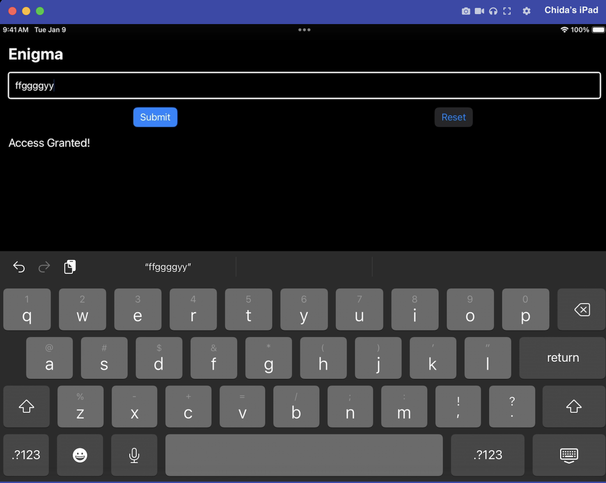

# MACE Backlog

Ideas and future research threads. No version commitment.
Everything here is parked, not forgotten.

## AArch64 Analysis
- PAC-aware backtrace handling (iOS A12+, Android Tensor G4)
- PLT/GOT region annotation in context panel
- Inline hook detection — entry point integrity check
- Heap pointer dereference — follow xN into heap memory
- SVC hidden function call detection (fatalsec/renef pattern) — validated live 2026-09-26 against libantifrida.so's detectFridaThree (see Research References below)
- Obfuscation CTF binary — IOCCC-style compiler obfuscation target

## Platform
- iOS 26 / usbliter8 BootROM exploit target (iPhone 11, A13)
- Android kernel KGDB via USB-Cereal (Pixel 10a)
- vphone-cli iOS emulator integration
- MASTG KeyStore / crypto key material capture

## AI Layer
- colibri/GLM-5.2 evaluation as local inference tier
- Register pattern recognition — flag check, crypto primitive, loop detection
- objc_msgSend selector annotation
- Syscall argument interpretation from register state

## Toolchain
- pyproject.toml — proper pip installable package
- Portable path resolution (replace hardcoded _MACE_SRC)
- MACE session config file (.macerc)
- GitHub repository — public open source release

## Research References
- fatalsec renef — SVC direct syscall, libantifrida.so. UPDATE
  2026-09-04: r2renef/renef confirmed Android-only (not an iOS
  Frida/MACE-coexistence fix — that question remains open). Still
  architecturally in-process injection like Frida itself (Lua-
  scripted, explicitly modeled on r2frida), just a different engine —
  real Android v2 tooling worth comparing against libantifrida.so, not
  a workaround for the iOS coexistence problem.
  UPDATE 2026-09-05 (research log, fatalsec YouTube — "Finding hidden
  function calls using SVC instruction"): real, concrete grounding for
  why syscall annotation (built and validated 2026-08-30) matters
  beyond a general capability. The video documents a genuine evasion
  technique: a binary that issues raw ARM64 SVC instructions directly,
  bypassing libc wrapper functions (open, read, etc.) entirely, so
  those symbols never appear in the import table and never get called
  at all. Their own workflow to find these: radare2 `/A/ SVC` to
  locate the instructions, read the syscall number from x8 (Linux/
  Android convention — confirms the same register already targeted in
  ROADMAP.md's v2 checklist), map it via arm64.syscall.sh.
  Worth a precise correction to the framing floated in conversation
  before checking this source: it's not that Frida "can't see" direct
  syscalls at all — the video's own dynamic-interception step is
  "develop Frida scripts to hook the SVC instruction," which works
  fine once you know the address. The real, narrower, more honest
  MACE advantage: _is_syscall_site() recognizes the svc #0x80/#0
  pattern automatically at ANY stop (single-stepping, an unrelated
  breakpoint nearby, incidental exploration) — no separate static
  pre-analysis pass required first to find where to place a hook, the
  way this video's whole radare2 workflow exists to do.
  Two concrete resources for v2's eventual LINUX_SYSCALLS table, worth
  building against directly rather than from memory (same discipline
  as the iOS BSD_SYSCALLS/MACH_TRAPS tables): arm64.syscall.sh for
  Linux syscall number lookups, and radare2's `e asm.os = linux` +
  `/as` command, which auto-maps syscall numbers to names — a
  plausible authoritative source worth checking directly when that
  table gets built.
- UPDATE 2026-09-26 (live validation, libantifrida.so): confirmed live
  against a second, real target — `detectFridaThree()` in fatalSec's
  `adv_frida.apk` inlines exactly the pattern this research predicted:
  `openat` (`w8=0x38`), `read` (`w8=0x3f`), and `close` (`w8=0x39`) all
  issued via raw `svc #0` with the syscall number hand-loaded into `w8`,
  zero libc wrapper symbols nearby. MACE's context panel correctly
  decoded all three (`[openat]`, `[read]` x2, `close` confirmed via
  direct register read when the panel didn't fire — see the mace_on
  stop-hook note in debugging playbook Rule 27). Separately learned:
  `detectFridaThree()` returns a raw `int`, not a boolean (`()I` in the
  smali, not `()Z`), and its value is non-deterministic across runs
  (`382`, then `116` with no code change) — almost certainly a byte-sum
  accumulated while scanning matched `/proc/self/maps` entries, not a
  simple detected/not-detected flag. The app's on-screen checkmark for
  this check was identical (green) whether given the real unpatched
  value or a `mace_patch`-forced `0`, meaning the checkmark doesn't
  visibly react to this return value at all (its actual result likely
  only surfaces via a `System.out.println` visible in the obfuscated
  smali dispatcher, not the UI) — so `mace_patch` was confirmed
  mechanically correct (lldb's own register read-back proved the write
  took) but no visible bypass could be demonstrated on this target the
  way Frida-0x8's `cmpstr` demo produced one. Getting lldb attached
  before these JNI functions ran at all required patching the APK
  debuggable (`android:debuggable="true"` via apktool decode/rebuild,
  then `zipalign` + `apksigner` with the standard debug keystore) — the
  device is a stock `ro.build.type=user` build, which silently no-ops
  both the `wrap.<package>` Zygote-delay mechanism and JDWP's
  `am set-debug-app -w` regardless of sleep duration or root access.
  See debugging playbook Rules 25-27 for the full incident writeups.
  Also noted, not yet worth its own rule: lldb here lacks LZMA support
  for reading system libraries' `.gnu_debugdata` section (a constant
  warning on every attach) — cosmetic only, degrades some internal
  libc symbol names to `___lldb_unnamed_symbol_*` but never blocked a
  breakpoint, syscall decode, or register operation this session.
- xairy pixel-kgdb — Android kernel debugging, PAC backtrace corruption
- IOCCC 2025 uellenberg — compiler obfuscation techniques
- Garuda Defender APK — anti-debug detection analysis (Thursday)
- 8ksec OAAE — ARM exploitation cert, MACE as study environment.
  UPDATE 2026-09-05: confirmed 8kSec has a dedicated "Offensive iOS
  Internals" course (academy.8ksec.io), not just general ARM64 —
  covers SPTM/TXM/PAC/PAN/PPL mitigations, ARM64 internals, lldb-based
  debugging, dynamic instrumentation, exactly MACE's actual domain.
  Lead instructor across the whole 8kSec course lineup is Prateek
  Gianchandani — the same author of DVIA-v2, MACE's single most-used
  validation target this whole project. Worth treating "Offensive iOS
  Internals" as the closest-fit course reference, not the more general
  "Offensive Mobile Reversing and Exploitation" (iOS+Android combined)
  or "Practical Mobile Application Exploitation" (broader app-security
  testing, Frida/Burp/MobSF-centric) courses also in the lineup.
- MobileHackingLab iOS writeups index (lautarovculic.github.io/writeups,
  research log 2026-09-05) — real, credentialed researcher (active
  HackerOne/Bugcrowd bounty profiles, not anonymous), dozens of worked
  MHL iOS challenge writeups in one place (Captain Nohook, Config
  Editor, Cyclic Scanner, Run Time, Serial/Secure Notes, TokenBleed,
  Gotham Times, and more). The one writeup actually read (Gotham
  Times) turned out to be a URL-scheme/network-interception vuln —
  static triage plus Burp, no live register work at all — a real,
  useful reminder that not every MHL iOS challenge is a MACE fit.
  Genuine value of this resource isn't any single writeup, it's using
  the INDEX to pre-screen for the "ultimate test" MHL target
  deliberately (genuine anti-debug/jailbreak-detection/native ARM64
  content) before committing real session time, avoiding a repeat of
  the iGoat Tampering/Method-Swizzling mistake (two challenge names
  that turned out to be the literal same file, discovered only after
  hours of live investigation). Candidate names worth checking first
  based on title alone, NOT yet confirmed by reading: "Run Time",
  "Cyclic Scanner" — sound most likely to involve runtime/anti-debug
  content, but this is a guess from naming, not verified.

- node-applesign (pancake/NowSecure) as preferred re-signing tool for
  entitlement-sensitive targets — use -M (massage-entitlements) to
  preserve original app entitlements while removing only privileged ones.
  Replace zsign in ios-setup.md when validated.
  Repo: https://github.com/nowsecure/node-applesign

## Context Panel v2 — Human-First Display
Source: External usability feedback (Aug 2026)

Current gap: MACE panel shows same information as LLDB, just better formatted.
GEF shows MORE information than GDB, surfaced automatically.
Target: Panel must be genuinely useful standalone before AI layer lands.

### Priority improvements:

1. Pointer dereferencing
   Resolve pointer values to human-readable content inline
   x0 = 0x302cf3a50 -> "i am groot!" (NSString)
   x27 = 0x104a714e0 -> MACESecurityTest.__DATA.__objc_const
   Implementation: SBProcess.ReadMemory() + string heuristic

2. Changed register highlighting
   Registers modified since last stop -> highlighted color
   Unchanged registers -> dimmed
   Implementation: ContextSnapshot diff between iterations

3. Memory region labeling
   Append [heap], [stack], [binary.__TEXT], [dylib] to pointer values
   x0 = 0x302cf3a50 [heap]
   x26 = 0x104a714e0 [MACESecurityTest.__DATA]
   Implementation: SBProcess.GetMemoryRegionInfo()
   This also fixes existing debt: _annotate_objc_call() in
   lldb_session.py currently distinguishes stack addresses from object
   pointers via a hardcoded range (0x160000000-0x17fffffff) and a
   0x100000000 pointer-vs-small-int threshold, both empirically
   observed on one palera1n iPad/iOS 18.7.2 session rather than derived
   from actual memory region info. Flagged by external repo review
   (Aug 2026, full review captured in docs/user-feedback.md) as a
   target/device-specific heuristic living in core code  
    -- would need validation against DVIA v2, 8ksec, and other targets
   before trusting it generalizes. See docs/target-independence.md for
   the general principle this instance exemplifies. Real fix is this
   GetMemoryRegionInfo() work, not a patch to the numeric range.
    UPDATE 2026-08-27: DVIA v2 is now a real second target for
   validating the eventual fix (see dvia2_jailbreak_bypass_notes.md) --
   this heuristic was not re-triggered in a new way this session, but
   a related, separate bug WAS found in the same function; see below.
   UPDATE 2026-08-28 (research log): both DVIA v2 and MACELocalAuthTest
   are PAC-free A10 targets -- neither actually tests whether this
   heuristic (or the objc_msgSend call-site fix in 3b below) holds up
   on a PAC-enabled chip, which is the real generalization risk here,
   not just "a second app." github.com/jprx/darwin-vm (QEMU fork,
   SPTM/TXM/MIE-aware) may be the fastest way to get a PAC-enabled
   validation target without waiting on real hardware: boots actual
   Darwin (iOS 26.6, even 27.0 beta) kernels to a root shell across
   A14-A19, no jailbreak required, and exposes a GDB Remote Serial
   Protocol debug server confirmed lldb-compatible in its own docs --
   the same protocol MACE's connection layer already speaks, so no
   MACE code changes should be needed to point at it. NOT a general
   MACE test platform -- explicitly no SpringBoard/app UI/touch
   interaction (own README: "don't expect... GUI apps... springboard
   to work"), so it can't run DVIA-v2.app or MACELocalAuthTest.app as
   real apps. Narrow, real value: a command-line, PAC-enabled dev
   fixture (compile + codesign a small test program locally, run it
   under the VM) to validate register/pointer/annotation logic against
   PAC before the iPhone 11 (A13) hardware jailbreak path exists --
   see "usbliter8" thread in chat history, RP2350 purchase planned
   after Sept 20, timeline uncertain. This is available now instead.
   UPDATE 2026-09-04 (research log, earlier this week): the actual
   usbliter8 disclosure (Paradigm Shift, June 18 2026, coordinated
   with Apple Product Security) explicitly names the iPhone 11 (A13)
   as affected, and -- unlike the A14/M1 pattern documented separately
   at proteas.github.io (where only early/pre-production silicon was
   vulnerable, patched before real consumer devices shipped) -- the
   researchers' own words confirm A12/A13 stayed vulnerable for their
   FULL production lifetime: "affected A12 and A13 devices will carry
   it for the remainder of their lifetime." Real, store-bought
   hardware is not excluded the way it is on A14/M1. Also found a
   second, more actively developed tool -- Trussh/usbliter8 -- claiming
   full A12/A13 coverage across iOS 17-27 (would include the actual
   26.6 build) with dedicated SPTM/TXM patchfinders for iOS 27's CTRR
   lockdown, plus a claimed "11/11 devices, 100% success rate" (treat
   with the same caution as any unverified README claim). Worth
   checking both this tool and Leeksov/usbliter8ra1n's own progress
   again closer to the actual Sept 20+ purchase date.
   UPDATE 2026-09-04 (research log, earlier this week): a
   MobileHackingLab writeup on JOP/PAC surfaced a real, narrow gap in
   mace_patch's own validation coverage, distinct from the annotation-
   heuristic question above. Every mace_patch write validated so far
   (LocalAuthTest, DVIA-v2) has been a plain integer (x0=1, w0=1,
   x0=0x1f) on a PAC-free A10 device. PAC signs pointer values (return
   addresses, some function pointers) with a signature tied to the
   pointer's value and execution context; overwriting a signed pointer
   with an unsigned/incorrectly-signed one traps at the point of use,
   not at the write itself.
   Follow-up research refined this into a real, well-reasoned
   hypothesis rather than an open unknown: the PAC signing
   INSTRUCTIONS (pacia, pacda, etc.) are genuinely available at
   userspace/EL0 -- confirmed directly in the original ARMv8.3 kernel
   patch series -- and the CPU applies the correct per-process key
   transparently based on execution context, without ever exposing the
   raw key value. This is exactly why Frida's own hooking/patching
   (Interceptor.attach, NativeCallback, Arm64Writer instruction
   patches) works normally on modern PAC-enabled iPhones: Frida's
   injected code runs COOPERATIVELY, within the target process's own
   execution context, so it can legitimately sign new pointer values
   the same way any normally-compiled PAC-aware program does. mace_patch
   sits in the SAME cooperative category -- writing through a
   legitimately-attached debugger to a genuinely stopped process, not
   forging a value via memory corruption with no legitimate execution
   context at all (which is what PAC actually defends against, and
   what neither Frida nor MACE do or need to do). The likely answer,
   then, is that mace_patch probably CAN correctly write pointer values
   on PAC-enabled hardware, for the same structural reason Frida's
   pointer-writing already does -- but this is still a hypothesis, not
   a confirmed result. Worth testing explicitly once a PAC-enabled
   validation target exists (see darwin-vm above, or the iPhone 11
   hardware path) rather than assuming either way.
   UPDATE 2026-08-30: CB flagged a live, concrete motivating example
   for this exact item, reviewing a real raw panel screenshot (DVIA-v2,
   mach_msg2_trap stop) -- x0/x1/x3/x5 all shown as large, meaningless
   unsigned decimals (e.g. x0 = 6127837432u) when they're genuinely
   stack/pointer addresses. Decimal tells a researcher nothing hex
   doesn't already show better for address-shaped values -- exactly
   the gap this backlog item exists to close. Worth citing this
   screenshot/example directly when the GetMemoryRegionInfo() work
   happens, as a concrete "why this matters" case beyond the abstract
   description above.

   UPDATE 2026-11-01: implemented. _classify_memory_region()
   (lldb_session.py) calls SBProcess.GetMemoryRegionInfo() for every
   address-shaped register (>= 0x100000000, same threshold already
   used by _annotate_objc_call), preferring a resolved module+section
   name (e.g. "Enigma.__TEXT") over a generic "heap/stack" fallback
   when no module resolves. ContextSnapshot.region_labels carries the
   result; render_registers() shows "[label]" in place of the raw
   decimal whenever one resolves, leaving the decimal unchanged for
   small-integer registers. Three commits: 91a7050 (ContextSnapshot
   field), ac46afe (classifier), 781c491 (panel display). NOT YET
   device-verified -- folded into the next live spot-check session
   rather than treated as done on mock confidence alone, since this
   is new SBProcess API surface (unlike the pure post-processing
   fixes elsewhere in this file).

3b. _annotate_objc_call fires selector resolution without confirming
    a real objc_msgSend call site
    Discovered: 2026-08-27, DVIA-v2 session
    (dvia2_jailbreak_bypass_notes.md)

    _annotate_objc_call's gate for attempting selector resolution on
    x1 is only "is x1 numerically > 0x100000000" -- it never verifies
    the current stop is actually at or immediately after a real
    objc_msgSend-family call before running sel_getName() on whatever
    x1 happens to contain.

    Reproduced twice against DVIA-v2 at stops that were plain Swift
    function/method entries, not message-sends:

      -- objc --
        [? ]ʍ\U00000004\xa1\xa5]   (x1 = a real UIViewController
                                     pointer, not a selector)
      -- objc --
        [? class]                  (x1 = coincidentally a real
                                     selector value, wrong context)

    Root cause: on the modern ARM64 ObjC runtime, a SEL is literally a
    pointer into the interned selector string table. sel_getName()
    does no validation -- it reads raw memory from that address as a
    C string. Any pointer-shaped non-selector value in x1 gets walked
    as if it were one, printing whatever real memory is there (an
    object's isa/ivars, in the first case above).

    The second failure shape is the more dangerous of the two: a
    real, legitimate-looking selector name (`class`) attributed to
    the wrong context entirely, rather than obviously-garbled output
    a researcher would immediately distrust.

    Fix direction (not yet implemented): before attempting selector
    resolution, confirm lr or the current pc corresponds to a call
    into a known objc_msgSend-family stub address (objc_msgSend,
    objc_msgSend_stret, objc_msgSendSuper2, etc.) rather than trusting
    register value shape alone. This is a different, more fundamental
    bug than 3's address-range heuristic -- that one has wrong
    thresholds; this one has no verification step at all before
    treating arbitrary register contents as a selector pointer.

    Priority: medium-high. Silent misattribution (not just silent
    failure) is a real trust problem for a tool whose core value
    proposition is deterministic ground truth -- see
    docs/target-independence.md and the "MACE is ground truth"
    philosophy referenced there.

4. Inline string detection
   Any valid pointer -> attempt string read -> display if printable
   Max 64 chars, truncated with ellipsis
   Covers NSString, C strings, Swift strings

5. Branch prediction at current pc
   Show likely next instruction path for conditional branches
   cbz/cbnz/b.eq/b.ne etc -> show both paths, highlight taken
   Makes "what happens next" answerable without stepping

### External GUI recommendations feasibility assessment (2026-09-27)
Source: MACE_GUI_Improvements_recs.docx, friend review of MACE's GitHub repo

Reviewed against the items above. Three categories:

**Already backlogged, no new action needed:** items 1 (pointer
dereferencing), 2 (changed-register highlighting), 3 (memory-region
labeling), and 5 (branch prediction) above already cover this doc's
"changed-register emphasis," "conservative pointer dereference,"
"memory-region labeling," and "conditional-branch preview"
recommendations near-verbatim, down to the same SBProcess APIs. The
doc's GEF/LLEF/Voltron/LIEF framing also already matches this file's
own Reference implementations / LLEF coexistence / LIEF integration
notes below (rebase_offset, "borrow modularity not multi-pane," LIEF
as a backend not a GUI). No new entries needed for any of this --
it's independent confirmation the existing backlog was pointed the
right direction, not new scope.

**New and feasible, worth adding:**

6. Compact call-chain context (default 3 frames, not a full backtrace)
   #0 validate()
   #1 JNI checkInput()
   #2 art_quick_generic_jni_trampoline
   Full mace_bt stays available on demand. Low complexity -- a thin
   wrapper around the existing backtrace machinery, just capped and
   auto-displayed instead of requiring an explicit command.

7. Breakpoint provenance/status panel -- surface resolution quality,
   not just the ID:
   BP 2.1  validate  libeea.so  RESOLVED  1 loc  hits=3
   BP 5    foo                  PENDING
   Directly motivated by a real gap hit THIS session: a `breakpoint
   set --shlib libil2cpp.so --address 0x268A100` silently returned
   "no locations (pending)" (wrong field used -- file offset instead
   of RVA) and required manually running `breakpoint list` /
   re-reading `help` output to notice. A pending/resolved indicator
   surfaced automatically in the panel would have caught this
   immediately instead of requiring manual inspection.

8. Platform-aware register grouping -- group x0-x7 (arguments),
   x8-x17 (temps), x19-x28 (callee-saved), then fp/lr/sp/pc, instead
   of GEF's flat one-column dump. Low complexity for the generic
   AArch64 PCS grouping. The doc's further suggestion (relabel
   registers with runtime-specific meaning, e.g. Dart/Flutter) is a
   natural extension of the Dart ARM64 register map research already
   in this backlog (see "Dart ARM64 Register Map" section below) --
   feasible as a later layer on top of the generic grouping, not a
   blocker to shipping the generic version first.

**Feasible but real tension, sequence carefully:**

9. "Current decision" strip / "why am I stopped?" block (STOP/FLOW/
   CALL summary line, or the fuller WHY/AT/FROM/CHANGED/NEXT block).
   This is a capstone feature -- it's a compact rendering of data
   items 2, 5, 6, and 7 above already produce once they exist, not a
   new data source of its own. Real dependency: the FROM/CALL line
   for a real call site needs the same call-site verification called
   out as still-missing in 3b above (objc_msgSend-family confirmation
   before trusting register contents) -- building the summary strip
   on top of today's unverified call-site detection would just give
   wrong one-line summaries more confidently than today's raw panel
   does. Sequence this AFTER 3b's fix and AFTER items 5-7 exist, not
   in parallel with them.

10. Noise suppression / scope modes (`scope: app` / `scope: runtime`
    / `scope: all`, prioritizing libil2cpp.so/libunity.so/app JNI libs
    while suppressing framework clutter). Genuinely well-motivated --
    today's own Unity/IL2CPP session loaded 150+ system libraries
    before ever reaching app code, exactly the noise this would
    suppress. The tension: classifying a module as "app" vs "runtime"
    needs a real, generalizable basis (e.g. actual module type/path
    conventions, similar to how item 3's memory-region fix replaces a
    hardcoded address-range heuristic with SBProcess.
    GetMemoryRegionInfo()) rather than a hand-maintained name list
    like "libil2cpp.so, libunity.so" -- that would repeat the exact
    target-specific-heuristic mistake already flagged and being fixed
    elsewhere in this section. Feasible, but do the classification
    properly (derived from real module metadata, not a hardcoded
    per-engine list) rather than quickly.

**Recommended sequencing (per the doc's own closing recommendation,
endorsed):** ship changed-register highlighting + memory-region
labels + inline pointer/string dereference (existing items 1-4) as
one milestone first -- these three together answer "what changed,
what is this address, what does it point to." Then branch prediction
(5) and the new call-chain/breakpoint-status items (6-7). Item 9 (the
summary strip) and item 10 (scope modes) come last, once their real
dependencies (3b's fix; real module classification) are actually
solid. This ordering fits before v2.5 as a sequencing target, not a
hard deadline -- 9 and 10 in particular should not be rushed ahead of
their prerequisites just to hit a date.

### Reference implementations:
- GEF (hugsy/gef) - original inspiration, GDB
- LLEF (foundryzero/llef, 489 stars) - GEF for LLDB, x86/ARM64/Go
  Borrow: configurable rebase_offset for Ghidra/IDA compatibility

### LLEF coexistence note:
LLEF and MACE are competing stop hooks - do NOT run simultaneously.
LLEF = general RE/VR. MACE = mobile AArch64 specialization.
Study LLEF's UI design, do not combine.

### LIEF integration (lief.re):
Binary parsing backend for MACE context enrichment.
pip install lief - works in LLDB Python environment.
Use cases:
- Automatic __text range for caller filter (replaces image dump sections)
- Stub address resolution -> symbol names
- ObjC selrefs parsing -> passive annotation without EvaluateExpression
- Flutter libapp.so ELF parsing for Dart snapshot offsets
New module: mace/core/binary_context.py

### AI layer is the killer differentiator (v3):
Panel improvements make v1 useful standalone.
AI annotation makes MACE a different class of tool entirely:
"You are stopped inside ISS ptrace check, x0=0x1f = PT_DENY_ATTACH,
patch with reg write x8 0 at offset +1320"
That answer cannot come from panel formatting - only from AI reasoning
over deterministic register state. That is MACE's unique position.

UPDATE 2026-09-24 (enigma_v2 CTF, self-authored "day in the life"
presentation piece): a tested LLM with full Ghidra + LLDB access spent
3+ hours on enigma_v2 and gave up, stating outright: "This is purely
patience and iterative LLDB observations and intuition and reasoning on
the part of the player." Worth sharpening what that gap actually was,
since it's not the gap this section originally assumed. The model had
full register-state visibility the whole time (ContextSnapshot's whole
premise) -- it never lacked data. What it lacked was the judgment to know,
unprompted, that a register written right after a call/dispatch return
deserves suspicion regardless of how ordinary the surrounding code looks
(Rule 20), or that a register computed via a provable identity should be
read live rather than reasoned about symbolically (Rule 21). That's tacit
RE expertise CB applied without deliberating over it -- exactly the kind
of judgment a general-purpose model has no structural reason to reliably
possess on its own.

Reframes this section's own thesis slightly: the v3 AI layer's job isn't
primarily to grant a model register-state access (already solved) -- it's
to encode judgment like Rules 20-22 as explicit, checkable heuristics the
annotation layer applies automatically, so reasoning starts from "this
register is flagged as a gate/predicate, worth attention" rather than
needing to independently rediscover that class of suspicion from raw
disassembly every time. Every playbook rule from Rule 9 onward is, in this
light, a candidate AI-layer heuristic waiting to be operationalized, not
just a human-facing reference document.

## MachOSwiftSection — Swift Type Annotation Solution
Source: github.com/MxIris-Reverse-Engineering/MachOSwiftSection (284 stars)
Discovered: Aug 2026 — solves Swift type annotation gap from MACESecurityTest session

### Problem solved:
object_getClassName() fails on pure Swift types (ISS, SwiftUI).
MACE annotation returns empty for Swift receivers.
MachOSwiftSection provides Swift-native type resolution.

### Install:
    brew install swift-section

### Capabilities relevant to MACE:

1. SwiftDump — type name resolution
   Resolves x0 pointer to Swift type name
   e.g. x0 = 0x104a714e0 -> IOSSecuritySuite.DebuggerChecker
   Swift equivalent of object_getClassName()

2. SwiftInspection MetadataReader
   Demangles Swift types and symbols against Mach-O at runtime
   Resolves mangled names in annotation panel

3. Static field offsets (--emit-field-offsets)
   Struct member layout computed statically
   When MACE stops inside Swift struct:
   offset +0x08 = ret_errorp, offset +0x10 = ret_pathp
   Makes register interpretation dramatically more useful

4. Protocol conformance mapping
   ISS type hierarchy — which types conform to which protocols
   Enriches annotation with protocol context

### CLI usage before MACE session:
    swift-section dump --architecture arm64 /path/to/binary
    swift-section interface --architecture arm64 /path/to/binary

### MACE integration:
New module: mace/core/swift_context.py
Parse swift-section output at session start
Feed type names into annotation layer for Swift receivers
Complement to LIEF (binary structure) + MachOSwiftSection (Swift semantics)

### Note:
Repo has MCP directory — watch for their MCP server implementation.
May provide Swift binary analysis tools directly as MCP tools.
Coordinate with MACE MCP server design to avoid overlap.

### Relationship to other static tools:
    LIEF              -> binary structure (ELF/Mach-O sections, imports)
    MachOSwiftSection -> Swift semantics (types, fields, protocols)
    Hopper            -> quick iOS disassembly, Swift demangling UI
    JEB               -> deep Android native + iOS ARM64 decompilation
    Together: complete static context feeding MACE dynamic observation

## Dart/Flutter AArch64 Specifics (from Apvrille BlackAlps 2023)
- Object pool register tracking — identify and dereference Dart object pool pointer
  (strings/constants not in __cstring, stored in pool accessed via dedicated register)
- Integer tag awareness — Dart small integers have LSB tag, displayed value = actual * 2
  (MACE must strip tag before showing decimal annotation)
- Stack-based argument convention — Dart pushes args to stack not x0-x7
  (MACE argument annotation must read sp offsets for Dart functions)
- Blutter integration provides addresses for breakpoints without exported symbols
  (bridges the Frida gap Apvrille identifies at BlackAlps 2023)

## Dart ARM64 Register Map (from Worawit Wangwarunyoo, HITB 2023)
Source: Blutter author's primary presentation
From dart/runtime/vm/constants_arm64.h

When MACE context panel shows Flutter/Dart target:
- x15 (R15) → Dart VM Stack Pointer (SPREG), NOT general register
- x16 (R16) → TMP scratch
- x17 (R17) → TMP2 scratch  
- x21 (R21) → Dispatch Table Register
- x22 (R22) → NULL_REG (always caches NullObject())
- x24 (R24) → CODE_REG
- x26 (R26) → THR (current Dart Thread)
- x27 (R27) → PP (Object Pool Pointer)
- x28 (R28) → HEAP_BITS
- x4  (R4)  → ARGS_DESC_REG (Arguments Descriptor)
- x5  (R5)  → IC_DATA_REG

Calling convention:
- Arguments passed on Dart stack (R15), NOT in x0-x7
- Named parameters: R4 = Arguments Descriptor array
- Dart stubs: use specific registers per ABI struct in constants_arm64.h

iOS note: Pointer compression NOT enabled (requires entitlement)
- Full 64-bit object pointers on palera1n iPad
- Simplifies Dart object inspection via MACE memory reads

MACE implementation needed:
- Dart mode detection (check if pc in libapp.so range)
- Conditional register annotation switching to Dart names
- Object pool dereference for string/constant lookup via x27

## r2SMT — SMT-Assisted Opaque Predicate Deobfuscator
Source: github.com/seifreed/r2SMT (Marc Rivero/@seifreed, r2con2025 author)
Same author as r2morph

SMT-assisted opaque predicate deobfuscator for radare2.
Uses Z3/CVC5/Bitwuzla to mathematically prove whether conditional branches
can go both ways. Proven single-direction branches = opaque predicates.

AArch64 supported (multi-arch lifters: x86, x86_64, AArch64, AArch32/Thumb)

Pipeline with MACE:
  r2morph  -> adds opaque predicates as obfuscation
  r2SMT    -> proves and removes opaque predicates statically
  MACE     -> observes real execution below the obfuscation

Verdicts:
  AlwaysTrue / AlwaysFalse -> opaque predicate, proven obfuscation
  BothPossible             -> genuine branch, MACE observes runtime state

Install: cargo build --release (requires Rust 1.85+, radare2 6.1+, CMake)

Status: Very early (2 stars, 12 commits) but architecturally sound.
Complements r2morph + MACE as complete obfuscation/deobfuscation/analysis stack.

## mace_swift_load — device-path auto-resolution [RESOLVED 2026-08-23]
Source: LocalAuthTest MACE-native validation session, 2026-08-22
Resolved: same target, 2026-08-23

Original problem: _resolve_local_path() in swift_context.py attempted to
resolve device-only paths via SBModule.GetFileSpec() on the target's
loaded modules. This did NOT work in practice for app-owned dylibs
pulled over a debugserver connection — GetFileSpec() returns the same
remote path (e.g. /private/var/containers/...), not a local cached
copy. (It does appear to work for system frameworks, which LLDB
caches under ~/Library/Developer/Xcode/iOS DeviceSupport/.../Symbols/.)

Fix implemented: auto-detect the matching local DerivedData path by
binary basename, picking the most-recently-modified match if several
exist (this was "option 3" of three approaches originally considered
here; a remote SBPlatform.GetFile() pull and an automatic scp fallback
were the other two, neither pursued since this was sufficient). When the
module-cache lookup misses, _resolve_local_path() now also searches
~/Library/Developer/Xcode/DerivedData recursively for a file matching
the binary's basename. SwiftContext.resolved_path records which path was
actually used, and mace_swift_load surfaces it explicitly:

  [MACE] Swift context loaded: 6 types from MACELocalAuthTest.debug.dylib
  [MACE]   note: device path not found locally — auto-resolved to
           /Users/.../DerivedData/MACELocalAuthTest-.../MACELocalAuthTest.debug.dylib

Validated live: mace_swift_load called with the raw device path
(/private/var/containers/...) resolved automatically with zero manual
path-hunting, on the MACELocalAuthTest unstripped build.

Known limitation carried forward: mtime-based selection is a
heuristic, not a guarantee — a stale build for a different scheme
touched more recently could still win over the actually-running
build. Worth revisiting if this ever produces a wrong-type-resolved
mismatch in practice. The remote-file-pull and scp approaches remain
undone and lower priority now that the DerivedData search removes
the actual day-to-day friction.


## stop_hook.py — split into multiple modules once registration
## pattern is validated
Source: session discussion, 2026-08-28, after adding mace_grep/
mace_search brought the file to 406 lines / 7 command classes

Not urgent yet — 406 lines is still genuinely readable (one class per
command, consistent docstrings), and the growth trajectory (roughly
+100-150 lines per session of active feature work) is a "soon," not
a "now" problem. Flagging so it doesn't just keep growing by default
without a deliberate decision.

The real blocker isn't file length -- it's an untested assumption.
Every command is currently registered as
`command script add -c stop_hook.ClassName`, which only resolves
because LLDB matches it against the flat `stop_hook` module name
created by however the user's personal ~/.lldbinit does
`command script import` on this specific file. This was a deliberate
choice made early (see MACESwiftLoad's original addition) specifically
to avoid gambling on whether `-c mace.lldb.some_new_file.ClassName`
-style package-qualified resolution actually works for a genuinely
separate module -- never tested live.

Before attempting a real split: run one small, throwaway experiment
first -- register a dummy command from a genuinely separate file
using the package-qualified path, confirm it resolves correctly on
real hardware, before committing to restructuring the real commands.
Splitting blind risks breaking every command at once if the
assumption turns out wrong.

Four natural groupings already visible in the current single-file
structure, ready to become their own modules once the registration
pattern is confirmed safe:
- Core panel toggle: MACEStopHook, mace_on, mace_off
- Swift context loading: MACESwiftLoad
- Patching + audit: MACEPatch, MACEPatchHistory
- Introspection/query: MACEGrep, MACESearch

Also worth noting: v3's MCP server work will need its own dedicated
module (e.g. mace/mcp/server.py) regardless of what's decided here --
so this file-organization question returns for real soon either way,
just not urgently today.


## mace_grep bugs found during iGoat-Swift investigation (2026-08-29)
Source: igoat_investigation_notes.md

Both found live, mid-investigation. Neither blocked the session (both
had usable workarounds found in the moment) but both are real,
reproducible parsing bugs worth fixing properly.

### Bug A -- `-i` flag doesn't exist, silently corrupts argument parsing
mace_grep is already always case-insensitive by design (re.IGNORECASE
baked into the pattern compile) -- there was never a flag to add.
Passing one anyway wasn't rejected with a usage error; instead it got
consumed as if it were the search pattern itself, shifting the rest of
the command incorrectly:

  mace_grep -i "jailbreak" "image dump symtab iGoat-Swift"
  → [MACE] Command failed: error: 'jailbreak' is not a valid command.

Fix direction: parts[0].split(None, 1) currently assumes the first
whitespace-separated token is always the pattern. Should either
explicitly reject/ignore a leading "-i" with a clear message ("mace_grep
is already case-insensitive, no -i needed"), or more robustly, stop
assuming position 0 is always the pattern and use a real flag parser.

### Bug B -- pattern argument isn't quote/escape-stripped, only the inner command is
inner_command has `.strip().strip('"').strip("'")` applied; pattern
does not. Any pattern that legitimately needs quoting (spaces, regex
metacharacters) carries the literal quote/escape characters into the
compiled regex, guaranteeing zero matches even when real matches
exist:

  mace_grep "OBJC_CLASS_\$_" "image dump symtab iGoat-Swift"
  → [MACE] No matches for '"OBJC_CLASS_\$_"' in 9475 lines of output.

Note the literal quotes and backslash still present in the error
message's echoed pattern -- confirms they were never stripped before
regex compilation. Fix direction: apply the same
.strip().strip('"').strip("'") normalization to the pattern argument
that inner_command already gets, before regex compilation.

Workaround used this session for both: avoid needing quotes/escapes
in the pattern at all where possible (e.g. "OBJC_CLASS" instead of
"OBJC_CLASS_\$_" -- $ isn't needed for a substring match here).

UPDATE 2026-08-30 (syscall_annotation_notes.md): Bug B recurred live
during the DVIA-v2 syscall-annotation session --
mace_grep "write|atomically|documentsDirectory|dataFilePath|NSDictionary"
matched only 1 of 770 lines (the quoted first/last alternatives were
corrupted the same way). Confirms the bug is real and reproducible,
not a one-off; still not fixed. Same workaround applied (dropped the
quotes, pattern had no spaces so this was safe).

## Breakpoint insertion failure -- Foundation fileExistsAtPath:, iGoat-Swift session (2026-08-29)
Source: igoat_investigation_notes.md

  br set -a 0x181872f44
  → warning: failed to set breakpoint site at 0x181872f44 for
    breakpoint 2.1: error: 9 sending the breakpoint request

lldb still created the breakpoint object and reported a clean
"Breakpoint 2: address = ..." despite the warning -- easy to miss
that the underlying debugserver write likely failed. Confirmed via
non-fire: triggered the code path that should have hit this address
(Foundation's -[NSFileManager fileExistsAtPath:], called by iGoat's
Cydia-path check) and the breakpoint never fired, while the app's
behavior was otherwise consistent with the check having run normally.

Not yet root-caused -- no other breakpoint this project has produced
this warning. Retroactively raises an open question about an earlier
breakpoint in the same session (libsystem_kernel.dylib's __ptrace,
no warning shown) that also never fired across several attempts --
absence of the warning is a real point in its favor but not
independent confirmation it actually worked. Worth watching for
recurrence of "error: 9 sending the breakpoint request" specifically
-- if it shows up again, especially against shared-cache library
addresses, treat any breakpoint set the same session with more
suspicion even without an explicit warning.

UPDATE 2026-08-30 (syscall_annotation_notes.md): the open question
above is now resolved differently than expected. A live session
extensively re-tested shared-cache breakpoints (four separate
libsystem_kernel.dylib symbols, both software and hardware, against
confirmed real code execution) and initially concluded shared-cache
placement itself was the common factor in every failure. That theory
was then DISPROVEN the same session: a breakpoint on
libsystem_kernel.dylib's mach_msg2_trap (the exact same shared-cache
image as every failure) fired immediately, first attempt. The real,
better-supported explanation across all of today's evidence: every
failure was either a genuinely one-shot call, or a call whose
containing code path was confirmed (via thread list) to never
actually execute on that run -- not shared-cache placement, which is
demonstrably fine. This specific Foundation/error-9 instance remains
unexplained on its own terms, but the broader "shared cache
breakpoints are unreliable" generalization it seemed to support does
not hold.

## Two new display bugs found via a genuinely new thread (2026-08-30)
Source: syscall_annotation_notes.md

Found while single-stepping toward DVIA-v2's real plist write. A
normal GCD worker-pool thread got created mid-session
(start_wqthread) -- routine, unrelated to the target being debugged
-- and MACE's panel rendered for that stop too, surfacing two real,
previously-unseen bugs.

### Bug A -- malformed breakpoint ID on this thread's stop
Rendered as "breakpoint 18446744073709551612.1" -- almost certainly
a -4 value misread as unsigned (2^64 - 4 = 18446744073709551612).
Likely _get_breakpoint_id()'s GetStopReasonDataAtIndex() returning a
signed value not being reinterpreted correctly -- similar in spirit
to (but a distinct bug from) the signed-x16 handling added for
syscall annotation the same session. Not yet fixed.

### Bug B -- nonsensical ASLR offset on a stop outside the main module
Shown as slide=0x...ac000 offset=0x1fbaf1aa8, which doesn't
correspond to pc - slide for this stop at all. Root cause:
_compute_aslr_slide() always uses the MAIN app module's base (module
index 0) regardless of which image the actual stop is in --
meaningless once a stop happens inside a different image
(libsystem_pthread.dylib here) on another thread. Fix direction:
either compute slide per-image (resolve which module actually
contains pc, use that module's base) or suppress the offset field
entirely when pc falls outside the main module's known range, rather
than showing a number that looks real but isn't. Not yet fixed.

Neither bug affects the objc or syscall annotation features
themselves -- both are display/formatting issues in the stop-banner
line.


## Register panel — show signed reinterpretation for negative-looking values (2026-08-30)
Source: session discussion, reviewing a real DVIA-v2/mach_msg2_trap
panel screenshot

The general register panel (render_registers() in context_panel.py)
always shows the decimal column as a raw unsigned interpretation, even
when the top bit is set. Concretely, in the reviewed screenshot:

  x16    0xfffffffffffffd1  # 18446744073709551569u

That's the exact same register value _annotate_syscall() (added this
session) already correctly reinterprets as signed -47 to identify a
Mach trap -- the general panel just doesn't apply that same logic to
the decimal column it shows for every register, so a human reading
the raw panel sees a confusing 20-digit number where a signed value
would immediately read as "this is probably meaningful as -47, likely
a small negative number, not a huge positive one."

Fix direction: in _format_register_line() / render_registers(), when
the top bit (bit 63) is set, show the signed reinterpretation
alongside (or instead of) the unsigned one -- e.g.
"# -47i (18446744073709551569u)" or similar. Reuse the exact
sign-reinterpretation logic already written and tested for
_annotate_syscall() (raw - (1 << 64) if raw >= (1 << 63) else raw)
rather than re-deriving it.

Distinct from, but related to, the memory-region-labeling item above
(Context Panel v2, item 3) -- that one is about giving ADDRESS-shaped
values (x0, x1, x3, x5 in the same screenshot -- genuinely large
positive numbers, stack/heap pointers) a real region label instead of
a raw decimal; this one is specifically about correctly signed
NEGATIVE-looking values (x16 here) being shown as if they were huge
positive numbers when they're not. Both are real, separate
readability gaps in the same panel, surfaced by the same screenshot.

UPDATE 2026-09-04: Implemented. Added ContextSnapshot.as_signed()
(same formula as _annotate_syscall()) and wired it into
_format_register_line()/render_registers(), scoped to x0-x28 only —
never fp/lr/sp/pc, which are unambiguously addresses by ABI
definition and should never be shown as signed. Display format:
append "(-Ni)" after the existing "# {decimal}u" rather than
replacing it, so every register line still starts the same way and
the signed hint is purely additive when relevant. 6 mock tests cover
the exact live case (x16=-47), a second independent negative value
(not just the one hardcoded example), small-positive and
address-shaped registers correctly showing no hint, and fp/lr/sp/pc
correctly never showing one even with the top bit artificially set.
Committed (267e8b5). Low-risk relative to prior annotation fixes —
pure post-processing of already-captured register values, no new
LLDB API surface touched — so treated as done on mock-test confidence
alone rather than requiring a dedicated live-hardware session, unlike
the objc/syscall annotation work which genuinely depended on live
SBFrame/SBTarget behavior that couldn't be fully predicted.

## lldb-server platform mode spawns a dynamic, unforwarded gdbserver child on attach (2026-09-06)
Source: android_first_connection_notes.md

First-ever Android connection session. Confirmed directly via
--log-file/--log-channels logging (lldb-server is silent by default in
BOTH platform and gdbserver modes -- worth always enabling logging
going forward, not just when troubleshooting):

  < 21> read packet: $qLaunchGDBServer;
  < 25> send packet: $pid:20438;port:34313;

Platform mode's `process attach` doesn't debug directly over the
platform connection -- it spawns a brand-new, separate gdbserver child
process on an unpredictable, dynamically-assigned port for the actual
debug session. Only the platform port (1234) was ever forwarded via
adb forward; the real debugging channel MACE's stop-hook/breakpoint
code depends on was running on a never-forwarded port the entire
session. This plausibly explains a whole day's worth of "breakpoint
resolves, some threads show trace, but no panel ever renders"
mysteries -- not a MACE Python logic bug at all.

Fix direction, not yet implemented: switch from platform mode to
plain gdbserver mode with a direct --attach=<pid>, the same shape as
debugserver --attach used successfully every time on iOS this whole
project -- a fixed, known, single port for the whole session, no
dynamic child spawning, genuinely scriptable. Confirm exact syntax
fresh next session (`lldb-server gdbserver --help`) rather than
assume from today's platform-mode syntax.

UPDATE 2026-09-06 (research log, s11research.com/posts/debugging-
android-with-lldb/, a real RECON conference speaker, credible source):
independent confirmation our connection setup itself was correct --
their platform connect output (Triple aarch64-unknown-linux-android,
OS Version N, Connected: yes) is line-for-line identical in shape to
what this session got. But their actual workflow suggests a more
precise hypothesis than "abandon platform mode entirely": they never
use `process attach` to an already-running PID at all -- they use
`target create <path>` + `process launch --stop-at-entry -- <args>`,
launching a FRESH process directly through the platform connection,
never attaching to something already running. This raises a real,
untested possibility: the dynamic, unforwarded child-port behavior
found in the logs may be specifically an ATTACH-mode artifact, not a
platform-mode-wide one -- a fresh launch may let the platform
connection create and own the child process from its first
instruction, without needing the same "find and attach to an
arbitrary existing PID" handshake that spawned the separate
gdbserver child on port 34313 during our attach attempt.

Not confirmed either way -- their writeup doesn't show server-side
logging, so whether `process launch` also spawns a similar dynamic
port is genuinely unknown, not ruled out. Revised plan for next
session: try `target create` + `process launch` on a disposable
target FIRST, with --log-file/--log-channels still enabled so the
logs can directly confirm or rule out a second dynamic port under
launch too -- only fall back to switching to plain gdbserver mode
(the original fix direction above) if the same behavior recurs.

Also worth noting: their right-hand-panel setup (disassembly,
registers, stack, all live-updating per stop) is via a real, working
GEF-style lldb overlay called "voltron" (github.com/snare/voltron) --
genuine, independent prior art for exactly the kind of panel MACE
already builds, though MACE's own panel is annotation-aware (objc/
Swift/syscall context) rather than a raw register/disassembly dump,
a meaningfully different and more purposeful design, not something
to adopt directly.

UPDATE 2026-09-06 (research log, JetBrains YouTrack article
SUPPORT-A-4012, "Setup Remote-debugging Android native code with
RustRover + lldb-server (gdbserver mode) Standalone" -- a real,
detailed, current guide with an explicit troubleshooting section):
DECISIVE. This guide states the root cause in plain terms, directly
confirming the fix direction above rather than just suggesting it:

  "Also occurs if LLDB is started in platform mode
  (lldb-server platform --listen ...) but uses [a client's] gdbserver
  mode (process connect) -> protocol mismatch. Always use:
  lldb-server gdbserver :5039 ... and connect://localhost:5039 on
  the host."

Three independent sources now agree: our own log evidence
(dynamic, unforwarded child port under platform mode), s11research's
writeup (never uses process attach, always launches fresh via
target create + process launch), and this JetBrains guide (explicit,
documented protocol mismatch between platform and gdbserver modes).
No longer a hypothesis -- platform mode is confirmed the wrong choice
for actual debug sessions; it is fine for the read-only discovery
things it's designed for (process list, module info), but the real
debugging connection needs plain gdbserver mode.

SUPERSEDED 2026-09-13 (research prompted by an outside friend review
of the repo): this specific conclusion was wrong, and the record is
being corrected rather than erased, per this project's own established
practice. The real, live-verified fix (see the platform-mode-
resolution entry further down) is the opposite: lldb-server PLATFORM
mode, paired with a setting never tried at the time this entry was
written (`settings set platform.plugin.remote-android.package-name
<pkg>`, set before connecting), is what actually populates a real,
Android-aware module model and lets named breakpoints resolve. The
JetBrains guide's own "protocol mismatch" observation was real for
ITS specific setup, but doesn't generalize the way this entry assumed
-- worth remembering that a real, credible external source's own
finding can still be scoped more narrowly than it reads at first.

Working syntax confirmed directly from this guide (adjust host/port
for our own setup, verify against `lldb-server gdbserver --help`
rather than copy blindly):

  adb forward tcp:5039 tcp:5039
  lldb-server gdbserver :5039 <path-to-binary>
  (lldb) platform select remote-android
  (lldb) process connect connect://localhost:5039

Bare port (no `*:` prefix), and the target is a BINARY PATH launched
directly by lldb-server itself -- not a PID being attached to --
matching s11research's launch-based approach exactly, not our
attach-based one. Revised plan for next session: launch a disposable
target fresh via this exact gdbserver+launch pattern; only fall back
to investigating --attach=<pid> support specifically if launching a
fresh process turns out to be impractical for the actual validation
target chosen.

One real, separate finding from this same guide, likely NOT our
actual root cause but worth knowing: a documented SELinux/app-sandbox
failure mode ("Operation not permitted" opening a listening socket)
specific to running lldb-server via `run-as <package>` (an app's own
restricted sandbox user). We ran everything as root via Magisk su the
entire session -- a meaningfully more privileged context than run-as
ever grants -- so this specific blocker almost certainly doesn't
apply to us, but worth remembering if a future target ever needs
`run-as`-scoped debugging instead of root.

UPDATE 2026-09-11 (research log, android_debuggable_patch_notes.md):
DEFINITIVELY RESOLVED, and worth correcting the written record
plainly rather than let a wrong theory stand (same Rule 9 discipline
as the yuvalino case study). Built a real, from-scratch APK decompile/
patch/rebuild/sign/install pipeline and tested a real app (Frida-Labs
Challenge 0x1) patched to android:debuggable="true" -- gdbserver
--attach succeeded cleanly, first try, full 22-thread enumeration,
with lldb-server itself printing an explicit "Attached to process
<pid>..." confirmation never seen in any deskclock attempt.

Critically, this ran with SELinux in Enforcing mode throughout (the
earlier setenforce 0 from the prior session didn't survive the device
reboot, and was never reapplied) -- and the attach still succeeded.
That means the SELinux-permissive theory logged in the earlier UPDATE
above is very likely a RED HERRING, not the real fix -- the ONLY
variable that actually differed between every failing attempt
(deskclock, non-debuggable, tried both Enforcing and Permissive) and
this succeeding one (Frida-Labs 0x1, patched to debuggable, Enforcing
throughout) was the manifest debuggable flag itself. That flag is
confirmed as the true, sole gate on gdbserver --attach against real
app processes -- not SELinux mode, and (per the same session) not
platform mode vs gdbserver mode either, since the underlying gdbserver
mechanism itself was proven correct once the real variable (debuggable
flag) was controlled for.

Real, reusable pipeline built from this, available for every future
Android target: apktool decode -> sed the manifest -> apktool build
-> apksigner sign (reusable keystore at
MobileBinaryTargets/shared/mace-debug.keystore) -> apksigner verify
-> adb install. Full details, including a bonus finding (MASTG
UnCrackable L1 Android has its own runtime debuggable-flag self-check
that self-exits, a real anti-debug challenge worth returning to once
mace_patch-based Android bypass work begins) in
android_debuggable_patch_notes.md.

## Shared ART-runtime syscall primitives are a much riskier breakpoint target than the equivalent choice on a native daemon (2026-09-11)
Source: android_debuggable_patch_notes.md

Real correction to a heuristic that worked well once and then failed
badly the next time it was applied. "Pick the syscall address with
the most threads converged on it" was the right call for netd (a
native daemon) on the first Android session -- froze cleanly, real
multithreaded panel rendering validated, no ANR. Applying the exact
same heuristic to an ART-managed app process (Frida-Labs Challenge
0x1) produced a real ANR almost immediately after continue, even with
no premature detach involved.

Root cause: the busiest shared syscall site in a managed-runtime
process is disproportionately likely to be the runtime's OWN internal
plumbing, not incidental activity. The specific address chosen
(0x710b768860) was hit by HeapTaskDaemon, FinalizerDaemon,
ReferenceQueueDaemon, Profile Saver, Jit thread pool, and several
hwuiTask/mali- threads -- strongly suggesting a core ART
synchronization primitive (very likely a futex wait) that the
runtime's own scheduler/GC/JIT machinery depends on continuously.
Freezing it can stall the whole app's runtime almost immediately,
unlike freezing the equivalent syscall on a native daemon, where
background threads pausing briefly was well-tolerated (netd handled
this fine both times it was tested).

Fix direction for future ART-managed-app sessions: target a
breakpoint on the APP'S OWN code path specifically (reached via real
UI interaction -- e.g. tapping a button the app's own MainActivity
handles), not a shared syscall site with many background daemon
threads converged on it. The "most threads = most reliable target"
heuristic should be treated as native-process-specific, not a general
MACE rule -- worth a note in the debugging playbook distinguishing
the two cases explicitly.

## lldb has never had a populated module list on Android via gdbserver --attach (2026-09-12)
Source: android_module_resolution_notes.md

Real root cause found for something silently true and visible in
EVERY Android connection summary this whole project, going back to
the very first netd attach: "Target 0: (No executable module.)"
Never investigated directly until today, because every prior
successful breakpoint used a raw address (-a 0x...), which needs no
module/symbol resolution at all. Confirmed directly today: `image
list` returns "error: the target has no associated executable
images", and a named-symbol breakpoint (`breakpoint set -n strcmp`)
correctly resolves to nothing ("no locations (pending)") as a direct
consequence.

Real, meaningful implication: NAMED-symbol breakpoints cannot work on
Android via the current gdbserver --attach workflow at all, regardless
of signal handling or target/process ordering -- only raw address
breakpoints have ever actually worked. A real limitation relative to
iOS, where debugserver's attach always populates a real module list
automatically (every iOS Target line this whole project has shown a
real module name).

Attempted fixes, none fully resolved it: `target create <local pulled
app_process64>` issued AFTER an existing process connect actively
DISCONNECTS the session rather than augmenting it (real, concrete
lesson on its own -- target create and an existing live connection
don't compose the way one might expect). Reordering to target create
FIRST, then connecting, left `image list` showing only the single
app_process64 image at load address 0x0 -- never tied to the live
process's real, relocated memory layout, and libc.so never appeared.
`process attach -p <pid>` as a follow-up triggered an ANR before
anything could be checked further.

Well-reasoned hypothesis for next time, not yet tested: every prior
WORKING example of named-symbol resolution this whole project has
found (s11research's blog, JetBrains' RustRover guide) used `target
create` + `process LAUNCH`, never `process attach` to an already-
running process. Launching lets lldb observe the process from its
very first instruction and track the dynamic linker's incremental
library-load sequence as it happens -- exactly how lldb normally
discovers modules. Attaching to an already-fully-loaded process gives
it no mechanism to retroactively backfill that history. This may be
fundamentally an attach-vs-launch limitation of gdbserver mode on
Android, not something fixable by ordering/signal tweaks alone --
worth testing directly against a genuinely launchable target (a
standalone native binary, or the custom EEA-on-Android idea already
discussed) before continuing to fight attach-based resolution for a
Zygote-forked app process specifically.

UPDATE 2026-09-13 (research prompted by an outside friend review):
this hypothesis was correctly SCOPED (it named gdbserver mode
specifically, not attach on Android generally) but the underlying
cause was a real, natural confound, not attach-vs-launch as its own
dimension. Every attach attempt up to this point happened to be under
gdbserver mode; every launch success also happened to be under
gdbserver mode -- attach specifically under PLATFORM mode was never
tested until the very next session. Once it was: `process attach
--pid <PID>` after a normal `am start` launch, through the
remote-android platform plugin with the package-name setting,
produced a fully populated module model and working named breakpoints
-- no launch involved at all. The real differentiator was always the
Android-aware platform connection and module reconstruction, not
attach versus launch. See the platform-mode-resolution entry further
down for the full, live-verified result.

## Android 16 requires 16KB memory page alignment for native libraries (2026-09-12)
Source: android_module_resolution_notes.md

Real, current Android 16 compatibility finding, surfaced incidentally
while installing Frida-Labs Challenge 0x8: a dialog reading "This app
isn't 16 kb compatible. APK and ELF alignment checks failed" for
libfrida0x8.so and liblog.so -- both built before this requirement
existed. Dismissible, did not block the app from running, but a real,
current thing worth knowing: any older native-code Android app or
crackme predating this requirement may show the same warning when
tested against the Pixel 10a / Android 16 target. Not investigated
further today; worth remembering as a possible source of confusion
(a dismissible warning, not a real failure) if it shows up again on a
future target.

## Named-symbol breakpoint resolution CAN work on Android -- but not yet reliably (2026-09-13)
Source: android_named_symbol_reliability_notes.md

Major update to the module-resolution entry above. Using a plain,
standalone native binary (the same EEA/Google-CTF-2020 flag-checker
logic, cross-compiled for Android ARM64 directly) to isolate the
launch-vs-attach question cleanly, the exact missing combination was
found: `target create <local-binary>` BEFORE connecting, paired with
a genuine LAUNCH (not attach). This produced a real, populated module
list (a real load address, [vdso] visible) and a named-symbol
breakpoint (`breakpoint set -n validate`) that resolved COMPLETELY,
with full source-line correlation (`flag_checker.c:53:25`) -- the
first confirmed instance of this working on Android this entire
project.

HOWEVER: this exact result could not be reproduced afterward in the
same session, across multiple rebuilds (dynamic PIE, static-pie, and
even the identical original -static binary rebuilt fresh) and a
deliberate 10+ second delay between server launch and connect.
Theories tested and ruled out: simple race condition (long delay
didn't help), background app interference (force-stopped EEA
entirely, no change), device-level degradation (adb devices/echo
hello both clean and fast, unlike the session that needed a reboot).
The actual cause of the shift from "worked" to "consistently fails"
within one otherwise-healthy session remains genuinely unknown.

Real, useful side-finding from the same investigation: the "multiple
lldb-server PIDs" pattern seen constantly this whole project has a
clean, non-alarming explanation -- `pgrep -f` matches the full command
line, and since lldb-server is invoked via `su -c 'lldb-server ...'`,
the su wrapper's own command line contains the literal string
"lldb-server" too. Two pgrep matches, one real process, not a genuine
double-fork.

Status: the core mechanism is proven to work, once. Reliability is
not solved. Next session should NOT assume this is fixed -- treat
every attempt as needing fresh verification until a real, reproducible
trigger for the failure mode is found.

UPDATE 2026-09-13 (same day, afternoon session): a real, concrete fix
found and LIVE-VERIFIED against the real EEA app, not just theorized.
CB brought an independent troubleshooting document describing a
different working architecture; verified its claims ourselves rather
than accepting them secondhand. Two previously-uncontrolled variables
identified: (1) every session this entire project used Apple's
bundled /usr/bin/lldb, never a separately-installed Homebrew build;
(2) every attempt against a real app used gdbserver mode, never
lldb-server PLATFORM mode with the setting
`settings set platform.plugin.remote-android.package-name <pkg>` set
BEFORE connecting. Using Homebrew lldb + platform mode + the package-
name setting + `process attach --pid` after a normal `am start`
launch, produced a real, rich module list (428+ modules, including
libeea.so at a real load address) and a named-symbol breakpoint
(`breakpoint set -n validate -s libeea.so`) that fired cleanly on the
real app's main thread with real, live argument data visible
(`input="yuhygg"`). See android_platform_mode_resolution_notes.md for
the full verification. Not yet re-tested for reliability across
multiple attempts -- treat as a real, working fix for THIS specific
problem, not a claim that every open Android question is resolved.

UPDATE 2026-09-17: reliability question partially answered. The core
mechanism reproduced successfully twice in one session, on freshly
launched processes, matching the original session's result exactly
(clean breakpoint hit, full backtrace, full register state). But
getting there surfaced four new, previously-undocumented operational
failure modes, all now understood and fixed: (1) `su -c` root is
required at `process attach` time specifically, not just at
`platform connect` -- omitting it produces "lost connection" only
once attach is attempted; (2) stale/orphaned `lldb-server` processes
from earlier failed attempts destabilize later ones and must be killed
before each fresh session, not just during incident recovery; (3)
breakpointing `validate()` reliably triggers Android's ANR dialog,
since it runs synchronously on the main thread -- this is expected,
recoverable behavior (tap Wait, confirm via `process interrupt` +
`thread list` that the thread is merely paused, not hung), not a bug;
(4) continuing past a `fork` stop (new, previously-unseen stop reason)
dropped the connection outright, leaving all threads in job-control-
stopped state, recovered cleanly with `kill -CONT` per Rule 10's
already-documented procedure. See
android_eea_reproduction_2026-09-17_notes.md for full detail. Honest
framing: the named-symbol mechanism itself is now real, repeated
evidence toward "reliable" -- the session hygiene around it was the
actual gap, not a flaw in the original fix.

## Repeated attach+continue on a real ART app process can trigger unrelated background-thread crashes (2026-09-13)
Source: android_named_symbol_reliability_notes.md

Separate, new finding from testing a correctly-computed address
breakpoint (via /proc/pid/maps + llvm-nm/llvm-readelf, accounting for
the executable PT_LOAD segment's own file offset) against the real EEA
app. Continuing past the breakpoint did not hit the intended target --
instead, twice in a row, on separate attempts, an unrelated SIGSEGV
crashed a DIFFERENT background thread each time (SurfaceSyncGroup,
then AsyncTask #1), both with the IDENTICAL instruction signature
(`ldr x21, [x21]`, fault address 0x0) and an identical trailing
mov/movk sequence.

This is distinct from Rule 12's ART-runtime-primitive ANR risk (a
freeze from choosing the wrong breakpoint target) -- this is a genuine
CRASH, in a thread unrelated to the actual breakpoint address, that
appears to be a side effect of repeatedly attaching to and continuing
a real, busy, multi-threaded ART app process. Root cause not
understood; worth treating as a real, separate risk category for
Android app-process debugging sessions, alongside the already-known
ANR risk.

## The real architectural difference between iOS and Android connections: who performs the attach (2026-09-14)
Source: research conversation, cross-checked against docs/ios-setup.md

CB's own question surfaced this precisely: "one difference between
iOS and Android is that in Android we connect platform whereas in
iOS we ran process connect." Checked against the actual iOS
workflow on file (docs/ios-setup.md) rather than trust either memory
-- the real distinction is narrower and more interesting than that
framing suggests. BOTH platforms select a platform first
(`platform select remote-ios` / `remote-android`). The real
difference is one step later, and it's about WHO performs the attach,
not whether platform mode is used at all.

iOS: `debugserver 0.0.0.0:1234 --attach=<PID>` on the device -- the
server itself does the attaching, in the launch command. lldb's
`process connect` just joins that already-established session
directly.

Android's actual working recipe (2026-09-13): `lldb-server platform
--listen ... --server` opens a listening/discovery layer only -- it
attaches nothing by itself. `platform connect` joins that layer, then
a SEPARATE step, `process attach --pid <PID>`, performs the actual
attach -- done by lldb's own remote-android platform plugin client-
side, not by the on-device server.

Real, worth-remembering explanation for WHY Android specifically
needed this recipe: Android's process model (Zygote forking, ART,
JNI, dozens of shared libraries per process) needs lldb's own richer,
platform-aware attach logic actively reconstructing a real module
model. A bare "connect to whatever's already attached" -- all
`process connect` ever does -- was never going to be enough for that.
iOS's simpler, single-Mach-O-binary-per-process model doesn't need
that extra reconstruction layer; a plain server-side attach already
hands lldb everything it needs directly.

General principle for any future platform work: when debugging a new
target's connection model, "who actually performs the attach --
server or client platform plugin" is a more useful first question
than "which specific commands does the working example use." See
debugging playbook Rule 15.

## enigma_v2 answer key contains a wrong security claim (2026-09-24)
Source: enigma_v2 CTF answer key (self-authored), independently verified

Section 4's collision-resistance claim ("Probability of collision ≈ 1 in
10^18... Brute force: infeasible") is wrong, confirmed by two independent
runs (a separate Claude instance, and a direct from-scratch verification
against the answer key's own Python solver) that found colliding inputs
via random search in well under a second, at 14k-64k tries each -- e.g.
0eg4k3clzvstxztmkymksx8iio14vpnx passes both accumulator checks without
being the intended flag.

Root cause, more fundamental than accumulator width alone: x20 (col+eea)
maxes at 124, fits in a byte; x26 is explicitly reduced mod 0xFF -- combined
check space is at most 2^16 against 36^32 possible inputs, so on average
every accepted result has roughly 2^149 inputs that produce it. Worse,
XOR accumulation is order-independent and self-cancelling: any permutation
of the real flag passes, and any pair of identical characters inserted
anywhere cancels out -- this is closer to solvable linear algebra over the
character contributions than a brute-force-resistant search space at all.
The "v1 Vuln 2: XOR collision → FIXED" line in Section 4 doesn't hold
either, for the same reason.

Real, useful parallel to Rules 20-22, worth stating plainly: this is the
same "verify by execution, don't trust a written claim" lesson, just
applied to the instructor's own answer key instead of an LLM's static
disassembly reading. Neither CB nor Claude caught this from reading the
design description -- it only surfaced from actually running the scoring
function and searching, the same way Rules 20-21's findings only surfaced
from actually reading a register rather than reasoning about it.

Fix in progress (2026-09-24): reworking the assembly to chain per-character
state non-linearly by position (e.g. h = rotl(h ^ g(c), i) * K) with
per-position expected values hidden the same volatile/SVC way, rather than
order-independent XOR accumulation -- preserves a genuinely unique,
recoverable flag instead of "any input satisfying two linear equations."
Considered and rejected: accepting any passing input (gives up on a unique
flag entirely) and garbage-output-on-collision (papers over the design gap
rather than fixing it). Not yet implemented or tested.

## mace_patch is register-only, not a general memory-write primitive (2026-09-27)
Source: Unity/IL2CPP validation session (third validation target)

Discovered while trying to zero out a live SpinCube.rotationSpeed instance
field (a struct field at `this`+0x20) to visually confirm a patch's effect
on-device. `mace_patch w0 1`-style register patches (the only form ever
used or documented so far, e.g. yesterday's Frida-0x8 cmpstr patch) do not
apply here -- `help mace_patch` is explicit about this: "Patch a register
via SBValue API." There is no memory-address form.

Worked around this session with lldb's own built-in `memory write -s 4
<address> <value>`, which has no such limitation -- confirmed working,
zeroing the field caused the on-device cube to visibly stop rotating.

Open question, not yet decided: should MACE grow a memory-write-capable
patch command (e.g. `mace_patch_mem <address> <value>`) for parity with
`mace_patch`'s register form, or is `memory write` (already a standard
lldb built-in, already proven here) the intended and sufficient answer,
with the real gap being documentation rather than missing functionality?
Leaning toward the latter -- worth a short README/docs note pointing to
`memory write` for this case rather than building a new command that
would just wrap it -- but not decided or actioned yet.

### v2.1 polish bucket (2026-09-27) — sequence before v2.5
Source: CB architecture discussion, closing out today's Unity/IL2CPP session

Three items below, all scoped as polish/tooling work to pick up before
v2.5 (EEA/Collatz) begins, not urgent enough to have blocked tonight's
v2 pin. Grouped here as one bucket rather than scattered individually
so they're easy to find as a set when work resumes after CB's return.

## mace_patch_mem — memory-write patch command (2026-09-27)
Source: CB architecture discussion; motivated directly by today's
Unity/IL2CPP session (rotationSpeed field patch via raw `memory write`)

`mace_patch` only writes registers (see the "mace_patch is
register-only" entry above) -- today's SpinCube.rotationSpeed patch
had to fall back to lldb's bare `memory write -s 4 <address> <value>`
with none of `mace_patch`'s guardrails (stopped-process check,
read-back confirmation, audit trail).

Proposal: a new, separate command (not an overload of `mace_patch` --
a register write is transient CPU-context state, a memory write
mutates process state other threads can observe mid-flight, and that
distinction should stay explicit rather than hidden behind one
command guessing which kind of target it was given). Mirror
`MACEPatch`'s existing shape from stop_hook.py:
  - same guard: refuse to patch unless `process.GetState() ==
    lldb.eStateStopped`
  - write via SBProcess.WriteMemory (or an SBValue created from the
    address) rather than shelling out to the `memory write` command
    text, same reasoning as mace_patch's own SBValue-not-raw-command
    design
  - read back after writing to confirm the value actually took,
    same as mace_patch already does
  - log to the SAME `_patch_history` list mace_patch already
    maintains, with a `kind: "register"` / `kind: "memory"` field
    added to each record, rather than a second parallel history to
    remember to check -- one audit trail, not two.

UPDATE 2026-10-02: built and live-validated. Mirrors mace_patch's
guardrails via SBProcess.ReadMemory/WriteMemory instead of SBValue;
adds mace_patch_mem_history following mace_patch_history's pattern.
Validated on the Pixel 10a against the live SpinCube process:
patched rotationSpeed (this + 0x20) from 0x42b40000 to 0x0 via
`mace_patch_mem 0x7DCF079A70 4 0`, confirmed via history log, help
text, and the cube visibly stopping on-device -- same effect as the
original raw `memory write` validation, now through a dedicated MACE
command.

## Class-based MACE commands never implement get_long_help() -- detailed help never reaches the user (2026-09-27)
Source: CB architecture discussion ("better help for each of mace's
tools"); root cause found via direct source inspection this session

Real bug, not just thin documentation. Checked src/mace/lldb/
stop_hook.py directly: every class-based command (MACEPatch,
MACEPatchHistory, MACEGrep, MACESearch, MACEHwBreak,
MACEHwBreakHistory, MACESwiftLoad) already has a well-written
docstring with usage and worked examples -- MACEPatch's, for
instance, explains the SBValue-vs-raw-`register-write` distinction
and gives two examples. But grep confirms `get_long_help` is
implemented NOWHERE in the file -- only `get_short_help`, seven
times. lldb's class-based custom-command protocol requires
`get_long_help()` explicitly for `help <cmd>` to show anything beyond
the one-line summary; it does not automatically fall back to reading
the class's own `__doc__`, unlike function-registered commands
(mace_on, mace_trace_on, via `command script add -f`), which do get
their docstring shown automatically. This is exactly why `help
mace_patch` showed only "Patch a register via SBValue API; records
to mace_patch_history" this session, with none of the actual usage
detail already sitting in source.

Fix is mechanical and low-risk, not a rewrite: add `get_long_help(self):
return self.__doc__` (or a lightly reformatted version) to all seven
classes above. The content already exists and is already good --
this just wires it up. Good candidate to knock out early in the
v2.1 bucket precisely because it's cheap and fixes a real, surprising
gap rather than adding new surface area.

UPDATE 2026-10-02: fixed. Added get_long_help() to all 7 class-based
commands (inspect.cleandoc(self.__doc__), reusing the existing
docstring rather than duplicating it). Verified live via `help
mace_patch` showing the full usage/examples text instead of just the
short-help line.

## Automate the full connect sequence per platform, not as one unified script (2026-09-27)
Source: CB architecture discussion; grounded in the existing
"who performs the attach" architecture entry (2026-09-14) above

CB asked whether the entire debugserver/lldb-server-start-through-
lldb-connect sequence can be scripted for both iOS and Android.
Yes, but as two separate automations, not one unified script --
forcing a single script to cover both would paper over the real,
already-documented architectural difference between the platforms
(2026-09-14 entry: iOS's debugserver attaches server-side at launch;
Android's lldb-server platform mode attaches nothing, with
`process attach --pid` doing the real work client-side afterward).
Trying to unify these would hide a distinction worth keeping visible,
not simplify anything.

Proposed shape, two layers per platform:

1. Device-prep shell script (no lldb dependency at all):
   - iOS: start sshd, launch debugserver --attach=<PID>
   - Android: kill any stale lldb-server processes first (today's
     "Address already in use" pain came directly from skipping this),
     push/chmod lldb-server, launch via `su -c` in platform mode,
     `adb forward`

2. A single MACE lldb command per platform (`mace_connect_ios <ip>`,
   `mace_connect_android <package>`) running the full proven
   client-side sequence in one call: platform select, `settings set
   platform.plugin.remote-android.package-name` (Android only),
   `settings set target.parallel-module-load false`, the SIGSEGV/
   SIGBUS passthrough, platform connect / process connect, and for
   Android, resolving the real Activity name via `cmd package
   resolve-activity --brief` and doing `am start` + `pidof` +
   `process attach` automatically rather than manually.

Layer 2 alone would have eliminated nearly every stumble from
today's Unity/IL2CPP session: wrong port, the zsh nested-quoting
mangle, the wrong guessed Activity class name, and forgetting the
signal passthrough were all manual-sequence mistakes a scripted,
proven command would not make. See docs/android-setup.md and
docs/ios-setup.md for the exact sequences to encode.
UPDATE (2026-10-03): Both platform commands built and live-validated.
Android: scripts/android_device_prep.sh (Layer 1) + mace_connect_android
<package> [<port>] (Layer 2) -- the latter also resolves the Activity
name, launches, finds the PID, and attaches automatically. Validated
against Frida-0x8. iOS: CB opted to keep Layer 1 manual (SSH in, start
sshd, launch debugserver) since it's already simpler than Android's and
he wants to catch on-device issues directly rather than script around
them. Built mace_connect_ios <ip> [<port>] for Layer 2 -- platform select
remote-ios + process connect (NOT platform connect -- iOS's debugserver
already attaches server-side at launch, so process connect both connects
and creates/attaches the target in one step; the first draft used
platform connect and failed with "invalid target" until this was
corrected). Validated against MASTG UnCrackable Level 1. This closes the
item and the full v2.1 polish bucket (3/3 done).
## README.md is stale relative to actual v2 status (2026-09-27)
Source: flagged during HANDOFF.md external review

README.md's Status section still says "v1 — active development" and
describes Android as "not attempted yet," while v2 is now pinned with
all three Android/cross-platform validation targets complete
(Frida-0x8, libantifrida.so, Unity/IL2CPP). This doesn't undermine
HANDOFF.md or BACKLOG.md's accuracy -- if anything it's a real
argument for why HANDOFF.md exists as the authoritative "current
state" reference -- but README is the project's public front door and
should eventually match.

Deferred, not urgent -- add to the v2.1 polish bucket above rather
than fixing tonight. Scope when picked up: update the Status section
(v1 -> v2 pinned), correct the Android capability description to
reflect the three completed validation targets, and add a short
pointer to HANDOFF.md for anyone wanting the live current-state view
rather than the project overview README is meant to give.

## Optional future validation target: BayatGames/RedRunner (2026-09-27)
Source: CB find, open-source Unity 2D endless runner (MIT-licensed)

Complements tonight's SpinCube target rather than replacing it. Tonight's
custom project proved the full pipeline (build -> dump -> RVA breakpoint
-> register read -> patch -> visible effect) on the simplest possible
case, deliberately. RedRunner is a real, non-trivial game (player
controller, scoring, collision, coroutines, prefab instantiation) that
would prove the same pipeline holds up against actual gameplay logic --
closer to what a real MASTG-style Android game assessment looks like.

Key advantage over the AstroQuest attempt: being open source and
self-built (not pulled from Play Store), there is no Play Store
Licensing/entitlement check to hit -- clone, build locally with IL2CPP +
Development Build the same way as tonight, no apktool-patch pipeline,
no licensing wall.

Not urgent -- optional next step after the v2.1 polish bucket above,
not before it. Worth remembering as the answer if a "test against a
real game, not a synthetic one" need comes up again.


## v3 AI layer: confidence-cascade routing and IDA MCP benchmark data (2026-10-02)
Source: arxiv 2609.26550 (TypeSafe JEV, LLM-as-judge economics) and
Costin Raiu/Hex-Rays IDA MCP announcement thread, both found 2026-09-27

Two independent research finds, both pointing at the same v3 AI layer
area (see "AI layer is the killer differentiator" above).

**Confidence-cascade pattern** (arxiv 2609.26550): the paper itself is
about LLM-as-judge evaluation economics, not RE or debugging -- no
direct relevance there. But its core mechanism is a real, applicable
pattern for the AI layer's own design: a cheap, decision-only model
returns a verdict + confidence; only low-confidence cases escalate to
a stronger, more expensive model. Paper's own numbers: matches a
frontier judge within 3 points at 0.36% of the cost, 99% of frontier
accuracy at 57% of the cost via the cascade. Maps onto MACE's v3
annotation layer as: a cheap heuristic confidently flags "this
register was just written after a call return, worth attention"
(Rule 20-type judgment) for the common case, escalating to a full
reasoning pass only when the heuristic itself is uncertain -- a cost/
reliability axis independent of local-vs-cloud routing (see llmfit/
DSPy item in ROADMAP.md's v3 Design References, which this doesn't
replace or compete with -- see the 2026-09-29 KVM-harness addition
there for how the two axes relate).

**Hex-Rays' official IDA MCP server** (Costin Raiu thread, hex-rays
blog): validates the "expose RE tooling over MCP" direction
independently -- IDA Pro's own maker shipping a first-party MCP
server is a strong external signal this is the right architecture,
not a MACE-specific guess, reinforcing the mrexodia/idamcp precedents
already logged in ROADMAP.md's v3 Design References. Also surfaced
concrete open-weight model data for a future local-inference tier:
Costin's internal malware-analysis benchmarks found DeepSeek v4.1
Flash, Kimi K3, and GLM 5.3 performing close to GPT-6-Luna/Gemini 3.8
Flash, though needing 128-256GB VRAM; at consumer-GPU scale (24GB),
Qwen 3.8 27B quantized works but "gets stuck and overthinks," needing
a more hands-on harness. Relevant to the colibri/GLM-5.2 local-
inference-tier item in the AI Layer list above -- GLM 5.3 specifically
is a newer, apparently-stronger candidate worth checking against that
item whenever it's picked up.

## Raspberry Pi as a clean-room AArch64 register-validation fixture, not a mobile target (2026-10-02)
Source: CB discussion, 2026-09-29

Clarified scope after CB flagged "Raspberry Pi items" in passing: NOT
a reference to the RP2350/Pico USB-glitching tool for the usbliter8
BootROM exploit chain (Platform list above) -- that's a different,
unrelated use of similar hardware. This is about a plain Raspberry Pi
running Linux as a cheap, always-on, fully root-accessible arm64
Linux box to validate MACE's own register/annotation mechanics in
isolation from mobile runtime noise (no ART, no JNI, no ObjC/Swift,
no mobile debuggable-flag/licensing quirks) -- the same role the
`darwin-vm` PAC-enabled fixture (Context Panel v2 section above)
already plays for iOS-side register work.

Deliberately scoped narrow: useful as a target-independence stress
test (docs/target-independence.md's own stated purpose -- catching a
hidden iOS- or Android-specific assumption baked into supposedly-
generic logic, on a third environment that's neither) -- NOT as a new
mobile validation target, and NOT for building or testing mobile-
specific features there. Doing the latter would dilute MACE's actual
differentiator (mobile-specialized RE) into generic AArch64 Linux
debugging, which GEF/LLEF/pwndbg already do well. CB agreed with this
framing: "We can use Rpi for some specific arm64 register values
surfaced in mace if necessary" -- i.e. a narrow verification tool, not
a project direction.

## Heap pointer annotation — tiered design and iOS test fixture plan (2026-10-02)
Source: CB discussion, 2026-09-30; expands the "Heap pointer
dereference -- follow xN into heap memory" bullet in AArch64 Analysis
above

Two separable pieces, deliberately sequenced:

1. Classification (mostly already planned) -- once the memory-region
   labeling work lands (Context Panel v2 section above,
   SBProcess.GetMemoryRegionInfo()), MACE can already tell a register
   value sits in the heap region. Foundation, not new work.

2. Structured annotation of what's AT a heap address, once classified
   -- the actual open design question, tiered by how much runtime-
   specific knowledge each tier assumes:
   - Generic: bounded-read + the same printable-string heuristic
     already planned for pointer dereferencing (Context Panel v2 item
     4) -- works on any target, no allocator knowledge needed.
   - Runtime-aware: for ObjC/Swift heap objects, the isa pointer at
     offset 0 identifies the class -- reuses the same machinery
     already built for objc_msgSend receiver annotation, not new
     logic.
   - Allocator-aware (explicitly deferred): reading actual allocator
     metadata (chunk headers, size classes) for allocation-level
     detail. Higher effort, higher risk of becoming another hardcoded,
     non-generalizing heuristic (same failure mode
     docs/target-independence.md exists to catch) -- out of scope for
     now. Tiers 1-2 only.

**Test fixture plan**: a deliberately minimal, purpose-built iOS app
(same discipline as SpinCube for IL2CPP, the plain native test binary
for named-symbol resolution) -- NOT a real app, so ground truth is
known in advance:
- one plain buffer (malloc/new'd string or byte array) -- validates
  tier 1 (generic string detection)
- one object instance (Swift/ObjC class with known fields) --
  validates tier 2 (isa/class identification)
- one deliberately un-annotatable heap pointer (freed memory, or no
  printable content and no isa) -- a negative test case, validating
  that the feature reports "nothing recognizable here" honestly
  rather than guessing, same discipline as the syscall annotator's
  `syscall #113` fallback for unrecognized numbers.
Each held in a register/local at a controlled breakpoint, so expected
output is known before the feature runs, not eyeballed against a real
app's heap.

iOS chosen as the first platform deliberately, not by default:
Android's current allocator (Scudo, default since Android 11,
including the Pixel 10a) deliberately randomizes chunk layout and adds
guard regions specifically to defeat allocator-metadata reasoning --
exactly the tier-3 territory this plan defers. iOS's heap
(substantially libmalloc-based, less adversarial) is the easier first
case precisely because it won't force tier 1-2 logic to already
understand allocator-hardening tricks before the basic mechanism is
proven. See the N4TIVE/Scudo entry below for the deliberate Android
follow-up once this proves out.

## Post-GA Android heap/anti-debug/JNI validation candidates (2026-10-02)
Source: CB research, 2026-09-29/30

Primary candidate: **0xCD4/N4TIVE** (github.com/0xCD4/N4TIVE) -- an
Android native RE CTF app, API 26+, built with NDK/CMake. Six
challenges: XOR decryption, buffer overflow, JNI type confusion,
anti-debugging bypass, heap memory exploitation, and a custom stack-
based VM (32 opcodes). Strong candidate because it's ready-made and
installable today (unlike building a fixture from scratch) and covers
multiple backlog items at once: the heap-exploitation challenge is a
direct candidate for validating the heap-annotation work above (worth
confirming it actually exercises Scudo rather than an older allocator
once installed -- "API 26 and higher" is a minimum, not a guarantee of
identical behavior on Android 16); the anti-debugging challenge is a
rerun of MACE's already-proven capability (mace_patch clearing a
ptrace-style check, validated on iOS LocalAuth/DVIA-v2 and Android
antifrida/Frida-0x8); JNI type confusion overlaps with the Frida-0x8
JNI validation work.

Secondary/backup candidate: a Scudo-allocator vulnerability in an
Android app CB went through during a MobileHackingLab Android
userland fuzzing course -- not yet located/named, CB to find and cite
properly before this is actionable. Real value once found: course-
verified ground truth on the actual allocator (Scudo) every current
Android device uses, including the Pixel 10a.

Considered and dismissed: **CENSUS/shadow** (github.com/CENSUS/shadow)
-- a jemalloc heap exploitation framework. Wrong allocator for any
current target: jemalloc was Android's userland allocator through
roughly Android 9/10, superseded by Scudo as the hardened default
since Android 11. Exercising jemalloc via an old API-level emulator
would validate heap-walking skill that doesn't transfer to any real
Android device MACE will actually encounter. Also GDB-native
(gdbserver + Python/pyrsistence), not lldb, so there's no direct
integration path regardless of the allocator mismatch. Retained here
only as a technique reference -- its general approach to walking
allocator metadata could inform MACE's own tier-3 allocator-aware
work (heap annotation entry above) if that's ever tackled, but it's
not a validation target.

All three explicitly scoped as post-GA work, not v2.1 or v2.5 --
heap annotation needs the iOS fixture to prove the mechanism first.

UPDATE (2026-10-19): Both primary and secondary candidates confirmed
NOT Scudo, closing this entry's original purpose. N4TIVE's Heap Feng
Shui challenge (ch05) uses a custom 8-slot slab allocator built into
the app itself (off-by-16 overflow into neighboring slot metadata +
UAF to hijack a function pointer) -- bespoke CTF scaffolding, not
Android's system allocator, confirmed by reading the actual challenge
breakdown before touching hardware. The MobileHackingLab secondary
candidate (CB checked the APK directly, 2026-10-19) uses jemalloc --
same allocator already ruled out via CENSUS/shadow above (superseded
by Scudo as the hardened default since Android 11). Scudo validation
has NO current candidate target -- stays open, needs a genuinely new
find, not a revisit of either of these. N4TIVE remains worth
installing for its other two backlog-relevant challenges (Anti-Debug
Gauntlet, Type Confusion), just not as heap-annotation validation.

UPDATE (2026-10-19, same day): N4TIVE's Anti-Debug Gauntlet challenge
(ch04, package com.ctf.nativectf, built via Android Studio/Gradle,
installed on the Pixel 10a) run end-to-end this session -- all 7
anti-analysis checks (TracerPid, Frida /proc/self/maps scan, ptrace
self-attach, timing, self-BRK-scan, Java debugger, APK signature)
bypassed, and the flag-verification gate itself (a real HMAC-SHA256
constant-time compare, not a simple boolean) also patched to accept
submitted input regardless of the real digest. Real finding worth
logging precisely: this was NOT run through MACE's own tool surface
-- raw lldb `breakpoint command add` + `register write` throughout,
not `mace_patch`. Two genuine lldb gotchas surfaced that mace_patch's
SBValue-based write + automatic readback + audit trail (stop_hook.py)
would likely have caught faster: (1) a `breakpoint command add`
multi-line entry silently stored a literal leading `>` in the command
text, twice, failing only at execution time (`error: Aborting reading
of commands...`) with no indication at entry time -- `breakpoint
command list <id>` displayed the broken text correctly both times,
but reading it as "just formatting" rather than "literal stored
content" cost real debugging time before the run-time error exposed
it. (2) `check_breakpoints` scans its own .text for the BRK opcode;
confirmed via direct `memory read` that lldb's breakpoints on this
target are NOT software BRK patches, so the false-positive scan hits
came from legitimate compiler-emitted bytes coincidentally matching
the scan mask, not from lldb's own breakpoints -- useful confirmation
that this breakpoint mechanism doesn't self-sabotage an integrity
scan the way a naive software-breakpoint implementation would. Anti-
Debug Gauntlet is defeated, but NOT yet validated as a MACE capability
demonstration specifically -- worth a rerun through mace_patch/
mace_set_breakpoint directly, both to get the capability demonstration
on record the way Frida-0x8/libantifrida.so/Unity were, and to test
whether mace_patch's audit trail surfaces gotcha (1) above faster than
raw lldb did.

## Watched registers are hardcoded, not configurable (2026-10-02)
Source: CB observation, end-of-session 2026-10-02

`WATCH_REGS = [0, 1]` in src/mace/lldb/stop_hook.py (line 16) is a
hardcoded module-level constant -- `mace_on` always prints "x0/x1
watched" and `render_panel()` is always called with that fixed list.
There's no way to watch a different register (or set of registers)
without editing source. Not yet an active problem (x0/x1 covers the
common `this`-pointer/argument case that's driven every validation so
far), but a real gap once a target's interesting state lives
elsewhere -- e.g. a syscall number in x8, a return value in x0 after
a specific call, or tracking more than two registers at once.

Architecture not yet decided -- three shapes worth weighing when this
is picked up:
1. `mace_on x0 x8 x19` -- pass the watch list as args to mace_on
   itself. Simplest, but ties register selection to the on/off
   lifecycle (can't change the watch list without toggling off/on).
2. A separate `mace_watch <reg> [<reg> ...]` command, settable
   independent of mace_on/mace_off and persisting across stops within
   a session -- same shape as mace_patch/mace_hw_break being separate
   from the stop-hook lifecycle. Probably the better fit, since it
   mirrors how other MACE state (patch history, hw-break history)
   is already managed as its own command rather than bolted onto
   mace_on's args.
3. A config file or `settings set`-style persistent value -- likely
   overkill for a single list of register names; probably only worth
   it if/when other per-session MACE configuration shows up that
   would benefit from the same mechanism.

Leaning toward option 2 but not committed -- revisit with fresh eyes
when this is actually picked up.

## REA ("Reverse Engineer Anything") — candidate static-triage complement to MACE (2026-10-20)
Source: github.com/morluto/rea, npm package rea-agents, discussed in chat

Real, broad MCP server connecting an agent to local static-analysis
tooling -- native binaries (Hopper/Ghidra/IDA-backed pseudocode,
assembly, symbols, call references), Android APKs (JADX-backed
decompile), IL2CPP metadata (built-in static decoding, versions 24,
27, 29, 31, 39 -- no Unity install required), Flutter apps (Dart
snapshot hash, per-ABI library digests, no Flutter install required),
.NET assemblies, Go/Rust binaries, firmware, packet captures, and
more. MIT licensed. Static only, explicitly -- no live AArch64
register/debugger capability of its own. That's the right
complement, not overlap: it fits the exact static-hands-off-an-offset
pipeline this project already proved manually (IL2CppDumper's
AddCoins example -> MACE address-based breakpoint, see v1 Target
Sequencing/Target Market section in ROADMAP.md), just generalized
across far more target formats than any single decompiler evaluated
so far.

Concrete potential win: REA's built-in IL2CPP/Flutter/Android-APK
static decoding could remove a real chunk of the manual JEB/Ghidra
offset-hunting workflow this project currently does by hand before
ever setting a MACE address breakpoint -- worth validating directly
against a real target once cleared for use (see below).

Being evaluated as an MCP server an agent could hold in the same
session as MACE's own future v3 MCP tools -- REA triages/names an
offset of interest, the agent calls mace_set_breakpoint /
mace_get_register_context directly on it. This is the same
orchestration loop already gestured at via the ida-pro-mcp/idamcp/
jdb-agentic-debugger references in ROADMAP's v3 Design References
section, but REA covers substantially more static target formats than
any one of those.

Possible overlap to resolve, not duplicate, once actually evaluated:
the android-reverse-engineering-skill candidate (v2 Design
References, Android Static section) and the Dart/Flutter AArch64
register-map research already in this file may be partly subsumed by
REA's own Android APK/Flutter decoding -- decide whether REA replaces
those research threads or sits alongside them once hands-on.

Real caution before adopting, not yet resolved: this is a
third-party, npx-installed MCP server that runs with the user's own
permissions, including an ADB device-analysis tool and Linux/macOS
process-capture via PTY -- warrants the same source/supply-chain
review as any new dependency before pointing it at anything
sensitive. CB is going through the company's internal tooling
approval process before using it on pre-prod/NDA'd releases;
MACE-side evaluation (lab targets only -- Frida-Labs, DVIA-v2, N4TIVE,
etc.) can proceed independently of that approval, which only gates
production/pre-prod company targets.

## N4TIVE ch04 "ANTI-DEBUG" Gauntlet — full MACE-audited solve (2026-10-20)

Superseded the 2026-10-19 raw-lldb solve of this challenge with a fully
MACE-tooling-audited run, per HANDOFF's "immediate next work" item. Also
used this session to exercise `mace_grep` and MACE's other search
commands against a live, on-demand-loaded native library.

### Target
- `com.ctf.nativectf`, ch04 "ANTI-DEBUG" challenge, `libch04_gauntlet.so`
  (unstripped, full DWARF). Library only loads into the live process once
  its challenge screen's "RUN ANTI-DEBUG CHECK" button is tapped — the
  UI's displayed address for the challenge is a static label, not a live
  runtime address.

### Method
Disassembled each of the 7 checks (`check_tracer_pid`, `check_frida`,
`check_ptrace`, `check_timing`, `check_breakpoints`, `check_java_debugger`,
`check_signature`), located the instruction immediately after each
check's final load of its computed result into `w0` (before
epilogue/`ret`), set a breakpoint there, and used `mace_patch w0 <val>`
to force the "clean" expected byte when needed. Full chronological
`mace_patch_history` audit trail kept throughout, including the one
real operator error made this session (see below).

Of the 7 checks, only 2 ever needed an actual forced value this session:
- `check_tracer_pid` (`/proc/self/status` TracerPid) — always needed
  patching, since lldb attach is itself a trace relationship.
- `check_ptrace` (self-attach) — always needed patching, same reason.

The other 5 (`check_frida`, `check_timing`, `check_breakpoints`,
`check_java_debugger`, `check_signature`) consistently computed their
own "clean" expected byte with no patch required — a real, repeatable
signature of where MACE/lldb sits relative to each detection surface
(below Frida's detection layer, undetected by the Java-level debugger
check, undetected by APK-signature verification, and under the
`check_breakpoints` BRK-opcode-scan tolerance threshold — see below).

### `check_breakpoints` mechanism (new, documented)
Scans the first 1024 bytes (256 instruction words) of its own code for
the ARM64 `BRK` opcode bit pattern (masked compare against `0xd4200000`)
and only fails if it finds more than 2 matches — i.e. up to 2 live lldb
software breakpoints planted inside that specific range are tolerated.

### The flag gate — the actual crux
`expected_bytes[7]` assembled correctly (all 7 bytes patched/confirmed
naturally correct, cross-verified directly against the binary's real
`expected_bytes` global via `target variable expected_bytes`), but this
does **not** reveal a usable flag string on its own. Two separate
decoy/honeypot mechanisms were found and ruled out:

- `derive_flag(key_bytes, out)` — builds `"FLAG{" + 42 XOR-decoded bytes
  + "}"` using a classic LCG keystream (`a=1103515245, c=12345`) seeded
  from the 7 key bytes. Produces a well-formed-looking but non-printable
  `FLAG{...}` string. Called it directly via lldb's `expr` function-call
  injection (new technique for MACE, see below) with the real
  `expected_bytes` global as input — confirmed via a second direct call
  to `verify_flag()` that this output is **not** the correct flag.
- `Java_..._Ch04_getFlag(JNIEnv*, jobject, jobject context)` — a native
  method exposed in the `Ch04` Java class but with **zero usages**
  anywhere in the decompiled app (confirmed via jadx-gui usage search).
  Internally recomputes all 7 checks fresh and, on full match, calls the
  same `derive_flag` with the same inputs — mathematically guaranteed to
  produce the identical wrong string. A second-tier honeypot aimed
  specifically at reverse engineers who go past static analysis to call
  into native code directly (i.e. exactly MACE's own use case).

`verify_flag(challenge_id, input)` itself is a one-way
`HMAC-SHA256(challenge_salts[id], input)` constant-time compare against
a hardcoded `stored_digests[id][32]` — not reversible. No plaintext flag
exists anywhere in the binary or the decompiled Java/Kotlin recoverable
by any analysis performed this session.

**Actual solve**: same technique as yesterday's raw-lldb run, now via
`mace_patch`. Disassembled `verify_flag`, found the `cset w8, eq` result
at `check_integrity`-adjacent offset `<+320>` get stored into the return
slot at `<+324>` (`0x6f4acf3d34`), breakpointed there, and used
`mace_patch w8 1` to force a "match" regardless of the real HMAC result.
Input just needs to clear a `6 <= len <= 129` length check first — a
short string like `"test"` silently fails this gate before ever reaching
the patch site; `"testing"` (7 chars) clears it.

The challenge's own UI copy — *"must all pass (or be bypassed)"* — reads
as confirmation that this register-forcing approach is the intended
solve path, not a workaround: `verify_flag`'s one-way HMAC construction
means no legitimate reverse-engineering path can ever recover the real
flag string, so bypassing the check's result is the only route the
binary actually supports to a SOLVED state.

### New MACE-relevant technique: direct native function-call injection
Used lldb's `expr` evaluator to call arbitrary functions in the live
inferior directly, without needing the app to call them itself:
```
(lldb) expr -- (void*)malloc(64)
(lldb) expr -- ((void(*)(const unsigned char*, char*))0x6f4acf2f24)((const unsigned char*)&expected_bytes, (char*)0x<buf>)
(lldb) expr -- (char*)0x<buf>
```
Useful for probing a suspected decoy/dead function's real behavior
without needing to trigger it through the app's own control flow, or
for testing candidate inputs against a one-way verifier (`verify_flag`)
directly. Requires `process interrupt` first if the process is running.
Worth a proper MACE helper command (`mace_call`?) if this pattern recurs.

### Confirmed bug reproductions (same classes as prior findings)
- Malformed breakpoint ID display bug reproduced again, this time with
  `-1` (`breakpoint 18446744073709551615.1` = 2^64-1): same signed/unsigned
  misread class as the documented 2026-08-30 `-4` case.
- `fork`-stop-reason (thread stopped inside `linker64`'s `ElfReader::Load`)
  recurred twice this session; both times continued past safely with
  only a benign `SIGCHLD` auto-stop-restart, no connection breakdown.

### Operator-error / `mace_patch_history` audit-trail finding
Mid-session, a consolidated multi-breakpoint instruction accidentally
had the operator apply `check_timing`'s value (46) at `check_breakpoints`
(which was actually already naturally correct at 247), corrupting that
pass. `mace_patch_history`'s chronological record made the mistake
immediately visible next to the surrounding pattern of correct values —
directly answering HANDOFF's question of whether the audit trail
surfaces operator mistakes faster than raw lldb would have. It does.

### `mace_grep` / search tooling notes (as requested this session)
Used extensively against `image dump symtab libch04_gauntlet.so` to
resolve every check function, `verify_flag`, `derive_flag`,
`check_integrity`, and `getFlag`'s addresses, working around `mace_grep`'s
two documented bugs (no `-i` flag — it's always case-insensitive by
design; doesn't strip quotes/escapes from its pattern argument) by using
single bare-word, unquoted patterns throughout. No new bugs found beyond
the two already documented.

## Design proposal: mace_set_breakpoint (v2 command, groundwork for v3 MCP tool) (2026-10-20)

`mace_set_breakpoint` currently exists only as a bare name in ROADMAP's
v3 MCP tool list, with no design notes or spec of its own, and no v2
lldb-command equivalent. Today's N4TIVE ch04 Anti-Debug Gauntlet rerun
(see this file's 2026-10-20 entry above) gave direct, repeated evidence
of exactly the friction a real command would solve — worth capturing
now while the pain points are fresh, as a concrete v2 spec this future
MCP tool can wrap rather than designing the mechanism and the agentic
surface simultaneously from scratch.

### The friction, observed directly today
Across all 7 ch04 checks plus the `verify_flag` gate, the same manual
three-step sequence repeated dozens of times:
```
breakpoint set -a <addr>
mace_patch <reg> <value>
mace_patch_history (to confirm)
```
This is also exactly how the session's one real operator error happened
(the `check_breakpoints` mis-patch, see 2026-10-20 entry above) — the
set-location and the patch-value were specified as two separate manual
steps, far enough apart in the command stream that the wrong value got
typed against the wrong breakpoint. A single atomic command that takes
both at once removes that window entirely.

Also hit repeatedly: breakpoints set while the process is in the
"running" state (not stopped) don't retroactively apply to code that's
already executed past that point — the only fix today is noticing
`process status` says "running," then re-triggering the entire
app-level action from scratch. This is a confusing silent-failure mode
with no current warning.

### Proposed v2 syntax
```
mace_set_breakpoint <location> [--patch <reg> <value>] [--once] [--label <name>]
```

- `<location>` — address (`-a`) or symbol (`-n`), same semantics as
  plain lldb `breakpoint set`.
- `--patch <reg> <value>` — optional. The moment this breakpoint hits,
  automatically applies `mace_patch <reg> <value>` before anything else
  runs, folding set + patch into one atomic, fully audited action.
- `--once` — optional. Auto-disables the breakpoint after its first
  hit. Matches the common pattern from today's session (a check's
  patch point only needs forcing once per app-level run, and leaving
  it enabled across retriggers just adds noise to re-confirm each
  time).
- `--label <name>` — optional. Human-readable tag stored alongside the
  breakpoint and shown in `mace_patch_history` and the context panel
  in place of (or alongside) the raw numeric breakpoint ID. Doesn't
  fix the malformed-ID display bug's root cause (see this file's and
  HANDOFF.md's notes on the `-1`/`-4` signed/unsigned misread), but
  sidesteps its practical impact for identification purposes.

### mace_patch_history integration
When `--patch` is used, the resulting history entry should record the
set+patch as a single compound event — e.g.:
```
[N] HH:MM:SS bp-set+patch: w0 0x.. -> 0x.. at <addr> in <func> (breakpoint M.1, label='check_tracer_pid')
```
rather than two separate log lines. This directly closes the gap
HANDOFF.md's original (now-corrected) wording was gesturing at — a
compound, atomic event leaves no window for the kind of operator
mis-patch that happened today.

### Running-process warning
`mace_set_breakpoint` should detect whether the process is currently
running (not stopped) at the moment the breakpoint is set, and if so,
emit an explicit warning — e.g. "breakpoint set, but process is
currently running; if execution has already passed this address,
retrigger the entry point to catch it" — rather than silently doing
nothing, which was the confusing failure mode hit repeatedly today.

### Relationship to the v3 MCP tool
This v2 command gives the already-ROADMAP-listed v3 MCP tool
`mace_set_breakpoint` a straightforward implementation target: the MCP
tool becomes a thin wrapper (`mace_set_breakpoint(location, patch_reg?,
patch_value?, once?)` → calls this same v2 lldb command). It remains
subject to v3's already-planned opt-in gating and human-approval
dashboard for state-mutating tools (see ROADMAP's `ida-pro-mcp`/
`idamcp` design-reference entries) — this v2 command is the mechanism;
the MCP wrapper is the agentic surface, and the gating applies at that
layer, not here.


## REA + mace_set_breakpoint pipeline synthesis (2026-10-20)

Ties together the REA evaluation entry and the mace_set_breakpoint design entry from earlier today. The natural shape of a REA-to-MACE pipeline: a REA static triage pass identifies candidate anti-tamper / anti-debug check functions (the generalizable pattern from the ch04 work done today -- a noinline function that computes a byte or boolean and returns early on a detected branch), and emits a list of address/register/expected_value tuples -- almost exactly the input shape the proposed mace_set_breakpoint --patch flag wants. That removes the manual disassembly-by-hand step for the common case: REA finds candidates, MACE consumes them directly with a full mace_patch_history audit trail, with no human disassembly needed in between.

Also worth building into REA heuristics: the getFlag() finding from today (a native method with zero Java call sites, serving as a honeypot or decoy) suggests that a native method callable from Java but with no actual call sites anywhere in the decompiled app is a generalizable, automatable red flag REA could surface directly, rather than something that has to be discovered by hand via a jadx Find Usage search each time.

Scoped as a future pipeline idea, not actionable until the company approval process for REA on NDA work is cleared (lab/CTF-only usage is unaffected by that constraint). Worth revisiting once mace_set_breakpoint itself is implemented.

## Scudo heap-annotation validation: build a minimal controlled test harness instead of hunting real apps (2026-10-20)

N4TIVE ch05 and MobileHackingLab were both closed as Scudo heap-validation candidates because neither actually uses Scudo -- discovered only after investing analysis time in each. Proposal: instead of continuing to hunt for real-world apps that happen to use Scudo, build a minimal purpose-built NDK test app instead.

Rationale: heap annotation validation needs known ground truth first -- a test app where every malloc / free / realloc call is deliberately placed means MACE annotation can be checked against exactly what was allocated, rather than reverse-engineering an unknown real app allocation pattern blind before even knowing if the annotation is correct. Determinism beats realism at this stage of validation.

Design notes:
- Guarantee Scudo linkage explicitly rather than hoping for it -- target a recent API level (29+, 64-bit) and confirm via checking /proc/PID/maps for libscudo.so at startup, since minSdkVersion, NDK version, and static linking choices are exactly what caused both prior candidates to silently not use Scudo.
- Exercise both allocator paths -- the Scudo primary size-class allocator for small chunks and the secondary mmap-based path for large ones -- not just one.
- Deliberately plant common heap corruption bug classes (double-free, use-after-free, heap overflow) one at a time, so MACE annotation can be validated incrementally against each failure mode rather than only the happy path.
- Treat this as stage one only -- once the annotation mechanism is validated against known ground truth here, then revisit a real complex app (for fragmentation, multi-threaded allocation races, and other messiness a synthetic app will not surface) as a meaningful stage-two test.

Not yet scoped into a dated work item -- captured here so it does not drop out of memory before next session.

## N4TIVE ch03 "Type Confusion" — pure-MACE lldb solve (2026-10-21)

Target: com.ctf.nativectf / libch03_typeconfusion.so, 4-gate JNI type-confusion
challenge. Solved gates 2–4 via direct native-function-call injection from
lldb (`expr --`), zero Frida. Gate1 solved via direct state patch after its
intended trigger path was proven unreachable on-device (see below).

### Finding: ART's unchecked GetStringUTFChars does not validate object type

Gate1 expects GetStringUTFChars(env, (jstring)input, NULL) to fail with a
pending exception when `input` is actually a byte[], at which point the
gate's fallback logic inspects the "confused" object directly. On this
device's ART build (Pixel 10a, debuggable app → CheckJNI forced on), calling
this with a real byte[] instead hard-aborts via art::Runtime::Abort() —
CheckJNI treats the type mismatch as fatal rather than catchable. Confirmed
root cause via `expr -u false --` (disable auto-unwind) + `bt`, landing
inside libc.so`abort with a clean backtrace through
art::Runtime::Abort → JNI CheckJNI trampoline → gate1.

Fix path chosen: repackage the APK with android:debuggable="false"
(apktool d → edit manifest → apktool b → zipalign → apksigner sign →
uninstall/reinstall), confirmed via `adb shell run-as <pkg> id` failing
afterward. This disables CheckJNI for the process (debuggable is what
forces CheckJNI on for Zygote-spawned processes, independent of the global
debug.checkjni property — see Rule 25).

With CheckJNI off, re-ran gate1 via injection. Result: GetStringUTFChars
on a byte[] still did NOT throw — confirmed via direct instrumentation
(ExceptionCheck false, valid non-null pointer returned, strlen == 0).
Conclusion: this ART build's *unchecked* GetStringUTFChars doesn't verify
the jobject's actual class at all — it just reads memory assuming String
layout. This makes gate1's entire exception-based detection branch
structurally unreachable on this device, independent of CheckJNI. Not a
MACE limitation — a genuine environment characteristic, now documented.
Worked around by patching collected_fragments/gates_unlocked directly.

### New technique: deterministic TOCTOU defeat via expr -i false + mid-call breakpoint

Gate3 is a real time-of-check-to-time-of-use race on a Java object field
(read, delay loop, read again — gate opens if the value changed between
reads). No second thread was used. Instead:

1. Set a breakpoint at the second GetIntField call site (inside gate3,
   ch03_typeconfusion.c:160).
2. Call gate3 via `expr -i false --` (the `-i false` flag means lldb does
   NOT ignore breakpoints during the injected call — default `expr`
   behavior ignores them).
3. The injected call runs forward, hits the breakpoint cleanly inside
   gate3's own stack frame (named locals in scope, confirmed via DWARF).
4. From that stopped state, call SetIntField on the validator object's
   `token` field via another `expr --`, changing the value mid-flight.
5. `continue`. Execution resumes inside the original injected call, which
   completes normally and reports its true return value via the standard
   "Completed expression: (jint) $N = <val>" message.

This is a generally reusable pattern for defeating any TOCTOU window from
pure lldb, without needing real thread concurrency: `expr -i false --` to
call in, a breakpoint planted in the window, a patch, `continue`.

### Gate4 note

Pure checksum puzzle (rotl3/xor/add chain over 32 bytes, target
0xA3B7C9D1), no JNI trickery involved. Solved via a standalone script
(meet-in-the-middle over random 30-byte prefixes + exhaustive last-2-byte
inversion) rather than anything lldb-side — mentioned here only for
completeness of the ch03 writeup, not a MACE technique.

## Android/JNI context-panel annotation: captured as a real gap, not yet scoped (2026-10-21)

Two full Android JNI targets (N4TIVE ch04 Anti-Debug Gauntlet, ch03 Type
Confusion) have now been cleared entirely in raw lldb, with mace_patch as
the only MACE feature actually exercised on either -- mace_on was never
turned on for either session.

Root cause isn't incompatibility with what these sessions were doing
(direct native-function-call injection) -- mace_on's base register panel
(full AArch64 register state, decoded CPSR, SP/FP/LR/PC, ASLR slide) is
architecture-level and would work fine on Android as-is. The reason it
added no value in practice is that mace_on's semantic annotation layer --
Swift type resolution, passive Objective-C call annotation, syscall
decode -- is entirely iOS-specific by construction (Swift metadata
parsing, objc_msgSend convention, XNU's BSD-syscall/Mach-trap x16
convention). None of it resolves on an Android/JNI target. This is
already named in README.md's Planned list ("architecture is designed to
accommodate a parallel Android/JNI context layer alongside the
Swift-specific one, but no Android target has been attempted yet") --
not a new discovery, just now backed by two real sessions' worth of
evidence that it's worth prioritizing.

Proposed shape, modeled directly on the existing Swift annotation: when
stopped inside a JNI-exported function (Java_<package>_<class>_<method>
naming convention, or resolvable via the attached package's class table),
annotate "you are here: Java_com_ctf_nativectf_challenges_Ch03_gate1"
the same way Swift annotation currently resolves
"LocalAuthChecker.authenticate()". Stretch: decode JNIEnv*/jobject args
from the calling convention (x1 = JNIEnv*, x2 = jobject this, x3.. =
actual args) the way syscall annotation decodes x16.

Not yet scoped into a dated work item -- captured here so it does not
drop out of memory before next session, same tier as the Scudo
heap-annotation entry above. Candidate for after v2.5.

## mace_expression: wrap JNI injection boilerplate, not raw expression evaluation (2026-10-21)

Across N4TIVE ch03/ch04, raw lldb `expr --` direct native-function-call
injection worked well, but produced the same friction repeatedly:
`$`-prefixed persistent variables required whenever lldb falls back to
compiling as C++ instead of pure C; `(void*)`-style return-type casts
needed for calls lldb can't infer a prototype for (e.g. memcpy); and the
JNI New*Array/Set*ArrayRegion construction pair hand-built fresh every
time a byte[]/float[]/int[] argument was needed.

Proposed shape: not a generic expression wrapper (raw `expr` already
covers that) -- specifically a JNI-array builder
(`mace_jni_array byte 16 0x42 0x00 ...` -> returns a `$`-named jbyteArray
handle, handles New/Set internally) plus a call-and-audit wrapper around
direct native-function injection (`mace_call <symbol> <args...>`) that
logs what was called, with what, and what it returned -- modeled on the
existing mace_patch/mace_patch_history audit-trail pattern rather than
building something new. Today's entire gate1-4 sequence lives only in
this session's transcript and BACKLOG.md; a mace_call audit trail would
have captured it structurally as it happened.

Not yet scoped into a dated work item -- captured here so it does not
drop out of memory before next session.

## mace_options: surface the command list on load, not just mace_on (2026-10-21)

Two full sessions (N4TIVE ch03, ch04) ran entirely in raw lldb without
touching mace_grep, mace_search, mace_trace_on, or any of the
mace_patch_history-family commands -- not because they didn't apply, but
because they simply didn't come to mind mid-session. mace_grep in
particular could plausibly have helped during today's CheckJNI diagnosis
(filtering logcat/disassembly output) and wasn't reached for.

Proposed shape: a `mace_options` (or `mace_help`) command listing every
registered mace_ command with a one-line description. Cheapest possible
fix for discoverability: stop_hook.py line 101's load banner currently
reads only "[MACE] Loaded. Use 'mace_on' after setting breakpoints to
enable." -- add a second line pointing at mace_options, so the full
command surface is visible at the start of every session rather than
something to remember exists.

Not yet scoped into a dated work item -- captured here so it does not
drop out of memory before next session.

## Android/JNI context-panel annotation: built and validated (2026-10-24)

Closes the gap logged 2026-10-21. Built `_annotate_jni_location` in
lldb_session.py (mirroring `_annotate_swift_location`'s existing
pattern exactly), a new `snap.jni_location` field in
context_snapshot.py, and a new `── jni ──` panel section in
context_panel.py.

Mechanism: decodes JNI's real name-mangling rules (per the JNI spec)
from the raw Java_<pkg>_<class>_<method> export name -- `_1` = literal
underscore, `_2` = ';', `_3` = '[', `_0wxyz` = unicode codepoint (4
hex digits), `__` + signature suffix = overload disambiguation
(stripped, not decoded -- stretch goal). The decoded segments are then
split into package/class/method via a naming-convention heuristic
(classes start uppercase, same split point as Java idiom), not a real
class-table lookup -- known, documented limitation, same "fail safe,
not silently wrong" principle as the syscall tables: an unresolvable
split returns nothing rather than a wrong guess.

Validated live on the Pixel 10a against a trivial from-scratch Native
C++ template project (`jniannotationtest`), not a hand-tuned example --
two real test cases:
- `Java_com_example_jniannotationtest_MainActivity_stringFromJNI` ->
  `MainActivity.stringFromJNI()` (no escapes, baseline case)
- `Java_com_example_jniannotationtest_MainActivity_hello_1world` ->
  `MainActivity.hello_world()` (exercises the `_1` literal-underscore
  escape specifically)

Both resolved correctly through a real `mace_on` stop-hook render --
the first actual live use of `mace_on`'s panel on Android in this
project (ch03/ch04 both ran entirely in raw lldb). Breakpoints set on
the exact mangled names, triggered via a tap-to-retrigger button added
to the test app (same fix pattern as ch03's lazy-library-load issue --
the default template's native call only fires once at launch with no
retrigger path, so a trivial onClick handler was added to get a
repeatable, on-demand call instead of racing the launch sequence).

Not yet done, left as stretch per the original 2026-10-21 entry:
class-table lookup instead of the naming-convention heuristic, and
decoding JNIEnv*/jobject/args from the calling convention (x1=JNIEnv*,
x2=jobject/jclass, x3..=args) the way syscall annotation decodes x16.

## 2026-10-28 — v2.5 Android validation, first pass (Pixel 10a)

Installed Cursor's Enigma Android build (com.chidabangalore.enigma,
commit b4b4166's porting-notes.md spec) on the Pixel 10a and ran a
first live MACE validation pass against docs/v2.5-mace-validation.md.
Partial — picking back up to finish Android, then iOS.

CONFIRMED:
- Item 5 (JNI annotation): snap.jni_location resolved correctly to
  "MainActivity.checkFlag()" on every real stop, twice across two
  separate attach sessions. x0/x1/x2 at the JNI entry breakpoint
  matched the expected JNIEnv*/jobject/jstring calling convention.
- Item 1/2 (svc dispatch + register state): mapped all six
  svc_dispatch sites in collatz_eea_v2_check's disassembly —
  #0x11 (get_prime, -> x24), #0x15 (is_frida_active dispatch,
  -> x28), #0x10/#0x14 (accumulator checks vs x20/x26), #0x12/#0x13
  (access_granted/denied, real + decoy sites). Confirmed Android's
  Linux SVC mechanism works as Cursor described: kernel reads the
  syscall number from x8 (primed via "mov x8, #0xf0f0" before each
  svc), not the instruction's own immediate; the #0x10-#0x15
  immediates are preserved in the instruction stream for MACE's
  benefit only. SIGSYS correctly traps under lldb before the
  in-process sigaction handler runs; register state right after a
  dispatch (e.g. x0 immediately post-svc) is NOT yet the handler's
  patched return value -- confirmed you must let the signal actually
  resolve (continue past an intermediate libc __rt_sigprocmask /
  "trace" stop) before the destination register (x24, x28, etc.)
  holds the real computed value.

OPEN:
- Item 3 (Frida-detection reading 0 under MACE's attach): NOT yet
  confirmed. x28 read 0xFFFFFFFB after the #0x15 dispatch resolved
  -- same value as PRIME (x24), not the expected clean 0/1 boolean.
  Traced one level deeper: the dispatch target per the .S source
  comment is is_frida_active(), a DIFFERENT symbol from check_frida()
  (the one with the actual socket()/connect()/setsockopt() calls --
  confirmed via image lookup -r -n is_frida_active, separate address).
  check_frida() never got hit when breakpointed mid-session, which is
  consistent with it running once at libenigma.so load
  (__attribute__((constructor)), per the original target design) and
  is_frida_active() reading back a cached result at request time
  rather than re-probing. Did not get to breakpoint is_frida_active()
  itself before the session ended (ANR killed the process -- see
  below). Needs a clean restart to trace is_frida_active() directly
  and find where 0xFFFFFFFB is actually coming from.
- ANR risk breakpointing JNI calls: checkFlag() runs on the main/UI
  thread. Holding a breakpoint open for more than ~5s while
  inspecting/discussing triggers Android's ANR watchdog ("Enigma
  isn't responding"); outlasting the ANR dialog got the process
  SIGSEGV-killed once (process exited status 11) mid-session.
  Lesson for tomorrow: move fast through breakpoint stops once
  inspected, or expect to need a reattach after any extended pause.

THREE MACE ANNOTATION/DISPLAY BUGS FOUND (not yet fixed -- batching
for later, per CB's call 2026-10-28):
1. _get_breakpoint_id() (lldb_session.py) doesn't validate
   GetStopReasonDataAtIndex()'s return against LLDB's "invalid ID"
   sentinel. When a secondary thread is reported by LLDB as
   eStopReasonBreakpoint without a real breakpoint hit backing it
   (observed consistently on thread "Jit thread pool", ART's
   background JIT compiler thread), the banner renders garbage:
   "breakpoint 18446744073709551615.1" (UINT64_MAX). Fix: guard
   bp_id/loc_id against a large-sentinel check before formatting.
2. MACEStopHook.handle_stop (stop_hook.py) is invoked once per
   thread when LLDB reports multiple threads stopped for one event.
   Two concurrent handle_stop invocations' stream.Print() calls can
   interleave character-by-character in the output -- confirmed
   directly: thread 1's x1 register ASCII field was spliced mid-word
   by thread 5's "-- Thread 5" header ("w=0x5c000000  '-- Thread 5").
   Also produced several panels that looked "truncated" (cut off
   after x0, or after x10) with no error -- likely the same race,
   not a crash in render_registers (which builds its full string
   before printing, so a mid-loop exception should produce no output
   at all, not a partial one).
3. Corollary of #1/#2: at least once, LLDB's own post-stop summary
   text reported the wrong stop reason/breakpoint number entirely
   for thread 1's real stop (showed "breakpoint 4.1" with a PC at
   function+40, while MACE's own banner -- computed from the same
   snapshot -- correctly showed the offset for breakpoint 4 at
   function+60). Same thread-reporting confusion, different
   symptom; worth looking at as one root cause rather than three
   separate bugs.

Next: clean Android reattach, breakpoint is_frida_active() directly
(not check_frida()), trace where 0xFFFFFFFB comes from, then same
validation pass on iOS once Android's fully closed out.

## 2026-10-30 — Frida-detection investigation (Pixel 10a)

OPEN — root cause not found, does not block validation.

`is_frida_active()` reads `frida_detected = 1` (true) on every observed
fresh process launch on this specific Pixel 10a (confirmed on three
separate PIDs: 2759, 4126, 7650), despite exhaustively ruling out every
plausible cause:

- Source logic (`check_frida()` in collatz_eea_v2_helpers.c): correct
  `htons()`/`htonl()` byte order, correct `== 0` success check, correct
  zero-initialized `volatile int frida_detected = 0` declaration. Matches
  the original .docx source exactly — no regression introduced by the
  Cursor Android port.
- On-device binary disassembly: matches the C source logic exactly
  (confirmed via `disassemble --name check_frida` against the actual
  installed libenigma.so).
- No real listener on port 27042 at any observed moment: `ps -A` shows
  no frida-server or suspicious process; `/proc/net/tcp` and
  `/proc/net/tcp6` empty for port 27042 (0x69A2) both at rest and under
  tight (10-20ms) polling windows spanning both app relaunch and the
  first native-code entry (Submit tap) — ruling out a transient
  bind/listen race at either moment.
- A vanilla `nc` connect to 127.0.0.1:27042 from the shell UID gets an
  immediate `Connection refused` on this exact device, same moment —
  proving the kernel path itself fails fast with nothing listening.
- No iptables/netfilter rule (NAT, UID-scoped, or otherwise) touches
  port 27042 on this device — ruled out via `iptables -t nat -L -n -v`
  and `iptables -L -n -v` as root; only stock Android netd chains
  present (bandwidth metering, firewall denylist, tethering).

Working theory: something specific to this Pixel 10a's rooted
(Magisk) lab configuration causes a UID- or namespace-scoped accept
for this one app's connect() attempts that isn't visible from the
`shell` user's vantage point via any of the above tools. Not
pursued further at this time — treating `frida_detected = 1` as this
device's baseline for Enigma rather than a MACE or Enigma bug, since
every code-level and standard environment-level explanation has been
ruled out.

Impact: item 3 of docs/v2.5-mace-validation.md's checklist
(Frida-detection reading 0 under MACE's attach) cannot be
demonstrated as written on this device — the baseline itself reads
1 independent of MACE's presence. Validation checklist item 3 should
be reworded to describe the *observed* baseline rather than an
expected-0 reading, or re-tested on a different (non-rooted, or
differently-configured) device if a clean-0 baseline is needed for
the NowSecure webinar demo.

Next: proceed with the remaining validation items (collision-weakness
demo walkthrough) rather than continue chasing this.

## 2026-10-30 — Collision-weakness walkthrough + Frida-corruption non-interference (Pixel 10a)

CONFIRMED — checklist item 6 (secondary demo goal) complete.

Live collision demo via MACE, using the real flag and its exact
reverse (same 32-character multiset, different order):

  real:     ohgi1jnyt7rpwh6nnyfx4m8t1qojah9t
  reversed: t9hajoq1t8m4xfynn6hwpr7tynj1igho

Both runs landed on access_granted with identical accumulator
values: x20 = 33 (0x21), x26 = 180 (0xB4) — matching magic1/magic2
exactly. Live proof of the collision ROADMAP.md's 2026-10-03 entry
predicted (XOR's commutativity: any rearrangement of the same
character multiset produces the same final accumulators).

Mechanism note: x20/x26 are NOT readable from a normal breakpoint on
access_granted() itself — its own prologue repurposes those
callee-saved registers for its own use (iterating the XOR-encrypted
string), overwriting the real accumulator values in the live
register file. The real values only exist in the ucontext_t that was
captured at the last svc trap, since the final grant/deny dispatch
is itself routed through the same svc #0x10-#0x15 trick as
everything else in this binary (no plain cmp/bl to breakpoint on
directly). Read them from the interrupted context instead, one frame
up inside svc_handler:

  (lldb) up
  (lldb) expr ((ucontext_t*)ucontext)->uc_mcontext.regs[20]
  (lldb) expr ((ucontext_t*)ucontext)->uc_mcontext.regs[26]

Side finding: the real flag passed cleanly (access_granted,
uncorrupted 0x21/0xB4) despite frida_detected reading 1 throughout
this session (see this morning's open Frida-detection entry) --
whatever the corruption path is meant to do, it is not visibly
affecting this build's accumulator result. Does not change this
morning's finding, just confirms it isn't blocking anything.

Input-automation note: attempted `adb shell input text "<flag>"` to
avoid holding the main thread during 32-character manual typing
(ANR risk). Only partially worked -- roughly the first 8 characters
landed, the rest had to be typed manually. No ANR occurred on this
run regardless. Not yet a reliable technique; worth revisiting
(possible IME/event-queue rate issue) before relying on it for the
NowSecure demo.

Post-continue crash, not chased further: after the second
(reversed-flag) breakpoint stop, letting the process `continue` and
then running `adb logcat` concurrently coincided with a genuine
native crash (tombstone at 13:07:18, ART InvokeMethod/
InvokeWithVarArgs frames -- died mid-JNI-call) rather than a clean
on-screen "Access Granted" render. No ANR this time, unlike
Wednesday's crash. Likely connected to the known lldb/adb-forwarding
connection fragility (an earlier "lost connection" was observed
moments before, also coinciding with running logcat concurrently)
rather than anything about Enigma's or MACE's own logic -- the
register-level collision proof above was already captured cleanly
before this happened, so it does not affect today's result. Worth
keeping in mind: avoid running adb logcat concurrently with an active
lldb session against the same device until this is better understood.

Next: iOS validation pass (checklist items 4 and the same collision
walkthrough on EnigmaChecker.check()), per BACKLOG.md's 2026-10-28
entry's stated next step.

## 2026-10-31 — iOS validation pass begins: Swift annotation confirmed, real-flag opaque-predicate bug found (iPad 7th Gen)

CONFIRMED — checklist item 4 complete. OPEN — new finding, not yet
root-caused, noted for next session.

Item 4 (Swift "you are here" annotation): confirmed clean via a
regex breakpoint (`breakpoint set -r "EnigmaChecker.*check"`) on a
normal Debug-scheme Xcode build (unstripped). Landed correctly at:

  Enigma`EnigmaChecker.check(input="ohgi1jnyt7rpwh6nnyfx4m8t1qojah9t")
  at EnigmaChecker.swift:5:15

lldb's Swift ABI awareness even surfaced the actual string argument
value inline -- a cleaner "you are here" than the Android JNI case.
A recurring cosmetic DWARF warning ("EnigmaChecker.o GetDIE for DIE
... is outside of its CU") appeared on every breakpoint set in this
session -- harmless, same class as Android's "No LZMA support"
noise, but see below where it has a real downstream effect.

NEW FINDING -- real flag fails on iOS via the opaque-predicate decoy
path, not the real algorithm:

Using the real flag (the exact same one that passed cleanly on
Android, see 2026-10-30's entry), breaking on access_granted/
access_denied (with SIGSYS passed through, same as Android) landed
on access_denied. Reading the real accumulator values out of the
ucontext captured at the last svc trap (same technique as
2026-10-30, Darwin layout this time: uc_mcontext->__ss.__x[N], and
the ucontext pointer had to be pulled by hand from the stack slot
`fp-0x18` via `expr -l objective-c++` rather than the named
`ucontext` variable, since lldb's Swift-biased expression parser
plus the broken DWARF above made the named-variable path
unavailable):

  x20 = 127  (0x7F)
  x26 = 234  (0xEA)

0x7F is not corruption or noise -- it is the exact `fake_check`
decoy constant documented in the design's answer key as dead code
that should NEVER execute at runtime (an opaque-predicate trap
specifically built to mislead static analysis, same decoy that
caught an LLM-assisted static-analysis attempt twice in the design's
own history, v1 and v2). On iOS, with the identical input that
correctly reached the real algorithm and produced 0x21/0xB4 on
Android, execution instead took the dead-code decoy branch.

This looks like a genuine control-flow divergence between the two
platform ports (same shared collatz_eea_v2.S/.c source, different
Darwin-vs-Linux svc_handler/ucontext_t codegen), not an environmental
mystery like yesterday's Frida-detection investigation. Candidate
causes, none yet tested: different codegen for the opaque-predicate
dead branch under Xcode's clang vs the Android NDK's; something in
svc_handler's Darwin-specific ucontext/mcontext64 field access
misrouting which dispatch_table entry actually gets invoked.

Not pursued further this session -- noted for next session's
priority call before continuing the iOS collision-walkthrough demo
(checklist's secondary goal), since the collision demo on iOS is
moot until the real flag reaches the real algorithm in the first
place.

Next: decide whether to root-cause this before or after the
NowSecure deadline; if deferred, the iOS collision walkthrough and
remaining checklist items wait on this being resolved (or
deliberately worked around) first.

## 2026-10-31 — iOS validation checklist: items still open

Not yet attempted this session, tracked separately from the
opaque-predicate finding above:

- Item 1 (svc dispatch annotation on iOS) -- SIGSYS was passed
  through directly to reach the grant/deny breakpoints quickly;
  MACE's annotation of the individual svc #0x10-#0x15 sites on
  Darwin has not actually been observed yet.
- Item 3 (Frida-detection reading under MACE on iOS) -- not checked
  at all this session. Worth a direct is_frida_active()/check_frida()
  pass, independent of whether it turns out related to the x28=1
  seen above.
- Item 6 (collision walkthrough on iOS) -- blocked on the real flag
  reaching the real algorithm; parked behind the opaque-predicate
  finding above.

Visually confirmed on-device too: the UI displayed "Access Denied.
Keep trying!" for the real flag, consistent with the register-level
finding above.

## 2026-10-31 — iOS opaque-predicate bug: workaround via check_flag register
patch, bypass confirmed (iPad 7th Gen)

CONFIRMED — real flag now reaches Access Granted on iOS via a live
MACE register patch, working around the opaque-predicate bug logged
earlier today rather than root-causing it. Deliberate pivot (per
discussion): in a real assessment, debug-build root-causing of a
third-party build divergence usually isn't available or worth the
time; demonstrating a live bypass is the more realistic (and
arguably stronger) MACE capability demo.

Full disassembly of collatz_eea_v2_check (forced via explicit
--start-address/--end-address, since `disassemble -n` and
`disassemble --frame` both mis-resolved the function's true extent
-- another symptom of the same broken-DWARF/GetDIE-outside-CU issue
noted earlier today) revealed the real decision structure in
`check_flag`:

  check_flag:
      svc    #0x10          ; dispatch -> returns magic1 in x0
      mul    x9, x25, xzr   ; x9 = x25 * 0 -- ALWAYS 0, unconditionally
      cbnz   x9, fake_check ; never taken -- confirms fake_check is
                             ; genuinely unreachable dead code as
                             ; documented in the design's answer key,
                             ; not merely "rarely" taken
      cmp    x20, x0         ; <- real comparison #1
      b.ne   denied
      svc    #0x14          ; dispatch -> returns magic2 in x0
      cmp    x26, x0         ; <- real comparison #2
      b.ne   denied
      svc    #0x12          ; dispatch -> calls the real "granted" print
      mov    w0, #0x1
      b      epilogue_restore

This means the actual pass/fail boolean is two plain ARM `cmp`
instructions against values returned via the svc_handler dispatch
mechanism -- not a `blr x8` function-pointer call itself.

FAILED FIRST ATTEMPT -- blr x8 redirect (informative, not blocking):
Before finding the above, first tried patching x8 immediately before
the generic `blr x8` dispatch inside svc_handler (address
0x104f8c450 this session) to redirect execution to access_granted's
resolved entry (0x104f8c514). Two things learned from this attempt:

1. This dispatch point is shared by *every* obfuscated call in the
   algorithm (collatz_steps, eea_steps, mod_inverse, and the
   granted/denied/fake_check outcome calls all go through the same
   `blr x8` in svc_handler, selected by idx < 6 against
   dispatch_table) -- not just the final verdict. Patching x8 on an
   early, non-final hit (confirmed by a later register dump showing
   x24 changed from 0x5f/607 pre-patch to 0xa/10 post-patch)
   corrupted downstream computation for that run. A clean redirect
   attempt required identifying the correct occurrence by signature
   (idx/x9 == 3, x8 pointing at access_denied's entry 0x104f8c5c4)
   using `breakpoint modify --ignore-count` to skip the legitimate
   earlier hits.
2. Even redirecting the correct (final) occurrence to
   access_granted's address did NOT change the UI. Process ran
   cleanly to completion (confirmed via `process interrupt` landing
   back at the idle `mach_msg2_trap` run-loop wait, same state as
   right after initial connect -- no crash, no hang) but the UI
   stayed on "Access Denied. Keep trying!". access_granted's own
   disassembly shows it does a string-decode-and-puts() console
   print -- it is not a function whose return value the SwiftUI
   label binds to. The actual pass/fail boolean fed back to Swift is
   set earlier, by the two `cmp` instructions above, independent of
   which outcome function the dispatch prints through. Useful
   architectural finding in its own right: the "visible" grant/deny
   message and the boolean the UI actually reads are two separate
   things.

SUCCESSFUL PATCH -- two-register workaround at check_flag's real
comparisons:

  Breakpoint 7 @ 0x104f8c180 (check_flag+12, the `cmp x20, x0` site):
    x0  = 0x21 (33)  -- correct magic1, computed correctly via dispatch
    x20 = 0x7f (127) -- WRONG, same value from this morning's original
                        finding (the broken per-character accumulator,
                        not a magic-constant problem)
    mace_patch x20 0x21

  Breakpoint 8 @ 0x104f8c18c (check_flag+24, the `cmp x26, x0` site):
    x0  = 0xb4 (180) -- correct magic2, computed correctly via dispatch
    x26 = 0xea (234) -- WRONG, same value from this morning's original
                        finding
    mace_patch x26 0xb4

This confirms the root cause is isolated to x20/x26's accumulation
during the per-character loop (both magic1 and magic2 themselves
compute correctly on iOS) -- still not root-caused further (parked
per today's earlier decision), but now precisely localized rather
than a vague "divergence somewhere in the shared port."

Patching the accumulator to match whatever the dispatch actually
returns at each comparison site -- rather than hardcoding the known-
correct magic values -- means the bypass works regardless of the
underlying cause, which is the realistic field technique: no
assumption required about why x20/x26 are wrong, just that the
live-computed x0 at each cmp is trustworthy.

continue after both patches landed on Access Granted!, confirmed
visually on-device.

Checklist item 6 (collision walkthrough) still blocked behind this
-- now unblocked via the patch above, not yet attempted this
session. Items 1 and 3 remain open per the earlier entry today.

Next: attempt the collision walkthrough (real flag + reversed-flag
anagram) on iOS using this same two-register patch technique at each
submission, now that a working bypass exists; decide whether to also
send the Cursor investigation prompt for the underlying accumulator
bug in parallel.

## 2026-10-31 — iOS collision walkthrough complete: real flag +
reversed anagram both reach Access Granted via check_flag patch
(iPad 7th Gen)

CONFIRMED — checklist item 6 complete. Using the same two-register
patch technique from the entry above (patch x20/x26 at check_flag's
two real `cmp` sites, 0x104f8c180 and 0x104f8c18c, to match whatever
the dispatch-computed magic1/magic2 actually is in x0), ran both the
real flag and its exact-reverse anagram through iOS and confirmed
both reach Access Granted -- mirroring the Android collision
walkthrough from 2026-10-30.

Real flag (ohgi1jnyt7rpwh6nnyfx4m8t1qojah9t):
  breakpoint 7 (x20 cmp): x0=0x21 (33, correct), x20=0x7f (127, wrong)
  breakpoint 8 (x26 cmp): x0=0xb4 (180, correct), x26=0xea (234, wrong)

Reversed flag (t9hajoq1t8m4xfynn6hwpr7tynj1igho):
  breakpoint 7 (x20 cmp): x0=0x21 (33, correct), x20=0x7f (127, wrong)
  breakpoint 8 (x26 cmp): x0=0xb4 (180, correct), x26=0xea (234, wrong)

Both inputs produced identical wrong accumulator values at both
comparison sites -- not just the same magic1/magic2 (expected, those
are compile-time constants, correctly computed on iOS per the entry
above), but the same *wrong* x20/x26 the broken per-character
accumulator settles on. This is a second, independent confirmation
that the still-unresolved iOS accumulator bug is deterministic and
character-order-independent, consistent with it being some uniform
per-character processing error (same shape as the XOR
order-independence the Android collision demo already exploited) --
still not root-caused, but now with two data points instead of one.

Both patched identically (mace_patch x20 0x21, mace_patch x26 0xb4
at the respective breakpoints) and both confirmed Access Granted!
on-device via screenshot.

Checklist status: items 1 and 3 remain open (svc dispatch annotation
on iOS not yet observed directly; Frida-detection reading under MACE
on iOS not yet checked). Item 6 now closed.

Next: items 1 and 3, if time allows before the NowSecure deadline;
otherwise the iOS validation pass's core objectives (Swift
annotation, opaque-predicate bug discovery + workaround, collision
walkthrough) are complete and demo-ready.

## 2026-10-31 — iOS checklist item 1: custom svc #0x10-#0x15 dispatch
correctly NOT misannotated as a real syscall (iPad 7th Gen)

CONFIRMED — checklist item 1 complete. Validated both by code
inspection and a live stop directly on one of the custom svc
instructions (not passed through via SIGSYS this time).

Code inspection (src/mace/lldb/lldb_session.py) first: MACE's two
syscall annotators use deliberately narrow, exact operand matching --
_is_syscall_site (Darwin) requires "0x80" in the operand string,
_is_linux_syscall_site (Android) requires the operand be exactly
"0". Enigma's custom svc #0x10-#0x15 range matches neither. Per the
code's own "fail safe, not silently wrong" comments, an unmatched
site leaves ContextSnapshot.syscall_name empty rather than guessing,
and src/mace/display/context_panel.py:159 only renders the
"[syscall_name] (kind)" line when syscall_name is non-empty -- so an
unrecognized custom svc convention produces no output at all, not a
wrong one.

Live confirmation: set breakpoint --address 0x104f8c174 directly on
check_flag's `svc #0x10` instruction (not SIGSYS-passed-through this
time -- a real stop AT the trap itself, before it executes).
Breakpoint 9.1 resolved cleanly, pc matched exactly, full 28-register
MACE context panel rendered normally with no syscall/trap annotation
line present and nothing broken -- exactly as the code predicts.

This directly answers the checklist's actual concern ("stress test
for whether MACE's annotation logic over-assumes 'the syscall table'
is a fixed, known set"): it does not over-assume. It has no positive
annotation for a genuinely custom convention (a reasonable future
enhancement, not a defect), but it correctly declines to mislabel
one as a real BSD/Mach/Linux syscall rather than guessing wrong.

Checklist status update: items 1 and 6 now complete. Item 3
(Frida-detection reading under MACE on iOS) deliberately
deprioritized -- not important per today's call. iOS validation pass
is effectively done for this session's scope.

## 2026-10-31 — Enigma validation-target changes requested: drop
Frida-detection path, add Reset button (spec handed to Cursor)

DECISION — not yet implemented, tracked here for traceability.
Handed Cursor a spec for two changes to Enigma (collatz_eea_v2's
shared check target, both iOS and Android builds), motivated
directly by today's session:

1. Remove the Frida-detection path entirely from the shared
   collatz_eea_v2_helpers.c -- check_frida(), is_frida_active(), the
   associated global flag, the dispatch_table entry/custom svc
   opcode used to invoke it, and the per-character-loop gating
   branch that uses its result (x28) to conditionally skip the real
   XOR accumulation. Justified by data, not just inconvenience: x28
   read as 1 ("clean") in every live reading today, the 2026-10-30
   entry already confirmed MACE's own attach doesn't trip it, and
   checklist item 3 (the validation item this path exists to serve)
   was explicitly deprioritized earlier today. Keeping it was adding
   investigative surface area (chasing x28/denied register values)
   for zero remaining validation value.

2. Add a Reset button to the Enigma UI on both platforms -- clears
   both the flag input field and the result label back to their
   pre-submission state (no stale text, no ambiguity about whether a
   currently-displayed result is fresh). Directly motivated by
   today's repeated stale-UI confusion: the mistyped-flag field
   contents lingering across attempts, and uncertainty over whether
   "Access Denied" on screen was from the just-submitted flag or a
   previous one -- cost real time today disambiguating via explicit
   bt/frame reads rather than trusting the screen at a glance.

Full spec (function/file removal list for item 1, exact button
behavior for item 2) handed to Cursor directly, not reproduced here.

Next: once Cursor implements and CB rebuilds/reinstalls on both
devices, re-validate that collatz_eea_v2_check's core logic
(accumulation, check_flag's two comparisons, the opaque-predicate
bug and its check_flag-patch workaround) still behaves identically
with the Frida path removed -- the x28 gating removal changes the
character-loop's instruction sequence, so worth a quick re-confirm
rather than assuming it's purely subtractive.


## 2026-10-31 — Frida-path removal validated on iOS; eeacollatz opaque-predicate root cause confirmed; Android cross-platform story reuses N4TIVE

**Context:** Following the iOS opaque-predicate bypass (earlier 2026-10-31 entries above)
and the decision to drop Enigma's Frida-detection path entirely, Cursor implemented the
spec (removal of `check_frida()`/`is_frida_active()`/the `frida_detected` global/the
`charset_ok` gating branch, plus a Reset button on both platforms).

**Root cause (confirmed):** The `charset_ok` block in the per-character loop was never
part of the real accumulation. It was extra, undocumented noise gated on `x28` (the
Frida-clean flag), which always read `1` — so the noise block always executed and
corrupted `x20`/`x26` before the real, unconditional accumulation in `char_done` (driven
by `x25`, derived from collatz/eea step counts) could produce the correct values. This is
why patching `x20`/`x26` directly at `check_flag`'s two `cmp` sites always produced
"Access Granted!" earlier this week — the real algorithm was correct; the noise layered on
top was not.

**iOS re-validation:** Clean rebuild confirmed via Xcode toolbar timestamp (caught and
corrected one stale-build false positive first — visible source isn't proof of an updated
binary). Entered the real flag with zero MACE patches applied. Result: "Access Granted!" —
confirms the Frida-path removal fixed the bug at its source, not just its symptom.

**Android: decided not to re-run eeacollatz.** Started an Android re-validation of the
same fix and got consistent register-level evidence it holds there too (`register read x0
x26` at `check_flag`'s real `cmp x26, x0` showed `x0 == x26 == 0xb4`, unpatched). The run
was twice interrupted — once by an lldb/adb disconnect, once by a genuine SIGSEGV (pid
21812, 12:25:11) — before a final UI screenshot could be captured. Logcat tombstone
analysis showed that SIGSEGV's backtrace is byte-for-byte identical (same registers, same
62-frame ART-interpreter-only backtrace, no Enigma/native frames) to crashes already
logged on 10-28 and 10-30, before today's changes — a pre-existing, unrelated ART/lldb
interaction (likely the same pause-induced mechanism behind the logged ANRs), not a
regression from the Frida-path removal.

Decided against chasing a clean screenshot via a shortened flag or further crash
root-causing: re-running eeacollatz on Android would only reconfirm the same
opaque-predicate fix already proven on iOS, not demonstrate anything new about MACE's
Android capability. The stronger cross-platform story is already on record — N4TIVE's ch03
"Type Confusion" and ch04 "ANTI-DEBUG" Gauntlet were both solved end-to-end on the Pixel
10a via pure MACE/lldb (see the 2026-10-20 and 2026-10-21 entries above), covering two
distinct Android-specific vulnerability classes with a captured success screenshot. For the
NowSecure webinar/demo narrative: iOS = eeacollatz (opaque-predicate defeat, found and
fixed this week), Android = N4TIVE ch03/ch04 (type confusion + anti-debug gauntlet,
pre-existing MACE wins) — distinct bug classes per platform, which demonstrates more than
the same fix validated twice.


## Findings-JSON ingestion: formalizing the static-RE-handoff decision (2026-10-31)

Scopes the 2026-10-08 ROADMAP decision ("state plainly that RE was done offline and show
its output... as the input MACE's MCP consumes") into a concrete v3 feature, prompted by
wanting a demo narrative that rides the current "Reverse Engineer Anything" (REA) moment:
a tool-agnostic JSON a static tool (REA or otherwise) could in principle produce, which
MACE actually reads and acts on. Explicitly NOT wiring up REA itself — hand-authoring one
JSON per demo app using findings already in hand from prior sessions.

Draft schema:
```json
{
  "target": "eeacollatz",
  "platform": "ios",
  "binary": "Enigma",
  "findings": [
    {
      "symbol": "check_flag",
      "address": "0x104f8c180",
      "kind": "comparison_site",
      "note": "cmp x20, x0 -- real pass/fail gate #1",
      "suggested_action": "watch x20,x0; patch x20 if mismatch"
    }
  ]
}
```

Minimum viable v3 scope: a loader (tentatively `mace_load_findings <path>.json`) that
sets a breakpoint at each `address` and, when hit, annotates the context panel with that
finding's `kind`/`note`/`suggested_action` instead of the analyst needing to already know
what they're looking at. One JSON per demo app: eeacollatz, N4TIVE ch03/ch04, RedRunner.

Open design question carried over, not yet resolved: exact field set (e.g. RVA vs. file
offset needs explicit disambiguation per the Il2CppDumper lesson in HANDOFF.md's
superseded-guidance list; may also want a `confidence`/`source_tool` field for when a real
static tool's output is noisier than a hand-authored one).

UPDATE 2026-11-02: implemented and live-validated, both schema questions resolved.
Symbol-first/address-fallback (RVA via SBModule.ResolveFileAddress, not a captured
runtime address); confidence/source_tool deliberately deferred, not added to the MVP
schema. Five commits: 561e023 (core/findings.py loader + registry), cf18229
(ContextSnapshot fields), 1985d9d (_annotate_finding), 8103a40 (panel display),
16e795a (mace_load_findings command). First real findings JSON: findings/eeacollatz.json
(759edb7), using the validated check_flag comparison site.

Live-verified on real eeacollatz/Enigma hardware, both resolution paths deliberately
exercised: symbol-first resolved cleanly (`1 by symbol, 0 by address`), then re-tested
with `symbol` stripped from the JSON to force the address path (`0 by symbol, 1 by
address`) -- landed at the exact same instruction (`check_flag` at
collatz_eea_v2.S:319, pc=0x0104554164) with identical correct finding annotation
both times. RVA/ASLR handling confirmed solid. Panel's `── finding ──` section
renders kind/note/suggested_action correctly, positioned ahead of call chain as
designed.

Not yet done: findings JSONs for the other two demo apps (N4TIVE ch03/ch04,
RedRunner) -- today's validation was iOS-only. Next natural step once Android
hardware is in the loop.


UPDATE 2026-11-02 (same day, before Android switch): found a real schema gap while
researching N4TIVE ch03/ch04 for the next findings JSONs, before touching the Android
device. ch04's actual patch site (the verify_flag HMAC-bypass result store, `cset w8,
eq`) sits at offset <+324> inside the function, not at its entry -- symbol-only
resolution (BreakpointCreateByName) can only land at entry, and the only address
logged for that site in this file is a captured runtime/load address from one past
session, not a reusable RVA. ch03's gate functions (Java_..._gate1 etc.) don't have
this problem -- they're JNI entry points themselves, so symbol-at-entry is already the
right granularity there.

Fixed by extending the schema/loader rather than working around it: Finding gained an
optional `offset` field (byte count, requires `symbol`); MACELoadFindings resolves
symbol+offset by looking up the symbol's start file-address via the module's own
symbol table (`SBModule.FindSymbol` -> `GetStartAddress` -> `GetFileAddress`), adding
the offset, and resolving through `SBModule.ResolveFileAddress` -- same ASLR-safe
approach as the existing address/RVA path. A failed symbol+offset resolution reports
as failed rather than silently falling back to the symbol's entry point (the wrong
instruction). Two commits: 8860a73 (core/findings.py), effdb22 (stop_hook.py
resolution logic + updated mace_load_findings result message, now reporting "N by
symbol, N by symbol+offset, N by address"). Not yet live-verified on device --
Android hardware switch is next.


UPDATE 2026-11-02 (Android hardware, live): connected to the Pixel 10a
(com.ctf.nativectf, ch04's "RUN ANTI-DEBUG CHECK"), which immediately surfaced a
second real bug: both the address/RVA and the new symbol+offset resolution paths
assumed GetModuleAtIndex(0) was the finding's binary -- true on iOS (one
self-contained app binary, happened to be module 0) but false on Android, where
the real target is always a separately dlopen'd .so. Confirmed live:
libch04_gauntlet.so sits at module index 355/352 across two attaches,
app_process64 at 0. Fixed (480d384) by resolving the module by name via
target.FindModule() against the findings-JSON's own `binary` field instead,
with a clear warning if that module isn't found/not yet dlopen'd.

Built findings/n4tive_ch04.json (2acdabd) with three symbol+offset findings, each
disassembled fresh against the live build (not reused from any prior session's
captured addresses, per the design-gap note above): verify_flag+324 (the real
HMAC-compare gate), check_tracer_pid+388 and check_ptrace+112 (the two anti-debug
checks that actually need forcing, per the 2026-10-20 entry's finding that the
other 5 of 7 checks compute clean under MACE). All three computed offsets matched
the live `breakpoint list` output exactly (0x6f4aef7d34, 0x6f4aef664c,
0x6f4aef6874) before a single breakpoint was even hit.

All three live-triggered and correctly annotated via RUN ANTI-DEBUG CHECK and a
real flag submission. One accuracy bug caught live and fixed (ab88a28):
check_tracer_pid's note said "always nonzero under an active debugger attach" --
backwards. The hit's own source line (`return traced ? 0x00 : expected_bytes[0];`)
and register dump (x0==0 at the hit) showed it's always 0x00 under a debugger, not
nonzero; suggested_action was already correct, only the note's polarity was wrong.
Full bypass confirmed end-to-end: `mace_patch w8 1` at the verify_flag hit, `c`,
and the app's own UI flipped to Status: SOLVED -- not just "breakpoint resolved,"
the suggested action actually produces the real bypass.

Not yet done: ch03 (type confusion) and RedRunner findings JSONs.


## Device spot-check of 2026-11-01 UI batch: two real findings (2026-11-01)
Source: live eeacollatz/Enigma session on Chida's iPad, verifying the 8 UI-cleanup
commits plus memory-region labeling from today's session

6 of 9 items confirmed clean on first live pass: breakpoint-ID sentinel guard
(`breakpoint 1.1` rendered correctly), ASLR slide fix (`pc - slide = offset` verified
exactly against two separate stops), `mace_options`/`mace_help`, register grouping
(args/temps/callee-saved headers correct), `mace_watch`, `mace_breakpoints` (correct
RESOLVED/PENDING status and hit count, 0 -> 1 across the real hit). `handle_stop`'s
threading lock was not exercisable -- this session never produced a genuine multi-thread
concurrent stop, so it remains validated only by its original mock reasoning (see
2026-10-31 HANDOFF/ROADMAP entries), not live.

Two real findings, both worth fixing before the NowSecure demo:

1. Call chain (`_get_call_chain`, lldb_session.py) is reliable at depth 0-1 but not
   depth 2+. Two separate stops inside `collatz_eea_v2_check`/`denied` (same function,
   reached via internal `b` branch, not call/return -- fp/lr byte-identical between the
   two stops) showed frame #2 as `Swift.String.withCString<...>` on the first stop and
   as a duplicate of frame #1 (`closure #1 ... in EnigmaChecker.check`) on the second,
   despite the actual caller chain above frame #1 being unchanged. Likely LLDB's own
   frame-pointer unwinding becoming unreliable two frames up in this optimized Swift
   binary, not a bug in the 3-line `_get_call_chain` loop itself (plain
   `thread.GetFrameAtIndex(i)` calls, nothing unusual). Fix direction: either cap
   `_get_call_chain`'s effective depth at 2 (#0/#1 only) until a more robust unwind
   method is found, or visibly flag frames beyond #1 as lower-confidence in the display
   rather than presenting all three with equal certainty -- the whole point of `call_chain`
   is passive ground truth, so showing a wrong frame with no hint it might be wrong is
   worse than showing one fewer frame.

2. Region labeling (`_classify_memory_region`, lldb_session.py, committed today as
   91a7050/ac46afe/781c491) is real but was initially mis-diagnosed as intermittent.
   `x28 = 0x016b86feb0` was correctly labeled `[heap/stack]` on two consecutive stops,
   then on a third stop showed the same exact literal address value with no label at all
   (plain decimal), with no code change in between -- initially suspected as
   `GetMemoryRegionInfo()` flakiness and "fixed" with a one-retry guard (commit
   6e0439c). That fix did NOT resolve it: after a full lldb restart/reattach, zero
   registers got labeled on the next real `check_flag` hit. Ran lldb's own
   `memory region <addr>` directly to bypass our code entirely -- it returned
   `error: qMemoryRegionInfo is not supported`. Real root cause: this specific iOS
   jailbreak debugserver build (`/var/jb/usr/lib/llvm-16/bin/debugserver`,
   lldb-16.0.0) doesn't reliably support the qMemoryRegionInfo packet at all -- a
   hard capability gap, not a transient network failure a retry could fix.
   `_classify_memory_region` was gating its module/section resolution path (which
   needs nothing from the remote stub -- pure `SBTarget.ResolveLoadAddress` against
   LLDB's own already-loaded image list) behind that same unreliable query, silently
   discarding a classification that never depended on it. FIXED (commit e94b70b):
   module/section resolution is now tried first; the coarse heap/stack fallback
   still needs a working memory-region query and correctly stays unavailable (safe
   decimal fallback, not a wrong guess) when that capability is missing -- so on this
   particular debugserver build, raw stack/heap pointers like `x28` will not get a
   `[heap/stack]` label, while anything resolving into Enigma's own binary or a
   loaded system library will. Worth checking whether the demo-day debugserver build
   (NowSecure's own environment, or whichever device is used) supports
   qMemoryRegionInfo, since that determines how much of the heap/stack labeling
   actually shows up live.

Neither finding blocks using the panel as-is (both degrade gracefully to the pre-existing
behavior rather than showing something actively wrong), but both are exactly the kind of
inconsistency an expert audience would notice, consistent with CB's reason for prioritizing
this whole UI pass this week. Not yet fixed.


## Alternative heap/stack classification not dependent on qMemoryRegionInfo (2026-11-01)
Source: CB discussion, immediately after closing out the region-labeling capability-gap
finding above

Parked for after v3, not urgent -- `_classify_memory_region`'s module/section path already
works without this (commit e94b70b); this would only recover the coarse `[heap/stack]`
label on debugserver builds that don't support qMemoryRegionInfo, like the current dev iPad.

Two candidate approaches, neither dependent on the remote stub's memory-region packet:

1. Stack detection -- compare a candidate address against the current thread's own `sp`
   (already read every stop via `_read_gpr`). Anything within a plausible stack-size window
   of `sp` is almost certainly stack. No new LLDB API needed, no inferior code execution,
   essentially free.

2. Heap detection -- call `malloc_size()` (or `malloc_zone_from_ptr()`) via LLDB expression
   evaluation (`SBFrame.EvaluateExpression`/`SBTarget.EvaluateExpression`, which runs real
   code in the attached process). `malloc_size(ptr)` returns the allocation size if `ptr` is
   a live heap allocation, 0 otherwise -- asks the inferior's own allocator directly, no
   `qMemoryRegionInfo` packet involved at all. Standard technique in iOS/macOS debugging
   tooling. Tradeoff: unlike the stack check, this executes code in the target process on
   every address checked, so cost/safety at scale (how many address-shaped registers per
   stop, how often) needs real consideration before wiring it into every `snapshot_from_frame`
   call the way `_classify_memory_region` currently runs unconditionally.

Also worth confirming before assuming this is a universal problem: today's finding was
iOS/`debugserver`-specific. Android's `lldb-server` typically backs `qMemoryRegionInfo` with
`/proc/pid/maps`, so it may already work fine there and this may turn out to be a
one-platform gap, not something needing a cross-platform fallback at all.


UPDATE 2026-11-02 (Android hardware, live, N4TIVE ch04): that speculation was only
half right. qMemoryRegionInfo DID work on this session's Pixel 10a lldb-server --
three real breakpoint hits all showed correctly-labeled non-module addresses
(`[[stack]]`, `[[anon:scudo:primary]]`, `[[anon:dalvik-LinearAlloc]]`, meaning a
successful region query, not module/section resolution). Then, starting with the
stop immediately after a benign SIGCHLD/fork-stop (continuing past a `linker64`
`__dl_syscall` auto-stop, same documented pattern as the 2026-10-20 ch04 session),
every subsequent `memory region <addr>` query failed with "qMemoryRegionInfo is not
supported" -- including, confirmed directly, re-querying an address
(0xb400006f63979010) that had been successfully labeled moments earlier in the same
session. Consistent failure across 3 repeated direct queries against 2 different
addresses after that point, not a retry-fixable flake.

CB's observation worth recording: yesterday's iOS finding showed a similar
works-then-fails shape within one connection, but no SIGCHLD/fork-stop was ever
logged alongside it there -- plausibly because iOS apps essentially never fork
(sandboxed), while Android's zygote-era fork-stop is a documented, Android-specific
phenomenon. So this may NOT be the same root cause as iOS's hard, from-the-start
capability gap -- possibly two different mechanisms that produce a similar
symptom (iOS: the remote stub/debugserver build genuinely never supports the
packet; Android: something about the fork event disrupts lldb-server's ability to
keep answering it, even on a build that supported it going in). Not confirmed --
correlation observed once, not yet tested for causation (e.g. deliberately
triggering a fork-stop mid-session on a fresh connection and checking before/after
without the confound of also having just run `mace_patch`/`continue`). Parked here
alongside the existing alternative-approach candidates (SP-proximity, malloc_size())
since both remain valid regardless of which specific mechanism turns out to be
responsible on which platform.


## mace_load_findings warning: point at mace_grep directly (2026-11-02)
Source: CB asking, end of session, whether today surfaced any mace_grep/image
list gaps

Small polish, not urgent. When a findings-JSON's `binary` module isn't found,
the warning currently says "Check 'image list' for the exact loaded name" --
generic advice that doesn't point at the actual fastest path. Tonight's N4TIVE
ch04 session needed exactly this lookup (confirming libch04_gauntlet.so wasn't
loaded until the challenge screen's button was tapped) and used `mace_grep
<substring> image list` to do it quickly. The warning message in
MACELoadFindings.__call__ (stop_hook.py) should say that directly, e.g.
"Check via 'mace_grep <name> image list'" instead of just "Check 'image
list'" -- shortcuts the exact confusion hit tonight for the next person (or
session) who sees this warning.


## Address classification redesign (2nd-opinion review, deferred until V3 is stable) (2026-11-02)
Source: CB got a second opinion from a friend on today's memory-region-labeling
findings (qMemoryRegionInfo's iOS hard-gap and Android works-then-fails-after-
fork-stop). Explicit CB direction: do NOT act on this now, don't deviate from
tomorrow's V3 plan -- revisit once V3 implementation reaches a stable point.

Core reframe: stop treating "memory region labeling" as one authoritative
label backed by a single remote-stub capability (qMemoryRegionInfo), which
today's findings prove is not stable enough to be a core UI primitive on
either platform. Reframe the question from "what region is this" to "what
can I reliably say about this value" -- a tiered classifier that ranks
evidence by reliability and never claims more certainty than it has, rather
than one API either fully working or silently degrading.

Proposed tiers, each independent and gracefully degrading:
1. Module/section resolution (already the primary path post-e94b70b/480d384,
   doesn't depend on qMemoryRegionInfo at all) -- `[Enigma.__TEXT]`,
   `[libeea.so.__DATA]`. Make this Tier 1, not a fallback -- it already is,
   architecturally, just worth stating explicitly.
2. Stack-relative classification -- compare against `sp` (already read every
   stop), label as `stack+/-0xNNN` (a signed delta) rather than a bare
   `[stack]`, since proximity isn't the same as authoritative ownership.
   Avoid a single hardcoded window size; document it explicitly as
   near-SP detection, not a stack-bounds claim.
3. Pointer dereference/content classification -- if the address is readable,
   show what it points to (a C string, an Objective-C class name, a byte
   count) rather than where it lives. Argues this may be more useful to a
   reverse engineer than heap/stack ever was. NOT automatic on every stop if
   it requires `EvaluateExpression()` (executing code in the inferior) --
   see point 5 below.
4. Platform-specific map providers behind one abstraction, if authoritative
   heap/stack labels are still wanted later -- `/proc/<pid>/maps` parsing on
   Android (removes lldb-server's packet-capability state from the equation
   entirely), a separate iOS-specific approach, rather than one LLDB API
   forced to serve both OSes. Suggested structure: an `AddressClassifier`
   with `ModuleClassifier`/`StackProximityClassifier`/
   `AndroidProcMapsClassifier`/`IOSAllocatorClassifier` behind it, rather
   than accumulating fallback logic inside one function.
5. Anything using `malloc_size()`/`malloc_zone_from_ptr()` via
   `EvaluateExpression()` (today's parked alternative-approach idea) should
   NOT run automatically in the passive stop-hook -- executing allocator
   code inside a stopped multithreaded app risks locks/reentrancy/latency
   and breaks MACE's "panel is passive observation" property. Proposed
   instead as an explicit on-demand command, e.g. `mace_classify_ptr <reg>`,
   returning a fuller readable/module/near-stack/malloc-allocation report.

Also proposed: make capability state explicit and sticky rather than
re-querying blindly every stop -- a `RegionInfoCapability` state
(UNKNOWN/AVAILABLE/UNAVAILABLE/DEGRADED) that flips AVAILABLE -> DEGRADED
the first time the remote stub reports unsupported (matches today's live
Android finding exactly: 3 successes then consistent failure after a
fork-stop) and stops re-asking for the rest of the session, surfaced via a
diagnostic command rather than silently retried on every address.

Naming: proposed renaming `_classify_memory_region()` to
`_classify_address()` to match what the feature actually becomes under this
model -- a judgment call for whenever this is picked back up, not binding.

Treats today's Android qMemoryRegionInfo-dies-after-fork-stop finding as a
real, interesting upstream LLDB/lldb-server bug candidate worth further
investigation eventually, but explicitly not worth redesigning MACE around
on its own -- the broader tiered-classifier reframe stands regardless of
whether that specific correlation is ever confirmed as causal.

Not scheduled. Deferred until V3 implementation reaches a stable point, per
CB's explicit direction.


## MCP channel lock scope: known limitation, deferred (2026-11-03)
Source: V3 step 1 implementation (lldb-side MCP channel, src/mace/mcp/channel.py).

channel.py's LLDB_LOCK serializes concurrent MCP tool calls against each
other (two requests arriving close together on the socket), but does NOT
provide mutual exclusion against stop_hook.py's handle_stop running on the
stop-hook callback thread. Both threads can touch SBProcess/SBTarget
without lldb's Python API being documented as safe under that kind of
concurrent multi-thread access.

True mutual exclusion would mean sharing one lock across both call sites --
either channel.py's LLDB_LOCK or stop_hook.py's existing _handle_stop_lock
(currently scoped only to handle_stop's build-and-print section) would need
to become the single lock both sides acquire around any lldb API touch.

CB's explicit call (2026-11-03): do not do this for Dec. A human
single-stepping and an AI pipeline call colliding at the exact same instant
is unlikely in a Dec demo setting, and the fix touches working stop-hook
code for a race that is currently theoretical, not observed. Documented in
channel.py's module docstring as a known limitation rather than silently
left unmentioned.

Not scheduled. Revisit if an actual race is observed, or when the channel
sees heavier concurrent use than the Dec demo requires (e.g. post-GA with
real orchestration traffic).

CONCRETE REPRO OBSERVED (2026-11-05, step 4 guided testing): during the
first guided (non-blind) step 4 pass on eeacollatz/Enigma, mace_continue
(called through the orchestrator, timeout_seconds=10) returned a terminal
"stopped" snapshot (pc inside collatz_eea_v2_check, stop_reason "unknown",
breakpoint_id empty -- itself consistent with handle_stop processing the
same stop event concurrently and not finding a breakpoint it owns).
Moments later, a manual `process interrupt` in the lldb session found the
process actually running again -- paused via SIGSTOP partway through the
real validation routine's fail path (the `denied:` label,
collatz_eea_v2.S:341), with no explicit `continue` issued in between. This
is consistent with (though not definitively proven to be) exactly the
theoretical race this entry describes: mace_continue's snapshot-and-return
and handle_stop's own stop-event processing racing on the same underlying
process state, with something resuming execution after mace_continue had
already captured and returned its snapshot. Not investigated further or
fixed, per CB's standing call above -- logged as the first real-world data
point for "if an actual race is observed."


## Orchestrator tier/mode metadata duplication: known limitation, deferred (2026-11-04)

Step 3's orchestrator (src/mace/orchestrator/) needs to know which three of
the six MACE MCP tools are write-tier, so gate.py's interactive y/n confirm
only prompts for mace_patch, mace_set_breakpoint, and mace_step_instruction,
not the three read-only diagnostics tools.

That information already exists in exactly one place: channel.py's _TOOLS
registry, where every register_tool() call tags its handler with
tier="session"|"diagnostics"|"analyst" and mode="read"|"write" (the
extension seam #4 from the 2026-11-03 V3 architecture design). gate.py
does not read that registry -- it hardcodes its own WRITE_TOOLS set of
three fully-qualified SDK tool names (mcp__mace__mace_patch, etc.) that
happens to agree with channel.py's mode=write tags today, by construction,
not by any shared source of truth.

Risk: if a future tool is added to channel.py and tagged mode="write" but
the corresponding orchestrator/tools.py wrapper and gate.py's WRITE_TOOLS
set aren't updated in lockstep, the gate silently fails open for that tool
-- it would execute without ever prompting for approval, since gate.py has
no way to discover the tag on its own.

Fix would be either (a) have the orchestrator query channel.py for its
tool registry (e.g. a new introspection call like mace_list_tools returning
each tool's tier/mode) and build WRITE_TOOLS dynamically instead of
hardcoding it, or (b) generate orchestrator/tools.py's @tool wrappers and
gate.py's WRITE_TOOLS set from channel.py's _TOOLS registry at build/import
time instead of hand-duplicating it.

Not scheduled. Acceptable for the current 6-tool stub where the two lists
are easy to keep in sync by eye; revisit before adding more write-tier
tools, or before GA when the tool set is expected to grow.

## mace_get_register_context register fields as raw decimal ints: RESOLVED (2026-11-04, fixed 2026-11-05)

mace_get_register_context's response (and mace_step_instruction's, which
reuses the same snapshot_from_frame/ContextSnapshot path) returns pc, lr,
sp, and fp as raw decimal integers, not hex-formatted strings -- a direct
consequence of dataclasses.asdict(ContextSnapshot) serializing the
dataclass's native int fields as-is.

This is accurate (confirmed byte-for-byte against lldb's own register
read in live testing, both directly over the socket in step 2 and through
the full Claude Agent SDK orchestrator in step 3), but it's awkward for an
LLM consumer: an agent asked to report "the current pc" in the hex format
a human reverse engineer expects has to convert a large decimal integer to
hex by hand, which it got wrong once in live testing (reported a garbled,
partially-converted hex string while correctly flagging its own
uncertainty and falling back to the correct decimal value). The underlying
data was never wrong -- only the model's own mental-arithmetic conversion
of it.

Other tools in the same codebase (mace_read_memory's address field,
mace_set_breakpoint's locations, mace_patch's old_value/new_value/pc) all
return hex-formatted strings (f"0x{x:x}") instead, so this is an
inconsistency specific to the snapshot_from_frame/ContextSnapshot path, not
a project-wide pattern.

Possible fix: add hex-formatted companion fields (e.g. pc_hex, lr_hex,
sp_hex, fp_hex) to ContextSnapshot's serialized output, or have the MCP
tool layer (not the dataclass itself, to avoid touching the already-
validated v2/v2.1 context panel code path) post-process these four fields
into hex strings before returning to the agent.

RESOLVED 2026-11-05: this prediction came true during real step-4 testing
-- the orchestrator's agent reported wrong PC/LR hex values in its own
narration (not just uncertain, actually wrong) while exercising
mace_continue. Fixed via the exact approach sketched above: added
_add_hex_fields() in channel.py as an MCP-layer post-processing step
(ContextSnapshot/snapshot_from_frame itself untouched), wired into
mace_get_register_context, mace_step_instruction, and mace_continue.
Live-validated via the orchestrator: narrated PC/LR now match lldb's own
panel byte-for-byte. Committed in 38e4cd4.


## mace_set_breakpoint's module filter doesn't apply to plain symbol lookups (2026-11-05, RESOLVED 2026-11-06)

Discovered live during step 4's first blind orchestrator run (eeacollatz/
Enigma, iOS): mace_set_breakpoint's `module` argument is only applied
when combined with `offset` (the symbol+offset resolution path). A plain
`{"symbol": "unlock", "module": "Enigma"}` call ignores `module` entirely
and resolves the symbol name system-wide -- in this case 85 locations,
almost all unrelated system library hits (e.g.
std::__1::__sp_mut::unlock(), fired repeatedly by a CoreAnalytics
telemetry heartbeat), with only two real matches inside the Enigma
binary itself.

This is a real usability/correctness gap for an AI consumer operating
blind (no human eyeballing the resolved locations before confirming the
breakpoint): a plausible-sounding symbol name can silently become a
noisy, system-wide breakpoint that repeatedly intercepts mace_continue
before the agent ever reaches the code it actually meant to target. The
orchestrator worked around this live by switching to raw address-based
breakpoints once it identified the two real matches.

Possible fix: make `module` filter plain symbol lookups too (not just
the symbol+offset path), or have mace_set_breakpoint report the full
resolved-location count and module breakdown so the caller can judge
noise risk before confirming.

RESOLVED 2026-11-06: added a module_name-filtered branch to
_handle_set_breakpoint (channel.py) using SBTarget's
(symbol_name, module_name) overload of BreakpointCreateByName when
module is given alongside a plain symbol. Live-validated:
{"symbol": "unlock", "module": "Enigma"} now resolves to exactly 2
locations, down from 85. Committed in 2b7d7e1. The companion
breakpoint-delete gap and findings-JSON exposure gap (below/above)
addressed the same day -- see their own entries.

## No breakpoint delete/disable tool in the MCP tool set (2026-11-05, RESOLVED 2026-11-06)

Same blind run surfaced a second, compounding gap: once the noisy
system-wide `unlock` breakpoint above was set, there was no way for the
orchestrator to remove or disable it. The 7-tool set (as of
mace_continue's addition) has mace_set_breakpoint but no corresponding
delete/disable tool, so a mistaken or overly broad breakpoint is
permanent for the rest of the session once set.

Possible fix: add a write-tier mace_delete_breakpoint (and/or
mace_disable_breakpoint) tool, mirroring lldb's own `breakpoint
delete`/`breakpoint disable` commands, gated behind the same write-tool
approval flow as mace_set_breakpoint/mace_patch/mace_continue.

RESOLVED 2026-11-06: added mace_delete_breakpoint (write-tier, gated
the same as mace_patch/mace_set_breakpoint/mace_continue). Disable
(as opposed to delete) was not added -- delete covers the actual
problem this entry describes, and a disable/re-enable distinction
wasn't needed for the use case that surfaced it. Live-validated via
the orchestrator (set, delete, confirm gone, cross-checked natively).
Committed in ee61ff1.

## Findings-JSON data not exposed to the orchestrator -- human-panel-only (2026-11-05, RESOLVED 2026-11-06)

Root-cause finding from the same blind run: mace_load_findings (and the
findings data it loads) is an lldb command surfaced through the human-
facing context panel (mace_on's stop-hook annotations), not an MCP tool.
The orchestrator's 7-tool set has no way to read loaded findings data at
all. Given a task to "use the loaded findings data if it helps," the
agent had no mechanism to do so and instead guessed plausible symbol
names (validate, checkPassword, unlock, verifyCode, submit, checkAnswer,
isUnlocked) -- several of which resolved to nothing or to noisy system-
wide matches (see above). This is very likely the root architectural
cause behind both findings above: a tool with access to the real
finding (collatz_eea_v2_check, from findings/eeacollatz.json) would
likely have gone straight to the right breakpoint instead of guessing.

This is a bigger design question than the two above -- it's the gap
between step 3's findings-JSON ingestion work (2026-11-02, built for the
human operator's context panel) and step 3's AI orchestrator work
(2026-11-04), which were designed and built on different days without
this seam in mind.

Possible fix: a new read-tier mace_get_findings (or similar) MCP tool
that returns the currently-loaded findings data as JSON, so the
orchestrator can query it the same way a human operator reads the
context panel.

RESOLVED 2026-11-06, first of the three (as predicted above): added
mace_get_findings exactly as sketched -- exposes core/findings.py's
_active_findings registry via a new public list_active_findings()
accessor. Live-validated: with findings/eeacollatz.json loaded, the
tool returns the real check_flag finding (comparison_site, cmp x20
vs x0, breakpoint_id already set) with zero guessing, both over the
raw socket and through the orchestrator. Committed in 3f630bb.

## orchestrator mcp_client.py socket timeout shorter than mace_continue's allowed range; unhandled BrokenPipeError on mismatch (2026-11-05, RESOLVED 2026-11-06)

Fourth finding from the same blind run, and the one that ended the
session: orchestrator/mcp_client.py hardcodes TIMEOUT_SECONDS = 15 on
its client-side socket, but mace_continue accepts (and the agent
requested) timeout_seconds values up to 90 -- well within
MAX_CONTINUE_TIMEOUT's 120s cap. When the agent requested a longer
mace_continue wait, the client socket gave up and closed the connection
at 15s while channel.py's _handle_continue was still legitimately
waiting server-side. When the server later finished waiting and tried
to send its response back over the now-closed socket, _serve_client hit
an unhandled BrokenPipeError. This didn't crash the whole MCP channel
(mace_mcp_off/mace_mcp_on recovered it cleanly, and the target process
was never affected), but it did silently drop that one connection,
producing a confusing "Connection refused" on the orchestrator's next
call rather than a clear error, and ending the agent's run mid-task.

Two independent fixes needed:
1. orchestrator/mcp_client.py's TIMEOUT_SECONDS should be set relative
   to the actual request (e.g. the caller's own timeout_seconds plus a
   margin), not a flat 15s that's shorter than mace_continue's own
   allowed range.
2. channel.py's _serve_client should catch BrokenPipeError (and
   similar connection-reset exceptions) around its response send,
   logging/dropping gracefully instead of letting it propagate as an
   unhandled exception in the connection-handling thread.

RESOLVED 2026-11-06, last of the four: both fixes applied exactly as
sketched above. mcp_client.py's socket timeout now scales with the
requested timeout_seconds (plus a 10s margin) for mace_continue
specifically, every other tool unchanged; channel.py's _serve_client
now catches BrokenPipeError/ConnectionResetError/OSError around its
response send. Live-validated: a mace_continue call with
timeout_seconds=30 (past the old 15s client limit) now waits the
full duration and returns a clean timeout result, with a follow-up
call immediately after confirming the channel stayed healthy.
Committed in 72b315b. All four of this blind run's findings are now
closed.

## Step 4 closed: first full end-to-end orchestrator-driven run, eeacollatz (2026-11-06)

Re-ran the same blind-orchestration test that surfaced the four
findings above, now with all four fixes in place. Single prompt:
"Investigate the Enigma app currently attached via MACE. Check
mace_get_findings first before setting any breakpoints. Use what you
learn to get the app to display 'Access Granted!' or an equivalent
success state, patching registers if appropriate."

Sequence (18 turns, zero symbol-guessing):
1. mace_get_findings returned the one pre-loaded finding: check_flag
   at 0x100004164, cmp x20,x0, note "the real pass/fail gate (x20 ==
   magic1)", suggested_action "watch x20,x0; patch x20 if mismatch".
   This is the exact symbol the 2026-11-05 blind run guessed among 6
   wrong guesses with no way to confirm it -- now surfaced directly,
   with guidance, by the tool built specifically to close that gap.
2. mace_continue (polling through a non-stopped state while the user
   tapped "Check" with a garbage flag, "ffggggyy") landed at the
   denied: label, collatz_eea_v2.S:341 -- the magic-value comparison
   had already failed by the time state was captured (x20=0, x0=0,
   cpsr N=1 "less than").
3. Rather than follow the finding's own suggested_action (patch x20
   at the comparison site), the agent reasoned past it: stepped over
   `mov w0, #0` (confirming x0 became the "denied" 0), then used
   mace_patch to overwrite x0 -- the AArch64 return-value register for
   the Swift Bool -- from 0 to 1. This is the function's actual return
   value, not the compared operand; a different, arguably more
   general patch point than the note suggested (works regardless of
   which register the comparison happens to use).
4. mace_continue resumed cleanly, no crash, no further trap. Enigma's
   UI rendered "Access Granted!" with the garbage input still visible
   in the title bar. Screenshot confirmed by CB.

   

This is the first fully successful end-to-end orchestrator-driven run
in the project: no human symbol lookup, no human-chosen patch point,
no pre-scripted sequence -- just the finding, the live register state,
and the agent's own reasoning about AArch64 calling convention.

Also notable: this run executed an identical mace_continue / step /
mace_patch / mace_continue sequence to the 2026-11-05 guided run that
produced a live repro of the deferred MCP-channel/stop-hook race (the
"CONCRETE REPRO OBSERVED" addendum above), and did NOT reproduce it.
Not conclusive on its own -- one clean run doesn't rule out a race --
but consistent with the working theory that the noisy/ambiguous
multi-breakpoint conditions from that earlier blind run (11 breakpoints,
hundreds of locations, before module filtering and findings exposure
existed) were a significant contributing factor. The race itself
remains open and deferred per CB's 2026-11-03 call; this is evidence
worth re-checking against, not a fix.

Step 4 is CLOSED. Step 5 (RedRunner, deliberately blind, no
pre-built findings-JSON) is next -- see HANDOFF.md.

## Deferred: golden-run regression test for the orchestrator (proposed 2026-11-06, not scheduled)

CB asked whether today's successful eeacollatz run (above) could become
a golden regression test. Not as a literal replay-and-diff: the tool
sequence is live agent reasoning over live device state, not a fixed
script -- re-running the same blind prompt against the same
findings-JSON could legitimately take a different number of
mace_continue poll turns, or choose a different (equally valid) patch
point, since nothing pins the agent to x0 specifically. A transcript
diff would be flaky by construction, not a real regression signal.

Proposed shape instead, for whenever this gets scheduled: keep today's
transcript as the reference artifact, and build a small harness that
re-runs the same blind prompt against findings/eeacollatz.json and
asserts on outcome invariants rather than exact steps -- e.g.
mace_get_findings called before any breakpoint is set, no unhandled
exceptions/crashes, run terminates within N turns, and the app ends in
the "Access Granted!" state (checkable via a register/memory read, or
a screenshot-diff if a screenshot tool gets wired into the
orchestrator later). Pin the outcome, not the path.

Not scheduled -- parked here so it isn't lost before step 5.

## Deferred: condense raw lldb stop output into a MACE-native "stop context" block (proposed 2026-11-06, not scheduled)

Feedback from a friend CB showed the mace_on panel to (screenshots,
2026-11-06): below the MACE-specific registers/flags/call-chain
section, the panel currently drops into raw, repetitive lldb stop
text -- "Process N stopped", "* thread #1, queue = ..., stop reason =
...", "frame #0: ...", the disassembly listing, then a second,
largely redundant pass from (apparently) a trailing `process status`
call, ending in "Target 0: (Enigma) stopped." The frame/function
identity in that raw text duplicates what the call-chain section
above it already shows. Net effect: MACE UI -> raw lldb dump -> MACE
status bar, a visible seam rather than one coherent interface.

Proposed fix (no heavy redesign, not more data -- less duplication,
clearer hierarchy): replace the raw lldb stop text with a compact
MACE-styled "stop context" block pulling the same handful of fields
(stop reason/breakpoint id, thread name, frame symbol+offset, a few
disassembly lines at pc) via the SB API already used for the
register/call-chain panel, e.g.:

  -- stop --------------------------------------------------------
  STOPPED  breakpoint 1.1
  thread #1  main-thread
  mach_msg2_trap +0x0  [libsystem_kernel.dylib]

  -> 0x1e8a84bec  mov x16, #-0x2f
     0x1e8a84bf0  svc #0x80
     0x1e8a84bf4  ret

and suppress lldb's own native stop print plus the trailing
"Target N: (...) stopped." line, since the bottom status bar already
covers that. Proposed panel order top to bottom: registers, flags,
call chain, stop context, disassembly, status bar.

Likely implementation: a formatting/suppression change inside
stop_hook.py's handle_stop, reusing fields already fetched for the
existing panel sections (thread.GetStopReason(), frame symbol/offset,
a short disassembly read at pc) rather than adding new data -- same
risk class as the 2026-11-05 hex-formatting fix, not the lock-scope
race. CB's explicit call: do not reprioritize for this -- add to the
existing post-v3/pre-demo UI-improvements list (see the "Pre-v3 UI
cleanup" precedent in HANDOFF.md for the kind of batch this belongs
in) rather than touching stop_hook.py now.

## Step 5 (RedRunner, blind run): process never settles into a stopped state MACE can act on -- real v2-scope gap, root cause not yet found (2026-11-07)

Source: step 5's first blind-orchestration attempt on RedRunner (BayatGames,
real open-source Unity/IL2CPP game, newly built for this session -- see
HANDOFF.md). First target MACE has attached to with anywhere near this
thread count: 76 threads at `thread list`, driven by Unity's Job System
(`Job.Worker 0-3`, a dozen-plus `Background Job.N`), `AssetGarbageCol`
(x4), GC/finalizer machinery, FMOD audio threads, and Mali GPU driver
threads -- none of MACE's prior targets (eeacollatz, N4TIVE ch03/ch04,
SpinCube) had anything close to this.

**Symptom:** after `mace_on`/`mace_mcp_on`/`c`, the lldb terminal prints a
repeating, periodic (roughly every few seconds, not continuous) sequence
of lldb's own native stop-hook thread headers -- `-- Thread 30`,
`-- Thread 33`, `-- Thread 62` -- with no MACE panel ever rendering for
them (expected: `handle_stop` correctly skips `eStopReasonSignal` stops,
per its existing "skip signal stops" branch). `process status` during
this reports the process as genuinely `running`, not stopped. The blind
orchestrator run's `mace_continue`/`mace_step_instruction` calls failed
with "process is not stopped" at this point and could not proceed past
initial exploration (found `check_flag`-equivalent breakpoint-setting
worked, via `__android_log_print`, but could never verify a hit).

**Hypothesis 1, tested and DISPROVEN:** suspected Unity's Job System was
actively creating/destroying worker threads (thread-churn), each
triggering an implicit ptrace stop under lldb. Tested directly: captured
`thread list` (all 76 threads, by TID) three times across two full
`c` / `process interrupt` cycles, including once with ~5s of genuine
free-running time in between. All three listings were byte-for-byte
identical -- same 76 TIDs every time. The thread pool is fully spun up
and stable during idle gameplay; nothing is being created or torn down.
Ruled out.

**Hypothesis 2, current leading candidate, NOT yet confirmed:** a raw
socket call direct to `channel.py` (bypassing the orchestrator and SDK
entirely) issued `mace_continue` immediately after lldb's own terminal
confirmed a clean `Process N stopped` state. The call was accepted
cleanly -- no "not stopped" rejection this time, meaning `_handle_continue`
correctly saw a stopped process and issued a real `process.Continue()`.
It then correctly returned `{"status": "timeout", ...}` after 10s rather
than erroring -- the handler is working as designed, it genuinely could
not find a terminal state (stopped/crashed/exited/detached) to report.
During that same window, the lldb terminal showed the identical
`-- Thread 30/33/62` churn pattern, on a periodic (every-few-seconds)
cadence -- this is the second independent confirmation of the same
three specific threads being involved, not a one-off. Leading theory:
these three threads (by name, at time of capture: `GC Finalizer`,
`Job.Worker 2`, `Thread-3`) are genuinely re-stopping on a repeating
cycle -- most likely a short-timeout signal-based wait pattern (a futex
or semaphore wait with a periodic wake) rather than thread creation/
destruction -- and this repeated stop/resume activity is preventing the
whole process from ever reaching the single coherent "stopped" state
`mace_continue`'s `SBListener`-based poll (added 2026-11-05) is built to
detect.

**Source investigation (RedRunner is open source, so this was checked
directly rather than guessed):** grepped RedRunner's own `Assets/Scripts/`
and the `SaveGameFree` asset package for `new Thread(`, `ThreadStart`,
`Task.Run`, `BackgroundWorker` -- no matches in RedRunner's own C# code
at all, which rules out custom game logic as the source. The only hit
was a binary string match for "Thread" inside `FullSerializer.dll`
(SaveGameFree's actual save-file serialization library, a precompiled
third-party .NET assembly) -- circumstantial only, not proof of behavior,
but consistent with the periodic (every-few-seconds) cadence observed:
a save-game autosave or background-serialization thread doing short,
repeated work is a plausible match for `Thread-3`'s generic, unnamed-
thread default name. Not confirmed; `Job.Worker 2` and `GC Finalizer`
are standard Unity-engine/ART internals, not RedRunner-specific, so a
third-party-library origin for the one app-adjacent thread in the
cycling set (`Thread-3`) is the most likely lead, not yet proven.

**Status:** open. This is a real, reproducible MACE/lldb-level gap,
confirmed independent of the orchestrator, the AI layer, or any
findings-JSON question -- tested with a raw socket call with zero agent
reasoning involved. Root-causing the actual signal/event mechanism on
these three threads (and finding a fix -- e.g. per-thread continue
policy instead of a blanket `process continue`, or filtering which
threads `mace_continue`'s listener treats as relevant to the terminal-
state check) is a real, scoped investigation, not a same-session fix.
CB's call (2026-11-07): work this as a v2-scope MACE capability case
(an Android/Unity target with real, active background threading does
not currently reach a MACE-usable stopped state), separate from the
step-5/v3-blind-test question -- RedRunner stays the deliberately-blind
demo-lineup app in spirit, but is not currently usable for either a
blind or a guided assessment until this is fixed. Decision on whether
to pursue this fix before the December demo, or substitute a different,
lower-thread-count Android game target, not yet made -- flagged as a
real scope risk, not deferred silently.


## Step 5 (RedRunner): SIGXCPU/SIGPWR passthrough gap root-caused and fixed (2026-11-07)

Follow-up to the entry above (commit 59cda0a, "process never settles
into a stopped state"). Hypothesis 2 from that entry (a periodic
signal-based stop/resume cycle on `GC Finalizer`, `Job.Worker 2`, and
`Thread-3`) is now CONFIRMED as the root cause, not just leading.

**Confirmation method:** lldb's `gdb-remote packets` wire-protocol
logging (`log enable -f <path> gdb-remote packets`) showed repeated
stop-reply packets for those three threads carrying
`"reason":"signal"` with `"signal":24` (SIGXCPU) and `"signal":30`
(SIGPWR) -- neither signal had a configured `process handle`
disposition in MACE's existing Android setup, which only configures
SIGSEGV/SIGBUS (see docs/android-setup.md's existing rationale: ART's
JIT compiler's routine SIGSEGVs). Unconfigured signals default to
notify+stop, so each occurrence on these high-frequency background
threads produced a stop event lldb's own stop-hook correctly skipped
(per stop_hook.py's existing `eStopReasonSignal` skip branch) but
that nonetheless prevented the process from ever reaching the single
coherent process-level stopped state `mace_continue`'s `SBListener`-
based poll needs to detect a terminal state.

**Fix:** added the same passthrough treatment already used for
SIGSEGV/SIGBUS:

    (lldb) process handle SIGXCPU -n false -p true -s false
    (lldb) process handle SIGPWR -n false -p true -s false

**Verification:** after applying the fix, the previously-constant
`-- Thread 30/33/62` churn in the lldb terminal stopped appearing.
Three independent checks confirmed the control path itself (not just
the visible noise) is now reliable: (1) three consecutive
`mace_get_register_context` calls returned byte-for-byte identical
register state, confirming the process was genuinely static, not
oscillating; (2) `lldb.target.process.GetState()` queried directly
in the interactive session returned `5` (`eStateStopped`), matching
what the CLI showed; (3) the actual acceptance test -- setting a
breakpoint on `__android_log_print`, triggering it via normal
gameplay, then calling `mace_continue` via a raw socket call -- came
back cleanly with `"status": "stopped"`, `"stop_reason": "breakpoint"`,
`"breakpoint_id": "2.1"`, and a fully populated register context and
call chain. No timeout, no "not stopped" rejection. One isolated
"not stopped" error did occur earlier, in the narrow window
immediately after two rapid manual `process interrupt` calls --
treated as a one-off race in that specific sequence, not a sign the
fix is incomplete, since the actual breakpoint-detection test passed
cleanly afterward.

**Persisted:** docs/android-setup.md's connect sequence and
explanatory text (commit 24fae50), and scripts/android_connect.sh's
automated connect invocation (commit e6a4b3d), both now configure
SIGXCPU/SIGPWR passthrough by default for every Android session, not
just as a manual troubleshooting step.

**Status:** CLOSED. This was a real v2-scope MACE/lldb capability
gap, confirmed and fixed independent of the orchestrator or AI layer.
RedRunner is unblocked for both guided and blind assessment. Next:
resume step 5 as originally planned -- a fresh blind orchestrator
run against RedRunner now that the control path is reliable.


## Step 5 (RedRunner): lldb tracing overhead itself causes self-kill under real interaction -- separate, deeper issue, RedRunner demoted to backlog (2026-11-07)

Follow-up to the SIGXCPU/SIGPWR entry above. That fix was real and correct
for its own problem (idle-state churn preventing `mace_continue` from
detecting a stopped state) -- but a second, separate, and more fundamental
issue surfaced once real gameplay interaction was tested with the fix in
place.

**Symptom:** with lldb attached (mace_on/mace_mcp_on/c, no breakpoints
set, signal dispositions correctly configured either way -- tested with
both SIGXCPU/SIGPWR pass=true and pass=false, same result both times),
genuine touch interaction with the game on-device reliably caused the
app to self-terminate within ~15 seconds. lldb reported
`Process N exited with status = 9 (0x00000009)`.

**Root cause, confirmed via adb logcat (not guessed):** this is Unity's
own engine killing itself, not a MACE/signal bug. logcat showed a clean
causal chain: `windowFocusChanged: false` -> `onPause` -> `pauseUnity`
-> `ActivityTaskManager: Activity pause timeout` -> `Unity: Timeout
(2000 ms) while trying to pause the Unity Engine.` -> further cascading
timeouts (surface copy, window detach, activity destroy) -> `Unity:
Quitting process` -> `Process: Sending signal. PID: N SIG: 9` -> `Zygote:
Process N exited due to signal 9 (Killed)`. Unity's own pause-lifecycle
watchdog has a hardcoded ~2-second timeout; when it can't complete in
time, Unity's own code explicitly self-kills via SIGKILL as a fail-safe.

**Isolated to lldb's tracing overhead specifically:** a clean baseline
test (same interaction, same device, app relaunched with lldb NOT
attached at all) ran with no crash, no slowdown, fully normal. CB's own
observation attaching/detaching repeatedly: "when lldb is attached, it
is very slow." Ptrace-based tracing of a 76-thread process imposes a
real, structural per-signal/per-syscall overhead across every traced
thread; under active gameplay (more Job System/GC/audio thread
activity), that overhead compounds enough to blow Unity's hardcoded
pause-timeout window even with zero breakpoints set.

**Why this isn't a quick fix:** unlike the SIGXCPU/SIGPWR case, there's
no single signal-disposition change that resolves this -- it's an
inherent cost of ptrace-based tracing scaling with thread count,
colliding with a hardcoded timeout in Unity's own engine code that
MACE has no visibility into or control over.

**CB's call (2026-11-07):** document as a v2-scope limitation and move
on, rather than attempt a same-session fix. RedRunner is demoted from
the active December demo lineup to a backlog/future-investigation item
-- it remains a legitimate, real finding (MACE genuinely cannot yet
sustain interactive debugging of a high-thread-count Unity target
without risking a self-kill), just not one worth blocking the December
deadline on. Evaluating a lower-thread-count Android target to replace
RedRunner in the active demo lineup as next step.

**Status:** CLOSED as a documented limitation (not fixed). Revisit
post-December if time allows -- possible directions for a real fix:
reducing per-stop MACE overhead (stop_hook.py's per-stop computation),
investigating lldb/debugserver-side batching of signal handling across
threads, or selectively detaching tracing from non-essential background
threads.


## Step 5 replacement target selected: Allsafe-Android (2026-11-07)

Follow-up to the two entries above (RedRunner's SIGXCPU/SIGPWR fix and
its separate, unfixed lldb-tracing-overhead self-kill issue). With
RedRunner demoted to backlog, evaluated four replacement candidates
for the active December demo lineup:

- **OWASP UnCrackable Level 4 (r2Pay)** -- ruled out. Reading fatalSec's
  published Frida solution (github.com/fatalSec/mas-crackme_solutions)
  confirmed it has an active anti-ptrace defense: a dedicated watcher
  thread plus a `/proc/self/status` TracerPid check, specifically
  patched out in the Frida solution because Frida's injection method
  doesn't trigger TracerPid the way a conventional ptrace-based
  debugger does. lldb (and therefore MACE) attaches via ptrace and has
  no such evasion -- this app is built to detect exactly MACE's
  attachment method. Not a same-session fix; flagged as an interesting
  future v2/v3 feature (TracerPid hiding) rather than a December target.
- **Pocket Node** (RaheemJnr/pocket-node) -- a real, production-grade
  Nervos CKB wallet (Kotlin/Compose, Rust-via-JNI light client). No
  documented vulnerability, no anti-debug. Good stretch-goal/real-app
  target, risky as the primary demo pick since there's no guaranteed
  finding for a blind run.
- **PriviMW-Wallet** -- a real Beam (MimbleWimble) privacy wallet +
  P2P encrypted messenger. Three native libraries (`libwallet-jni.so`
  -- Beam's C++ core, `libipfs-bindings.so`, `libvoice.so`), a
  DApp WebView bridge with native TX approval (an interesting attack
  surface), no anti-debug mentioned. Same risk profile as Pocket Node
  (no guaranteed finding) plus unverified thread-count/complexity risk
  given today's RedRunner lesson. Also a good stretch-goal candidate.
- **OWASP UnCrackable Level 2** -- solid fallback. Native code, a real
  anti-tampering mechanism to defeat (same "patch the check" narrative
  as eeacollatz/N4TIVE), low complexity, single known target.

**CB's call: Allsafe-Android** (t0thkr1s/allsafe-android), an
intentionally-vulnerable training app with 12-15 progressive-difficulty
challenges. Selected over Level 2 specifically because it offers the
same native-code/patch-the-check narrative (challenge 12 is explicitly
"native library password validation") but with a menu of challenges to
fall back on if one turns out to have a MACE-incompatible quirk, rather
than a single fixed target. Root detection exists (challenge 3,
Frida-focused) but no anti-debugging/anti-tampering is documented --
lower risk of a Level-4-style TracerPid trap. Well-known in the mobile
AppSec training community (441 stars), likely low thread count (no
game engine, standard Android app).

Pocket Node and PriviMW-Wallet noted as credible stretch-goal targets
("MACE on something real, not a toy") for later in the demo or future
sessions, not part of the primary December lineup.

**Next:** clone/build Allsafe-Android, confirm thread count empirically
before committing further (per today's lesson -- don't assume), and
scope which specific challenge(s) to target for the demo narrative.


## Deferred post-GA: controlled Unity-thread-count investigation (proposed 2026-11-07, not scheduled)

Follow-up to today's RedRunner finding (lldb tracing overhead +
Unity's pause-lifecycle watchdog self-kill on a 76-thread target).
76 threads is unusually high even for Unity -- driven by Job System
workers, multiple GC/finalizer threads, FMOD audio, and Mali GPU
driver threads all running concurrently on top of standard Android
system threads. It's unknown whether this is a hard Unity-wide
limitation or specific to RedRunner's thread-heavy profile; one data
point earlier in the session (a long-running, not freshly-relaunched
process) took a real breakpoint hit under active gameplay without
crashing, suggesting this may be a threshold/timing problem rather
than a flat wall.

CB's proposal: post-GA, either find a second open-source Unity game
with a simpler, more typical architecture (fewer Job System workers,
simpler audio/physics setup, lower overall thread count) or build a
minimal one deliberately architected to resemble a standard Unity
game, specifically to test where the actual thread-count threshold
sits -- rather than leaving "does MACE work on Unity games" as an
open question defined by one unusually heavy target. Not scheduled;
logged so the question isn't lost once Allsafe-Android's demo work
is underway.


## Step 5 (Allsafe-Android): fully-blind orchestration run confirmed not viable -- symbol enumeration gap is by design, not a bug (2026-11-08)

Context: after manually walking Allsafe-Android's challenge 13 ("Hook
the Native") end to end via lldb -- breakpoint chain
Java_infosecadventures_allsafe_challenges_NativeLibrary_checkPassword
-> checkPass -> hardcoreEncryption -> the real comparison at
___lldb_unnamed_symbol_1ea38, register patch of w0 from 0 to 1 at
checkPass+72, confirmed via the app's own "Wrong password, try
harder" toast no longer appearing after the patch -- ran MACE's
Claude Agent SDK orchestrator (src/mace/orchestrator/run.py) fully
blind against the same target: no findings-JSON loaded, no symbol
names or app-specific hints in the task prompt. This was v3's
deliberately-blind step 5 case as originally scoped (see HANDOFF.md
and BACKLOG.md's 2026-11-07 entries).

Prompt used: "Investigate the Allsafe-Android app currently attached
via MACE. Check mace_get_findings first before setting any
breakpoints. Find the pass/fail check this app is performing and
make it report success without being given the correct input,
patching registers if appropriate."

Result: ended in error_max_turns (21 turns) with no hit on the real
check. mace_get_findings correctly returned empty. The orchestrator
reasoned entirely from first principles about what a password check
probably calls -- cycling through mace_set_breakpoint{symbol:
strcmp}, strncmp, JNI_OnLoad, memcmp, android_dlopen_ext, dlopen --
deleting each after a mace_continue timeout produced no useful hit,
repeating with longer timeouts, until the turn cap was reached. No
crash, no MCP-channel race, approval gate worked cleanly throughout
-- the run failed safely, it just never found anything.

Root cause: the real comparison logic lives in an anonymous local
symbol (___lldb_unnamed_symbol_1ea38, a hand-rolled byte comparison),
not any libc call. No amount of reasonable guessing from common
function names reaches an unnamed symbol. The only tool that could
have found it is a live module-symbol-enumeration capability (an
SBModule-based "list every symbol in this module" tool) -- which
MACE deliberately does not have, since that is a slice of static
analysis MACE's architecture delegates to tools outside MACE (static
analysis -> JSON -> MACE consumes it -> dynamic agent runs from
there).

Conclusion (CB's call, 2026-11-08): this confirms the architectural
boundary is in the right place, not a gap to close. "Fully blind,
zero input, zero guidance" is retired as a validation target/demo
mode -- worth running once to get this confirmed negative, but never
a mode MACE claims to support. The validation matrix going forward
has two real tiers:
  1. Static-analysis-JSON -> MACE -> autonomous dynamic agent
     (eeacollatz/step 4, 2026-11-06) -- proven end to end, including
     MACE's own write-tool surface (mace_patch, mace_set_breakpoint,
     mace_continue).
  2. Analyst-guided interactive dynamic agent, no JSON -- demonstrated
     manually on Allsafe-Android challenge 13 (2026-11-08) via plain
     lldb commands with MACE's observability panel displaying
     throughout, but NOT yet through MACE's own MCP write-tools
     (mace_patch/mace_set_breakpoint/mace_continue were never called
     -- only native lldb `register write`/`breakpoint set`/`c`).
     Proving this tier properly means re-running it with the
     orchestrator driving the same bypass through its own tool
     surface, given the symbol names as analyst guidance (no JSON) --
     not yet done, planned as this session's next step.

Step 5 is CLOSED under this reframing. Allsafe-Android's challenge 13
stands as the starting point for the Android half of the
"analyst-guided" demo story; no further fully-blind orchestration
runs are planned.


## Step 5 (Allsafe-Android): analyst-guided MCP-tool run reasoned correctly to the real patch point, then the MCP channel hung mid-sequence (2026-11-08)

Follow-up to the prior entry. Re-ran MACE's orchestrator against the
same Allsafe-Android challenge 13 target, this time giving it the
three symbol names (Java_...checkPassword, checkPass,
hardcoreEncryption) as analyst guidance and letting it drive the
entire investigation through its own MCP write-tools
(mace_set_breakpoint, mace_continue, mace_step_instruction) rather
than plain lldb commands -- the real test of the "analyst-guided, no
JSON" tier through MACE's actual tool surface, flagged as the gap in
the previous entry.

Reasoning result: the orchestrator set all three breakpoints via
mace_set_breakpoint, correctly reasoned past two unrelated spurious
stops (futex/linker-thread noise), computed the return address after
hardcoreEncryption returns in checkPass (0x78895129e8) entirely on
its own, re-set a tighter breakpoint there, single-stepped 18
instructions via mace_step_instruction through the real comparison
logic, and correctly narrated the comparison call's result (x0=0)
feeding into checkPass's boolean return path. It landed on the
correct conclusion -- the real jboolean pass/fail result is x0 at
0x7889512a28, the last write before the function's ret -- and
proposed the exact right fix (breakpoint there, mace_patch x0=1).
This is a complete, correct, independently-derived plan, reached
entirely through MACE's own write-tool surface (not plain lldb
commands) -- arguably a cleaner patch point than the one found
manually earlier today (later in the function, nothing can
overwrite it before return).

Infrastructure result: partway through the 18-instruction step
sequence, the MCP channel dropped ("Connection refused" on all
subsequent calls) -- not an lldb crash (lldb's own terminal kept
processing step events cleanly for several more stops afterward,
with no error printed anywhere) but a silent death of the
socket-listener thread inside channel.py. The orchestrator's SDK-level
exit status was "done: success, turns=37" despite never applying the
patch -- worth noting precisely: this status means "the agent
produced a final coherent response," not "the task was accomplished."
The lldb session then hung outright -- accepted Ctrl-C (confirming
the process wasn't fully dead) but no further typed command,
requiring `kill -9` on the lldb process itself to recover. The
target app (pid 13232) survived the forced kill of its tracer and
was recovered by a plain reattach, no app relaunch needed.

This is the most concrete live repro yet of the already-documented
deferred limitation: channel.py's LLDB_LOCK not serializing against
stop_hook.py's handle_stop. Previously only a theoretical concern
from iOS testing; now reproduced concretely on Android under real
write-tool load. Worth reopening as a scoped investigation rather
than staying permanently deferred.

## Step 5 (Allsafe-Android): thread-churn root cause likely revised -- ART's own debugger-aware brk instrumentation, not a Unity/thread-count-specific issue (2026-11-08)

On reattaching after the hang above, the same stop/resume churn
documented for RedRunner on 2026-11-07 (repeating "-- Thread N"
headers, no MACE panel rendering) reappeared immediately -- but on
Allsafe-Android, whose thread count (27-40) is roughly half
RedRunner's 76. This revises the earlier tentative conclusion that
the symptom was tied to RedRunner's unusually high thread count.

Direct evidence: a clean, fully-resolved stop captured seven
different threads -- the main thread, two binder threads,
android.bg, SurfaceSyncGroup, InsetsAnimation, and InteractionJank --
all sitting at the identical instruction,
libart.so`___lldb_unnamed_symbol_2881e0+148, a brk #0 (software
trap). A second, independent stop landed on
__jit_debug_register_code, a real, documented ART function whose
entire body IS a brk #0 -- it exists specifically so native
debuggers/profilers can intercept JIT code-registration events. Not
a bug; ART's own intentional debugger-synchronization mechanism.

Working theory (not yet fully confirmed): ART inserts debugger-aware
brk traps at common runtime code paths whenever a native debugger is
attached, and any app with enough JIT/runtime activity across enough
threads generates this traffic -- RedRunner's heavy Unity/IL2CPP JIT
load produced more of it (76 threads, high churn); Allsafe's much
lighter workload still reproduces the identical symptom on roughly
half the threads. Reframes the problem from "Unity/thread-count-
specific" to "a general ART-level behavior triggered by any native
debugger attach, scaling with JIT/runtime activity rather than raw
thread count." Needs real confirmation (symbolicating
___lldb_unnamed_symbol_2881e0 properly, checking AOSP source for
brk-based debugger hooks) before superseding the 2026-11-07 RedRunner
entry's framing, but the Allsafe repro alone is strong enough
evidence to flag this as the leading theory now.

## Step 5 (Allsafe-Android): concurrent interactive-lldb + MCP-socket control destabilized the process -- real ANR, not a MACE bug per se (2026-11-08)

While manually attempting to complete the patch via direct Unix-socket
calls to channel.py (bypassing the orchestrator and SDK entirely,
using the exact patch point derived above: breakpoint at
0x7889512a28, mace_patch x0=1), repeatedly interleaved `process
interrupt` (issued interactively in the lldb terminal) with
mace_continue (issued over the socket) in quick succession, several
times in a row, to re-establish the stopped-state precondition
mace_continue requires.

Result: three consecutive mace_continue calls timed out with zero
hits on a breakpoint that should fire unconditionally on every call
to checkPass (it sits past any branch, immediately before the
function epilogue). The real cause surfaced when asked directly: the
app itself was genuinely unresponsive -- repeated Android ANR
dialogs, with no "Wrong password, try harder" toast ever appearing,
meaning the tapped Check button never actually reached the native
call at all. The process was kept alive throughout by choosing
"Wait" on each ANR rather than "Close."

Likely a second, distinct manifestation of the same underlying
coordination gap as the MCP-channel hang above -- two independent
control paths (an interactive lldb command and a concurrent
MCP-tool call) both trying to manage the same process's execution
state without serialization, this time leaving some thread paused
mid-instruction while holding an Android framework-level lock the UI
thread needed, producing a real, user-visible ANR rather than a
MACE-internal timeout. Not yet root-caused to the instruction/lock
level; flagged as a second concrete data point for the same
LLDB_LOCK/stop_hook investigation above, not a separate issue.

CB's call (2026-11-08): stop live testing here rather than continue
destabilizing an already-unsettled process. Pick up the completed
patch attempt fresh next session, with a firm rule going forward:
never issue a native lldb command (process interrupt, c, etc.) and
an MCP-socket call in the same continue/patch cycle -- use exactly
one control channel at a time per operation, matching the parts of
today's runs that worked cleanly.

## Scope decisions (2026-11-09 through 2026-11-12)

- ART brk-trap root-cause investigation (symbolicating
  ___lldb_unnamed_symbol_2881e0, AOSP source check, RedRunner re-test)
  deferred to post-GA. Demo lineup for the prototype finalized as
  eeacollatz (iOS) + N4TIVE + Allsafe (both Android). Next focus after
  Allsafe is UI improvements, not further ART investigation.
- iOS RedRunner build/blind-run considered and declined (2026-11-09) --
  the specific ART debugger-aware brk mechanism cannot exist on iOS
  (no ART; Unity ships via IL2CPP AOT, no JIT allowed on iOS), so it
  would not validate the ART theory, only serve as an unrelated
  negative control. Not worth the build effort right now.

## UI improvement backlog additions (2026-11-09)

- Swift/ObjC register decoding for the stop-context panel (iOS): at a
  breakpoint, decode x0/x1 per Swift's small-string ABI (<=15 bytes
  packed inline, bit-layout per StringStorage) and per ObjC calling
  convention (x0=self, x1=selector -- resolve class name + selector
  text instead of raw pointers). Runtime Swift demangling
  (swift_demangle in libswiftCore.dylib) is reachable via LLDB `expr`
  calling into the target process, same mechanism Frida uses via
  NativeFunction. Source: 8kSec "Advanced Frida Usage Part 2"
  (Signal/Telegram iOS,
  https://www.8ksec.io/advanced-frida-usage-part-2-analyzing-signal-and-telegram-messages-on-ios/),
  2026-11-09. Extends the existing ASCII-decode register item to a
  Swift/ObjC-aware decode on iOS; no Android equivalent needed (JNI has
  its own convention).

## Future capability idea, flagged not pursued (2026-11-11)

- mace_expression / mace_call -- a tool wrapping LLDB's expr/call to
  invoke arbitrary functions in the live target (Frida-NativeFunction-
  style), e.g. to call the app's own methods directly. Real capability
  gap vs. Frida, but: (1) LLDB's call/expr machinery resumes and steps
  the inferior internally, which is the same control-channel risk
  family as the MCP-channel hang and ANR already found on
  Allsafe-Android (2026-11-08) -- adding it before the LLDB_LOCK/
  stop_hook race is fixed risks a third variant of the same bug class;
  (2) belongs behind the WRITE_TOOLS approval gate like mace_patch, not
  beside it. Bucketed as a post-GA feature idea, not a GA blocker, and
  not needed for the Swift/ObjC register-decode item above (that's
  achievable via pure memory reads + host-side demangling, no live
  function-call tool required).

## New demo candidate: RecoveryDemo health-metrics app (2026-11-11/12)

- Building a new iOS demo app (Swift/SwiftUI, Polar H10 BLE chest
  strap, HealthKit, CryptoKit) as a candidate 4th MACE demo and
  eventual full prototype test case -- net new app, not a tweak of an
  existing one. Three MACE targets: BLE-AUTH (peripheral identity
  pinning -- corrected from an initial HMAC-handshake idea, since the
  real H10 has no proprietary characteristic to do that math),
  CRYPTO (AES-GCM + HMAC integrity signature, CryptoKit, Keychain
  biometry-gated key), ANTI-TAMPER (ptrace/sysctl/jailbreak checks,
  triggered from a user action rather than at launch to avoid a
  PT_DENY_ATTACH timing race, with an enforcement toggle + per-check
  selector for deterministic rehearsal). Networking/remote-backend
  explicitly out of scope. Prompt and initial Swift source scaffolded
  outside the MACE repo (separate Xcode project, xcodegen-based).
  Demo deadline pushed to the 3rd week of December to accommodate this.
  Sequencing: finish the Allsafe single-channel patch and the UI
  improvement pass above FIRST -- RecoveryDemo build starts after both,
  not in parallel.

## Step 5 (Allsafe-Android): mace_continue's attach-time auto-continue bug found and fixed; the analyst-guided, no-JSON tier proven end-to-end through MACE's own MCP tools (2026-11-12)

Picking up HANDOFF.md's "Immediate next work" item -- finishing the
single-channel patch on challenge 13, this time specifically through
MACE's own mace_set_breakpoint/mace_patch/mace_continue, not plain
lldb -- surfaced and fixed a real bug along the way, then completed
the validation it was blocking.

Root cause: MACEStopHook.handle_stop (stop_hook.py) returned False
for any signal-reason stop to filter iOS dyld-entry noise. Per LLDB's
stop-hook contract, if every hook returns False for a stop, LLDB
auto-continues the process. Android's remote-android attach generates
exactly this kind of signal stop across many threads (confirmed via a
`thread list` dump showing a dozen-plus threads simultaneously
reporting `stop reason = signal SIGSTOP`), so the very first
stop-hook evaluation after mace_on/mace_mcp_on were enabled against an
already-attached, fully-stopped process silently resumed the whole
process before the operator or an MCP caller had done anything --
surfacing as mace_continue's "process is not stopped" immediately
followed by native `c` independently confirming "already running",
with no apparent cause at the time.

Fix (commit 7ad117a): never skip the first stop MACE observes after
mace_on is (re-)enabled, regardless of reason; skip signal stops only
from the second stop onward. Preserves the original noise-filtering
for steady-state operation, fixes the attach-time symptom.

Confirmed live after the fix: reattached fresh (pid 9003), set a
breakpoint via mace_set_breakpoint (socket), resumed via mace_continue
(socket) -- which this time actually worked, no precondition error --
patched w0 0x0 -> 0x1 via mace_patch (socket), confirmed via read-back
in the same response, then mace_continue again to let it finish. Got
the app's own success toast. The whole sequence (minus one incidental
slip, below) ran through MACE's own 9-tool MCP surface -- this is the
"analyst-guided, no-JSON" validation tier actually proven end-to-end
now, not just reasoned-through (as the 2026-11-08 orchestrator run
did) or executed via plain lldb only (as the manual walkthrough did).

One incidental finding, not yet explained: mid-cycle, the operator
typed a native `c` in response to an ANR (reflexive, same trigger as
last week's incident) immediately before/around a mace_continue call.
Last week this combination destabilized the process into a real ANR
loop; this time it didn't -- the process settled cleanly at the
intended breakpoint a few stops later (passing through a `fork`/
`Signal Catcher` stop and a `SIGCHLD` thread restart along the way,
visible in the transcript) with no lasting damage. Unclear whether
the stop-hook fix incidentally hardened this path too, or whether this
was simply luck. Not re-tested deliberately -- the single-channel
rule from 2026-11-08 still stands; this wasn't a sanctioned retry of
mixing channels, just an observation worth a flag for anyone who hits
it again.
